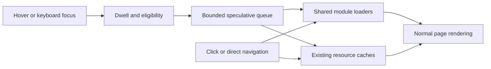

**Implementation plan: prefetch destinations on user intent.**

Prepared November 9, 2026. Status: implemented. See the [implementation and measurements](2026-11-09-intent-prefetch-implementation.md). Scope is the hover/focus prefetching discussed in this conversation. The other project-audit recommendations remain separate work.

The recommendation is to share the app's existing dynamic module loaders between navigation and a small intent-prefetch layer. Ship ordinary pages and selected articles first. Add explicitly selected map destinations and small required datasets after production-build measurements. Keep the current BrowserRouter architecture.

Expected behavior: pausing over an eligible link or focusing it with the keyboard starts preparing its destination. Clicking uses the same pending or completed work. A fast click, failed prefetch, unsupported optimization API, or disabled prefetch setting still follows the ordinary navigation path.

The intended benefit is less waiting after a click. It does not remove map initialization, GPU work, data transformation, or all image loading. No improvement percentage or timing is established by this planning work.

**What the source inspection establishes.**

| Existing behavior | Consequence for implementation |
| --- | --- |
| `src/App.tsx` uses BrowserRouter and module-level React.lazy pages | Extract and share the functions behind those lazy components. |
| Flights, temperature, tornado, and ADV Atlas have another lazy renderer boundary | Preparing only their page modules leaves the main visualization download until navigation. |
| The Flights lazy renderer factory starts two cached data requests | Separate its reusable renderer loader and essential-data warmer; preserve parallel loading on direct visits. |
| `src/content/posts.ts` exposes `loadComponent` and the lazy article component | Prepare the selected article through that registry rather than reconstructing its filename. |
| `loadTripManifest()` shares pending work and removes failed entries | Reuse it for the selected trip. Keep manifest parsing and development URL rewriting intact. |
| `fetchWithCache()` deduplicates by URL, has TTLs/timeouts, and retains at most 32 responses | Reuse it for eligible JSON. A second prefetch cache would lose demand-request sharing. |
| `useTripRoute()` has reader counting and cancellation | Keep route geometry out of speculative loading in this version; preserve that cache's ownership contract. |
| Generated production registries omit unpublished content | Resolve articles from the existing registry; never discover drafts by guessing URLs. |
| Reading routes have explicit JavaScript budgets | The prefetch coordinator must stay small and preserve code splitting. |

These findings come from the current source, including [App](../../src/App.tsx), [Flights](../../src/pages/Flights.tsx), [post loaders](../../src/content/posts.ts), [manifest loaders](../../src/features/trips/tripManifests.ts), [JSON cache](../../src/data/fetchCache.ts), and [shared-module contracts](../shared-modules.md).

**Research and architectural choice.**

React Router 7.18.5 exposes Link prefetching in Framework Mode; it is not available through this app's declarative BrowserRouter. The installed implementation also returns no prefetch behavior without framework context. Adding `prefetch="intent"` to existing links would therefore be ineffective. Implement a wrapper for the existing router instead of changing router modes. [Version-matched mode table](https://reactrouter.com/7.18.5/start/modes), [Link behavior](https://reactrouter.com/7.18.5/api/components/Link).

Use explicit dynamic imports for the initial implementation. Imports resolve the production filenames through Vite, follow its dependency optimizations, and share the browser's module map. An import evaluates module code; it is more than a low-priority download hint. Review top-level work and CSS effects before enabling a destination. [Dynamic import behavior](https://developer.mozilla.org/en-US/docs/Web/JavaScript/Reference/Operators/import).

Vite loads async CSS with the associated chunk and preloads common dependencies. Reuse those build transformations rather than maintaining hashed chunk URLs by hand. Include before-click stylesheet behavior in verification because importing a map can add global MapLibre CSS before navigation. [Vite async chunk and CSS handling](https://vite.dev/guide/features#async-chunk-loading-optimization).

`modulepreload` can fetch and compile a module without running it, but a robust implementation would need a generated dependency/asset mapping. Keep it as a follow-up if measurements show that early module evaluation is costly. Ordinary document prefetch does not automatically prepare this SPA's route data or nested renderer. Browser Speculation Rules target document navigations and do not prerender internal SPA route changes. [Module preload](https://developer.mozilla.org/en-US/docs/Web/HTML/Reference/Attributes/rel/modulepreload), [Chrome's SPA limitations](https://developer.chrome.com/docs/web-platform/prerender-pages#speculation-rules-and-spas).

**Resource policy.**

| Link destination | Prepare after sustained intent | Continue to load on navigation or explicit feature use |
| --- | --- | --- |
| About, Projects, Posts, project overview pages | Destination page module and its normal static dependencies | Screenshots and other page images |
| A known blog post or trip report | Article page module, that article's `loadComponent()`, and that trip's manifest when present | Full-resolution photos, animation media, route geometry, and the embedded map renderer |
| Flights map | Page and actual FlightsMap renderer; the existing flights and visited-airports JSON | Optional airports/states layers, basemap textures, WebGL/GPU setup |
| Temperature map | Page and actual TemperatureMap renderer; summary and Recent records for the Recent view | County records, state records, history/trends, and tiles |
| Tornado map | Page and actual TornadoMap renderer; annual summary and notable events | Geometry, point collections, trend index, warnings, and tiles |
| ADV Atlas map | Atlas page and actual TripAtlasMap renderer | Route geometry, image collections, workers, tiles, and renderer construction |
| Filters, same-page fragments, downloads, external URLs, unknown destinations | No speculative work | Existing behavior |

For temperature links selecting County, State, or Freshness, prepare code plus summary only initially. Do not fetch Recent records for these URLs. Large selected-view datasets can be considered later after sizes and usefulness are measured. Retain the existing query-based data selection on entry.

Normalize destination aliases before classification. `/projects/adv-atlas` redirects directly to the atlas map; it is not a lightweight overview page. The legacy motorcycle-trip paths must resolve to the same target. `/blog` and `/trips` list aliases should prepare Posts. Article paths should use their registry-defined canonical collection. This resolution is for preparation only: the clicked URL, query, fragment, and React Router state remain untouched.

Expose a small custom `IntentLink` prop, `prefetchMode?: 'page' | 'destination' | 'none'`, defaulting to `page`. This is implemented by the wrapper, not delegated to React Router's framework-only prefetch prop. Header/dropdown links use `page`; selected article cards, report actions, and map launch actions use `destination`. Project cards can use `destination`: ordinary overview targets still prepare only their page, while the direct atlas destination receives the explicit map policy.

**Trigger and scheduling defaults.**

The following numbers are proposed starting policies, not universal best-practice thresholds. Tune them using the measurement matrix below.

| Situation | Initial policy |
| --- | --- |
| Mouse or hovering pen over a lightweight link | Wait 150 ms before preparing. |
| Keyboard focus on a lightweight link | Use the same 150 ms dwell. |
| Explicit destination preparation that includes a map renderer | Wait 300 ms for pointer or keyboard intent. |
| Pointer leaves or focus leaves before dwell | Remove that signal; cancel if no hover/focus signal remains. |
| Touch interaction | No speculative pointer-down or viewport work in the first version. Normal navigation still uses parallel code/data loading. |
| Link leaves the document, changes destination, or page becomes hidden | Cancel its pending timer/queue entry. |
| Initial document or visible critical images are still loading | Skip speculative work; never delay demanded navigation. |
| Current foreground map is still starting | Skip new heavy speculative work. |
| Data saving is enabled, connection is reported as slow-2g/2g, or browser reports offline | Skip speculative work. Demanded navigation remains available. |
| Network Information API is absent | Use the conservative dwell/concurrency policy; absence does not establish a fast connection. |

Track hover and focus independently so pointer-leave does not cancel an ongoing keyboard focus. Compose supplied React handlers and respect their `defaultPrevented` state. Preserve refs, accessible names, styling, `to`, `relative`, `state`, `replace`, `target`, and standard Link click behavior. Skip `download`, `reloadDocument`, and non-self target links for prefetch eligibility. Do not intercept article HTML links or add global pointer-move listeners.

Use one active speculative destination job and at most two queued destinations. Keep the most recent valid intent when the queue fills; discard entries whose links no longer have intent. This bounds logical jobs, not the number of HTTP requests: one dynamic import can fan out to several dependencies. Initially allow at most two distinct heavy map destinations to be prepared per document, then measure whether that cap should change. Count attempts when work starts so repeated failures cannot defeat the cap.

Click-driven loading bypasses the speculative queue, dwell, connection checks, and heavy-work cap. It can share an already pending loader but must never wait behind speculative preparation of a different destination. Stop dequeuing unrelated jobs once navigation starts. Do not wait for the entire preparation job before rendering; if optional warming is pending, the ordinary page path proceeds.

Cancelling a timer or queued job is reliable. An already running dynamic import has no AbortSignal cancellation mechanism, and loaded modules are retained by the browser. Do not describe this layer as fully cancelable or memory-evictable. Let started shared requests finish rather than aborting a request that a click may now need. The small data allowlist and heavy-work limits constrain this cost.

Network Information properties are feature-detected hints with limited cross-browser availability. Fetch's `priority: 'low'` can be used for newly introduced JSON warming if it is threaded through the shared cache; it is a relative priority hint, not a bandwidth cap or a mechanism for reprioritizing a request that already started. Avoid a cache rewrite solely to add this hint. [Save-Data](https://developer.mozilla.org/en-US/docs/Web/API/NetworkInformation/saveData), [effectiveType](https://developer.mozilla.org/en-US/docs/Web/API/NetworkInformation/effectiveType), [fetch priority](https://developer.mozilla.org/en-US/docs/Web/API/RequestInit#priority).

**Loader and failure contracts.**

Create stable module-loader functions used by both React.lazy and prefetch. Keep explicit import expressions so Vite can analyze them. Share the pending promise, retain fulfilled work, and clear the application's failed pending entry. Do not put a permanent rejected promise in the new scheduler or loader registry. Call the loader to warm it; do not render a hidden lazy component or reach into React's private lazy internals.

Apply the same loader-sharing rule to article `loadComponent()` functions, so warming and the existing `Component` use one source of truth. Retain the existing manifest loader's failure eviction. Do not store map data in localStorage or a parallel application cache. Use the same URL and TTL as the demanded consumer: Flights currently uses the default five minutes; tornado resources use thirty minutes. An infinite completed-destination set must not prevent rewarming expired JSON.

Catch speculative failures at the coordinator boundary. They must not display an error overlay, navigate, write history, reload, emit a pageview, or create an unhandled rejection. Record a bounded diagnostic outcome for testing. Demand failures continue through the existing visible recovery paths.

Clearing an application promise does not guarantee that all module failures can be retried in the same document. React.lazy caches its own rejected loader result, while module parsing/evaluation failures can also remain cached. Preserve the existing bounded manual page-reload recovery and test prefetch-then-click failures in production Chromium and WebKit. Never add automatic reload on hover. [React.lazy caching](https://react.dev/reference/react/lazy), [JavaScript module failure caching](https://developer.mozilla.org/en-US/docs/Web/JavaScript/Reference/Operators/import).

JSON warmer completion is not permission to display data without feature validation. Retain schema parsing in the current consumer path. HTTP failures must remain uncached. Test malformed prefetched JSON followed by a corrected response: if the generic parsed-JSON cache prevents recovery, add a narrowly scoped invalidation or validated-resource boundary that cannot discard a newer force-refresh result. Do not label a destination successfully data-ready merely because JSON decoding succeeded.

**Proposed implementation boundaries.**

| Proposed file/change | Responsibility |
| --- | --- |
| `src/navigation/moduleLoaders.ts` | Small retryable/deduplicated dynamic loader helper and explicit page loader functions. No eager page/feature imports. |
| `src/navigation/prefetchTargets.ts` | Pure URL eligibility, aliases, route kind, article identity, and resource-selection rules. |
| `src/navigation/intentPrefetch.ts` | Dwell, readiness/connection guards, bounded queue, heavy-work cap, and speculative failure handling. |
| `src/components/IntentLink.tsx` | Existing Link behavior plus composed intent events and cleanup. |
| Feature-local renderer loader files | Functions shared by map pages and explicit destination preparation, without introducing dependency cycles. |
| Feature-local data warmers, loaded only after intent | Existing URLs/cache TTLs and selected small required resources. |
| `src/App.tsx` and four map pages | Reuse loader functions; retain module-level lazy declarations and current route recovery. |
| `src/content/posts.ts` | Share each selected article loader between warming and lazy rendering. |
| `src/vite-env.d.ts` and a small runtime policy module if needed | Type/configure the rollout mode and an off switch. |

Integrate links in Layout, Home, Projects, Posts, ProjectPageHeader, PostNavigation, BlogPost series/return links, and TripAtlasResults report actions. Preserve return-location state in Posts and Atlas and all existing atlas selection/hover callbacks. Focus or hover on an atlas selection button should continue to highlight/select the trip; only its actual report link prepares the report.

Use an explicit registry or one-way loader imports. The registry must not import App or cause App → IntentLink → registry → App cycles. Feature data URLs stay feature-owned. Loading the prefetch helper itself must not load Zod, all manifests, every article body, MapLibre, or the globe renderer into the entry chunk.

Imports should not construct a renderer or start texture/route requests at module evaluation time. Existing renderer construction is primarily component/effect-owned, and the MapLibre module sets its worker URL at import time; verify that warm-only imports do not actually create workers, canvases, map instances, or background render loops. Worker fetches, textures, and map readiness will therefore still contribute to the post-click path in this version.

**Implementation sequence and review checkpoints.**

1. Capture a production-build baseline and inspect import boundaries. Record ordinary navigation, rapid hover-without-click, article navigation, and explicit map launch. Save network traces, before-click resource lists, click-to-heading/content timing, click-to-usable-map timing, and current reading-page byte budgets. Inspect actual top-level side effects and async CSS behavior. Estimated effort: half a day.
2. Extract shared page/article/renderer loaders without enabling intent triggers. Preserve the existing behavior and bundle boundaries. Cover failed speculative loader reuse without invoking React.lazy early. For temperature and tornado pages, start only the necessary allowlisted data alongside renderer loading on direct entry, matching the Flights pattern. Estimated effort: half to one day.
3. Add IntentLink and the scheduler, then integrate ordinary navigation, project overview cards, selected articles, and report links. Enable a `pages` rollout mode first. In this mode direct map destinations may prepare their page wrapper, but the nested renderer/data policy stays disabled. Add interaction and production-browser regressions. Estimated effort: half to one day.
4. Enable the explicitly requested map destination policy under an `all` rollout mode. Use the resource matrix, small JSON allowlist, 300 ms dwell, and heavy-work cap. Keep direct-entry data/code parallelization independent of speculative settings. Measure before enabling this mode by default. Estimated effort: half to one day.
5. Compare builds, run targeted regressions and required repository checks, and save the evidence. Keep an `off` mode to reproduce baseline behavior and disable speculative work without undoing loader extraction. Estimated effort: half to one day.

Total estimate: approximately 3–5 engineering days including validation. Stage 1 (ordinary pages/articles) can ship independently of stage 2 (map preparation). Dependency upgrades, router migration, service workers, viewport prediction, prefetching external apps, full photo warming, and renderer construction before navigation are outside this plan.

**Verification that establishes useful behavior.**

Use meaningful tests around externally visible behavior, rather than asserting that one helper calls another:

- No eligible intent means no speculative route/data requests. A short hover or quick Tab traversal stays below the dwell and causes no preparation. Hover plus focus on the same link shares one job; removing one signal does not cancel the other.
- Sustained pointer and keyboard intent starts only the intended destination's resources. Canonical aliases deduplicate. Query/hash/state handling and eligibility checks match real Link resolution, including relative and basename-aware URLs.
- Click before dwell, during an import, and after completion navigates normally. A different destination click bypasses a busy speculative queue. Successfully shared resources are not requested twice.
- Leaving a link, unmounting it, changing its `to`, hiding the document, and navigating away remove stale queued work. Browser Strict Mode must not create duplicate requests or leaked timers.
- Simulated save-data, slow connection, offline, missing Network Information, touch scrolling, and keyboard-only operation follow the policy and retain normal navigation.
- Failed modules/data do not disturb the current page. Cover failure before click, click while failure is pending, corrected data, stale deployment chunks, and persistent failure with the existing bounded recovery behavior.
- Preparing an article fetches only that body/manifest and never MapLibre, embedded map geometry, photos, animation media, unpublished bodies, or unrelated articles. Preparing a project overview does not initialize its interactive app.
- Preparing a map loads its actual nested renderer but creates no map canvas/worker/GPU loop and fetches no optional layers, tiles, route geometry, or texture collections. Add positive assertions after clicking so the test does not merely suppress rendering.
- Warming map CSS does not change the current page's layout, scroll, focus, link styles, or screenshots. Atlas highlighting, selection, camera state, return state, and Back restoration retain their current browser contracts.

Suggested coverage locations: focused new unit cases under `src/test`, a production-preview `tests/e2e/intent-prefetch.spec.ts`, existing `tests/trips/reading.spec.ts`, existing page-recovery tests, and existing flight/temperature/tornado startup cases. Run Chromium and WebKit for behavioral checks. Chromium-only CDP measurements should be kept separate from cross-browser functional assertions.

Keep the current no-intent reading budgets unchanged: Home and Posts below 125,000 gzip bytes, a normal article below 185,000, and a trip report below 190,000. Keep the Flights renderer's existing production limits below 1,400,000 raw and 400,000 gzip bytes. These are existing checks, not new performance claims. Add a provisional entry-code overhead ceiling of 5 KB gzip for the prefetch layer; lower it if the implementation is smaller. Intent scenarios have their own explicitly accounted byte totals, including unused speculation; do not hide prefetched bytes by starting measurement at click time.

Run lint, typecheck, the relevant unit tests, production fixture build, recovery/browser checks, and the existing reading/renderer budgets as the changes land. Run the full JavaScript/Python suite and relevant production browser suites before merging the complete implementation. Follow the repository's configured Node/npm toolchain. No new dependency is required by the proposed design.

**Measurement and rollout criteria.**

Compare `off`, `pages`, and `all` modes under the same build/content, cache, network, and CPU conditions. Use fresh browser contexts per run and measure both cold and previously visited destinations. Include no-hover clicks, 200/500/1,000 ms intent windows, 50 ms sweeps across multiple links, touch scroll/tap, and pointer intent while the current page is still loading. Run at least ten serial samples per important scenario and publish medians plus the distribution; do not present a small lab sample's p75 as a real-user percentile.

Measure time from activation to meaningful destination content, and separately to a map with loaded data and working controls. A painted heading or canvas alone does not establish map usability. Include total journey transfer, unused speculative transfer, duplicate requests, main-thread long tasks, layout shifts, and any loss of responsiveness on the original page. The existing `scripts/measure-performance.js` primarily measures hard page loads, so add a dedicated soft-navigation scenario rather than inferring success from a Lighthouse score.

The deterministic release conditions are: request reuse works; no speculative navigation or hidden renderer creation occurs; reading budgets hold; queue/heavy caps hold; failure recovery works; keyboard/native-link behavior is preserved. For performance, require a repeatable improvement beyond run-to-run noise in the intended warm navigation scenarios, with no material regression in current-page loading or rapid navigation. The baseline step should define numerical tolerances from observed variance before comparing the implementation. Reduce the allowlist/dwell aggressiveness or retain `pages` as default if heavy-map warming does not earn its resource cost.

Save the final results under `docs/performance/` with exact conditions, sample counts, failures, and enabled policy. If production instrumentation is later added, record destination categories and aggregate readiness timings without generating extra pageviews during preparation. No analytics or deployment change is necessary to create or implement the initial local comparison.

This plan records repository inspection and the linked primary documentation at the planning stage. The earlier audit's build sizes and waterfall probes identified the opportunity. They were not prefetch benchmarks. The planning change only added documentation. The implementation report records subsequent code changes, tests, and measurements.
