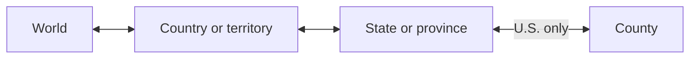

# Pins navigation and visual context — November 13, 2026

## Decision

Use one geographic parent model for map clicks, keyboard input, and visible controls.
Keep other pins visible and selectable in muted colors.
Keep peer circles as quiet outlines during selection.
Reserve strong fills, boundary emphasis, and distance labels for the selected pin.

This design supports exploration without losing the surrounding geography.
The implementation uses the existing map renderer and source data.

## Research and design judgment

Shneiderman's [visual information-seeking model](https://vis.csail.mit.edu/classes/6.859/readings/pdfs/Shneiderman-TheEyesHaveIt.pdf) connects overview, filtering, detail, relationships, and history.
For this map, each detail view needs a clear route back to its geographic overview.
A county should return to its state before returning to the world.

Esri's [feature effects](https://developers.arcgis.com/javascript/latest/references/core/layers/support/FeatureEffect/) demonstrate emphasis with subdued surrounding features.
The design judgment here is to preserve selectable context with neutral markers and lighter circle outlines.
Existing MapLibre layers implement that treatment.

The [W3C breadcrumb pattern](https://www.w3.org/WAI/ARIA/apg/patterns/breadcrumb/) provides a model for showing a hierarchical location.
The map uses a named navigation landmark, an ordered path, and a marked current location.
Native buttons change the map viewport and its shareable URL.

[Progressive disclosure](https://www.nngroup.com/articles/progressive-disclosure/) supports keeping secondary controls available on request.
The layer controls therefore start collapsed on phones and short screens.
Parent navigation remains visible.

The [label-in-name guidance](https://www.w3.org/WAI/WCAG22/Understanding/label-in-name.html) requires accessible names to contain their visible labels.
The parent button's accessible name starts with **Up one level** and adds the destination.
The card's accessible name starts with its visible **Back to** label.
This supports speech input as well as screen readers.

The [enhanced target-size guidance](https://www.w3.org/WAI/WCAG22/Understanding/target-size-enhanced.html) informs the larger touch hit area.
Coarse-pointer picking searches 22 CSS pixels around the input point.
The closest rendered marker wins when search areas overlap.
The ranking list supplies large keyboard-accessible alternatives.

These references inform the design. The interaction contract below is the application-specific decision.

## Alternatives

| Treatment | Benefit | Cost | Decision |
| --- | --- | --- | --- |
| Hide surrounding pins | Strong focus | Removes comparison and orientation | Use only for unrelated county detail |
| Keep all circles and labels at full strength | Immediate access to every measurement | Competing fills and labels obscure the selection | Retain in overview views |
| Mute peer pins and circle outlines | Preserves comparison while emphasizing selection | Requires a visible indication that muted pins remain selectable | Use during selection |

Context markers keep enough contrast to remain visible.
They use a smaller size and sit below active markers.
This order matters where country and territory poles overlap.
A context marker must not cover a smaller active marker.
The legend states that other pins remain selectable.

## Geographic hierarchy

| Current view | Parent action | Result |
| --- | --- | --- |
| Selected county | Up, card parent, or click outside | Clear selection and retain its state scope |
| State county overview | Up or empty-map click | Country overview |
| Selected state or province | Up, card parent, or click outside | Clear selection and show its country |
| Country overview or selected country | Up or click outside | World overview |
| World overview | Empty-map click | Retain the world view |

The World trail button provides a direct return to the globe.
Search text clears when opening a parent view.
Distance units, circle preferences, and sort order remain available.
The Within filter retains the chosen ranking type.
A fresh shared state scope starts with its county ranking.

## Pointer and gesture rules

Clicking another pin selects it directly, including a muted pin.
Clicking a child polygon opens that child geography.
Clicking inside the selected polygon retains its selection.
Clicking a sibling polygon's surrounding area returns to the parent.
This prevents polygon fills from consuming every click outside a small selection.

Background navigation waits 500 ms for a possible double-click or double tap.
The installed MapLibre tap recognizer uses that interval.
A new mouse press, touch, camera movement, or double-click cancels the pending action.
An old action cannot navigate after the geographic location changes.
Renderer disposal also cancels it.
Map controls, modified clicks, and pending pin batches do not start background navigation.
The visible parent controls remain immediate.
Buttons use `touch-action: manipulation` to support rapid successive taps.
This follows [WebKit's tap guidance](https://webkit.org/blog/5610/more-responsive-tapping-on-ios/) and retains pinch zoom.

## Keyboard behavior and history

Escape closes a hover tooltip first.
A nonempty search field clears before geographic navigation.
Native selectors and native fullscreen retain their Escape behavior.
Escape then moves up one geographic level.
At the world level, it closes an open explorer panel.
Held-key repeats do not traverse several levels.

Keyboard parent actions move focus to the next parent control.
At the world level, focus moves to the World button.
Pointer clicks on the map retain map focus.
A status message announces the current geographic path.

User navigation creates browser history entries.
Browser Back and Forward restore geographic scope and selection.
A state scope uses `state=51` for Virginia.
It remains valid after reload without a selected county.
Shared county links infer their state before the pin data finishes loading.
Unrelated query parameters remain intact.

## Visual hierarchy and responsive layout

The selected pin has a stronger marker, circle, boundary, and measurements.
Other markers use a neutral color and smaller size.
Peer circles retain an outline and omit fill.
Context labels and unselected distance badges disappear during selection.
Hover feedback and direct pin selection remain available.
Layer switches also apply to muted markers.
The selected circle remains visible when ordinary circles are off.

The location trail uses one row and retains full accessible names when text is visually shortened.
The layer disclosure stays below the navigation controls.
Touch parent controls and map buttons have a minimum height of 44 CSS pixels.
Short landscape screens place the explorer beside the map.

The camera checks whether the control stack covers the map center.
On a narrow map, it frames the selected point below those controls.
Distance badges also avoid the navigation hint.
Returning to the world clears local camera padding before framing the globe.
Reduced-motion preferences continue to control camera animation.

## Delivery and geometry cost

Context uses the global country index without requesting unrelated province geometry.
Country outlines remain lazy.
The default U.S. view adds one lightweight context request.

| Local measurement | Result |
| --- | ---: |
| Country index | 192,685 bytes |
| Country index with gzip | 44,184 bytes |
| Previous point count for a selected Falls Church county without a state filter | 3,292 |
| Current point count with Virginia and global country context | 446 |
| Previous ordinary circles in that county view | 3,292 |
| Current peer circles in that county view | 132 |

The circle comparison assumes ordinary circles are enabled and county details are visible.
The selected high-resolution circle is separate from those ordinary circles.
These are source and geometry counts, not measured frame-time or phone-memory results.
Bulk county outlines retain their existing delivery path.
Physical-device measurements and tiled delivery remain in [TODO.md](../../TODO.md#pins-of-inaccessibility).

## Validation and code ownership

The [measurement record](../performance/2026-11-13-pins-navigation-design.json) stores the final test and coverage results.
Browser tests keep the real renderer and geographic files, with fixed external-service responses.
They include click-away navigation, native gestures, browser history, state reloads, touch input, and accessible labels.
The touch case checks 320-pixel portrait and 667-pixel landscape layouts.

The proposed commit passes 3,144 JavaScript tests across 217 files in an isolated checkout.
That suite includes the production fixture build checks.
Lint, TypeScript checks, and 18 temperature-data tests also pass.
The documentation scan checks 138 files and finds no broken local links.

The full browser run passes 45 of 46 scenarios across Chromium and WebKit.
The remaining late-response recovery case exceeds its five-second assertion window in WebKit during the combined workload.
It passes in both engines when rerun after the JavaScript suite finishes.
The new navigation, touch, history, and accessibility cases pass in both engines.
The test server disables file watching to prevent concurrent workspace edits from reloading test pages.

A workspace run also finds a trip-gallery reference failure from a separate concurrent manifest edit.
Those trip edits remain uncommitted.
The isolated checkout verifies the proposed map commit with the baseline trip manifest.

Focused coverage includes the Pins feature and its shared data and geometry contracts.

| Focused measure | Before | After |
| --- | ---: | ---: |
| Regression tests | 82 | 106 |
| Lines | 99.31% | 99.64% |
| Statements | 97.00% | 97.41% |
| Branches | 93.89% | 94.98% |
| Functions | 97.93% | 98.59% |

The interaction model lives in [navigation.ts](../../src/features/pins/navigation.ts).
The visible path and parent control live in [PinsNavigation.tsx](../../src/features/pins/PinsNavigation.tsx).
[presentation.ts](../../src/features/pins/presentation.ts) selects context pins and peer circles.
The renderer owns hit testing, gesture cancellation, layer order, and camera framing.
This keeps geographic decisions shared between pointer and keyboard controls.
