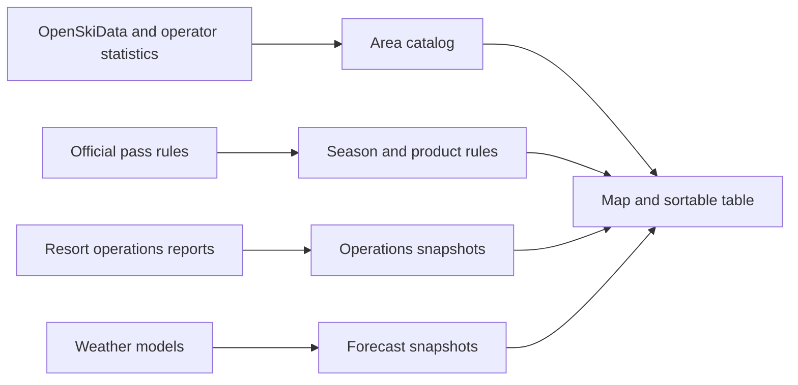

# ski-status guide and project plan

November 19, 2026

ski-status is a personal map and table for North American ski areas and worldwide Ikon, Epic, and Indy destinations. Use it to compare mountain statistics and find areas on your pass.

Use the operator links for current conditions. Pass filters show access by family for the listed season. See the [release tasks](TODO.md).

## Use ski-status

Open `/projects/ski-status/map`. Select **Map**, **Split**, or **Table** at the top of the page. Each view keeps your filters, sort order, and selected area.

- **Map** gives the map most of the space. On a wide screen, use the list beside it to select an area.
- **Split** gives both panes equal space on a wide screen. On a narrow screen, scroll between the table and map.
- **Table** gives the comparison table most of the space. On a wide screen, the map stays beside it.

On a wide screen, the page starts in **Split**. On a narrow screen, it starts in **Table**.

- Search by ski area, alternative name, town, country, or skiing type. Search for **cross-country** to find Nordic centers and areas that offer both types of skiing.
- Use **Region** to select a country, state, or province. A shared ski area appears under each country that it covers. On a narrow screen, select **Filters** to open the filter controls.
- Select **Indy** for included access. Select **Indy discounts** for Alpine Allied discounts and the North Cascade Heli offer.
- Use **Skiing type** to filter the map and table. **Conventional downhill** includes outdoor lift-served areas that also offer Nordic trails. **Cross-country only** selects Nordic-only areas. **Specialty skiing** shows the Nordic-only, indoor, heli-skiing, cat-skiing, ski touring, dry slope, and lift-served freeride areas together. Select a single type to narrow the results.
- Turn on **In map view** beside the results count to limit the table to the visible side of the globe.
- Select a column header to change the sort order.
- Hover over a dot to see the area name and location. Zoom in to separate nearby dots.
- Click or tap a dot to select the area and open its map popup. Select a table row to open the same popup when the map is visible.
- Use **View resort details** in the popup or select the area name below the filters. On a narrow screen, the full details are below the map.
- Click or tap empty map space to clear the selection. You can also use the popup close button or press Escape with focus in the map.
- Select **Official conditions** to open the operator's report. If the resort publishes conditions on its main page, use **Resort website and conditions**.

The URL stores the search text, filters, sort order, selected area, view, and map settings. The browser stores your unit preference.

The map keeps its position when you change views. With **In map view** off, filter changes fit the results when the map is visible and no area is selected. If the background fails, select **Retry background**. The table stays available during map failures.

### Map display

Drag the globe to see other regions. Zoom in to see a local map. Select **Fit results** to frame matches in the same region. For matches across the world, the map zooms out to a globe overview.

With **In map view** on, the table and count update after you turn the globe or change the zoom. They also update when the map pane changes size. A marker must be on the visible side of the globe and inside the map pane. Change the other filters or sort the table to compare areas in view. **Fit all results** uses the other filters to set the map view.

When **Table** hides the map on a narrow screen, the table uses the last visible map area. Before the map opens, the table uses the other filters. Open **Map** to set the area. If you pan away from the selected area, its details stay open.

The default map shows one cyan dot per ski area. Use **Color by** to show pass access, skiable area, vertical drop, summit elevation, or highest lift terminal. The legend shows ranges in your selected units. Gray marks an unknown value. A gold outline shows the selected area.

In **Map** view, the second column follows **Color by**. Select its header to sort by the displayed number. With **Resort dots** selected, the column shows the active sort field or skiable area when you sort by name.

With **Pass access** selected, the map shows a brand icon for each area with included access. The icons grow as you zoom in. A yellow **+** marks an area with access on more than one pass. Use the pass filter to choose which icon appears on a multi-pass badge. Select an area to see all its passes.

An orange dot marks an area with discount-only access. With **Indy discounts** selected, the map uses orange for each Indy discount. A gray dot marks an area without confirmed access. The legend shows the pass for each icon.

The map, filter, and area details use the pass images below. The app serves these images with its own files.

| Pass | Source |
| --- | --- |
| Ikon | [Ikon Pass favicon](https://www.ikonpass.com/favicon/favicon-white-32x32.png) |
| Epic | [Vail Resorts My Epic app icon](https://apps.apple.com/us/app/my-epic-skiing-snowboarding/id395375487) |
| Indy | [Indy Pass website icon](https://www.indyskipass.com/themes/custom/origin/images/favicon/apple-touch-icon.png) |
| Mountain Collective | [Cached Mountain Collective site icon](https://www.google.com/s2/favicons?domain=mountaincollective.com&sz=64) |

An acreage value such as `200+` gives a minimum. The table sorts by that minimum. If the minimum leaves more than one possible color range, the map shows a gray dot.

The globe uses the hosted CARTO Dark Matter vector style. Turn on **Terrain relief** to see shaded slopes from zoom level 8. CARTO continues to provide the streets and labels. Mapterhorn supplies the elevation tiles. [CARTO Basemaps](https://docs.carto.com/faqs/carto-basemaps), [MapLibre projections](https://maplibre.org/maplibre-style-spec/types/#projectiondefinition), [Mapterhorn elevation tiles](https://mapterhorn.com/data-access/)

Zoom in to level 11 to see ski-area outlines, runs, and lifts for the current results. Dashed gold lines show lifts. Run colors follow the local difficulty scale. Cyan runs show Nordic trails and violet runs show ski touring routes. Lift stations appear at zoom level 13. Hover or tap a run or lift to see its mapped name and type. Use **Ski terrain** to hide or show these layers.

CARTO publishes Dark Matter, Voyager, and Positron. MapTiler offers a separate Winter basemap. [CARTO styles](https://carto.com/basemaps/#styles), [MapTiler topographic and winter maps](https://www.maptiler.com/maps/outdoor-topo/)

## Catalog

On November 19, 2026, the catalog had 565 map points in 20 countries. It had 323 points in the United States, 66 in Canada, and 176 in other countries. The country filter also includes Germany through shared areas. The catalog had 126 areas with Ikon access, 98 with Epic access, and 298 with included Indy access.

Each area has a published fact or a mapped terrain value. The catalog has at least one published fact for 493 areas and mapped terrain values for 519 areas. It has 169 skiable acreage figures, 376 published lift counts, 417 published trail counts, and 216 conditions links. The mapped data adds lift counts, downhill and Nordic trail lengths, and terrain elevations.

| File | Use |
| --- | --- |
| [Area statistics](data/areas.json) | Resort sites, published mountain statistics, and official report links. Empty fields display as unknown. |
| [Locations and mapped terrain](data/locations.json) | Points and mapped values from the November 16 OpenSkiData build. The file also includes points from OpenStreetMap and operator directions. Each record has source links and the file has ODbL attribution. |
| [Resort terrain index](data/resort-terrain.json) and [PMTiles archive](data/resort-terrain.pmtiles) | Footprints, runs, lifts, and lift stations for 533 catalog areas. The index records the source date, checksums, and which areas share terrain. |
| [Pass memberships](data/passes-2026-27.json) | Family access for the 2026/27 season. The details show discounts and listings with unconfirmed access. Each entry links to a source. |

Use the same area ID in the area, location, and pass records. The terrain importer uses those IDs. Add one point per area and one membership per pass family. Put the country of the representative point in `country`. Put verified additional countries of a shared area in `otherCountries`. Add state or province codes to North American areas that use them.

Use the operator's statistics when the source names the terrain or equipment that the figures cover. Keep the source of the pass rules with the membership. Use absolute HTTPS source links. The catalog checks IDs, references, statistics, and the format of geographic codes. It checks the location attribution and the pass season. [Catalog validation](../../src/features/ski-status/catalog.ts)

Use the **Mapped** columns for OpenSkiData figures. The elevation range covers mapped terrain. The **Base**, **Summit**, and lift terminal columns show published elevations for those locations. Published lift and trail counts have their own columns. Each area with mapped figures links to the source in its details. [OpenSkiData dataset and license](https://www.openskidata.org/#license)

### Ikon destinations

The catalog covers the 26/27 Ikon destination list, including Europe, Asia, Oceania, and Chile. It uses separate points for the three NZSki areas, the three Grandvalira areas, and the five Valle d’Aosta areas. Each of the 12 Dolomiti Superski regions has one point. Search by group name, such as **Dolomiti Superski** or **SkiBig3**, to find its areas. The pass links give shared limits and product rules. [Ikon destination map](https://www.ikonpass.com/en/destinations), [Ikon access comparison](https://www.ikonpass.com/en/compare-benefits)

The Ikon map lists Kappl, See, and Galtür without access details. Find them in the full catalog under **Austria**. Their details show **Lift access unconfirmed**. The Ikon filter shows the confirmed Ischgl / Samnaun and Kitzbühel areas. [Ikon destination map](https://www.ikonpass.com/en/destinations), [Ischgl / Samnaun access](https://www.ischgl.com/en/winter/operating-times-prices/ski-network-tickets/ikon-pass)

### Epic destinations

The catalog covers the 26/27 Epic Pass list. It includes 44 North American areas and 54 areas in Europe, Japan, and Australia. The map has a pin for each of the 36 named European partners. Brides-les-Bains uses the Olympe gondola base. Search by group name to see its ski areas. For example, **Hakuba Valley** finds ten areas in Japan. [Epic Pass list](https://www.epicpass.com/pass-results/college.aspx), [European partners](https://www.epicpass.com/regions/europe.aspx), [Hakuba Valley](https://www.epicpass.com/regions/japan/hakuba-valley.aspx)

The three Australian resorts have access in the 2027 winter season. Select **Epic** in an area's details to read the current terms. Partners can share a day limit. Ski Arlberg also requires a stay booked directly with a lodging partner. [Australia access](https://www.epicpass.com/regions/australia.aspx), [Ski Arlberg access](https://www.epicpass.com/regions/europe/austria/ski-arlberg.aspx)

### Indy destinations

The catalog covers all 302 cards from the November 19 roster, plus the Gore Mountain Nordic Center. It includes 69 destinations outside the United States and Canada. The 303 records have 298 included memberships and five discounts. [Indy resort roster](https://www.indyskipass.com/our-resorts), [Indy November additions](https://www.indyskipass.com/this-is-indy/news/whiteface-gore-and-belleayre-join-allied-program-as-indy-pass-announces-15-additional-resorts-for)

Gore has a pin for downhill discounts and a separate pin for included Nordic access. Manning Park also has separate downhill and Nordic pins. Use the group link for shared day limits and redemption rules. Portes du Soleil appears under France and Switzerland. Oberstdorf Kleinwalsertal and Steinplatte appear under Austria and Germany. Each group has one representative pin. [Innsbruck access](https://www.indyskipass.com/our-resorts/innsbruck-region), [Portes du Soleil access](https://www.indyskipass.com/our-resorts/portes-du-soleil), [Oberstdorf and Kleinwalsertal ski areas](https://www.ok-bergbahnen.com/en/skigebiete/), [Steinplatte ski area](https://www.steinplatte.tirol/en/steinplatte-winklmoosalm-ski-area-in-winter.html)

The catalog uses the published roster figures for vertical drop, lifts, trail count, night skiing, and terrain parks. Use the operator's figures when the operator gives a more precise value for the same area. Leave fields empty when the source gives no comparable figure. The **Skiing** and **Night skiing** columns describe the venue. Open the pass link to check which activities and sessions it covers. [Indy access rules](https://www.indyskipass.com/this-is-indy/how-it-works), [North Cascade Heli discount](https://www.indyskipass.com/our-resorts/north-cascade-heli), [Stoke Mountain profile](https://www.indyskipass.com/our-resorts/stoke-mountain)

## Local checks

Install the repository dependencies. Run `npm run dev` to start Vite. Open `/projects/ski-status/map` on the local server.

Run the unit tests for the catalog, table, details, and markers.

```bash
npx vitest run src/test/skiStatus.test.ts src/test/skiStatusComponents.test.tsx
```

Run the browser tests. They check globe fit, the skiing type filter, visible results, pass colors, popups, view changes, and error recovery.

```bash
npm run test:e2e -- tests/e2e/ski-status.spec.ts --project=chromium
```

## First release

In North America, include active public conventional downhill areas with at least 100 published skiable acres. Include official pass destinations, including worldwide destinations for Ikon, Epic, and Indy. Add specialty venues when an operator or managing organization documents the activity. Record the type of access for each pass. Keep eligible areas visible in the off-season. [Ikon destination map](https://www.ikonpass.com/en/destinations), [Epic Pass list](https://www.epicpass.com/pass-results/college.aspx), [Indy resort roster](https://www.indyskipass.com/our-resorts)

Whaleback has 86 skiable acres and qualifies through Indy lift access. Use skiable acreage for the threshold. Resort property acreage can include lodging and terrain outside the ski area. [Indy Whaleback profile](https://www.indyskipass.com/our-resorts/whaleback-mountain), [Monterreal property description](https://www.monterreal.com/)

### Map and table

- Add filters for pass product, ski date, and operating status.
- Color dots by operating status after the app can check report age. Use gray when the latest report is unavailable or stale.
- Add separate columns for measured snow and forecast snow. Compare each field in common units. Put unknown values last in both directions.
- Group columns by mountain statistics, conditions, and season dates. Save the column settings on the device.
- Export filtered rows as CSV where licenses permit it. Include units, report times, and source links.

### Comparable mountain statistics

| Field | Definition |
| --- | --- |
| Area identity | Store the official name, website, ID, region, country, and time zone. Keep former names for search. Place the point near a base, trailhead, or visitor entrance. |
| Skiable acres | Use the operator's published skiable area. Record which mountains or terrain the figure covers. |
| Guided terrain | Use the published area of the terrain that the heli-ski or cat-ski operator serves. Record it in **Guided terrain**. |
| Lifts | Use the operator's total for the same area. Include surface lifts. Record the counts by lift type when available. |
| Elevation and vertical | Store the highest and lowest lift terminal elevations in their own fields. Use the operator's drop for skiable vertical. If the operator gives only the elevations, calculate the range for the same skiable area. |
| Trails | Store the total and the number for each published grade. Keep the original basis for percentages such as trail count or terrain area. |
| Trail length | Record the published lengths of downhill and Nordic trails in their own fields. Use miles or kilometers in the app. |
| Night skiing | Store yes, no, or unknown. Show night skiable acres when the operator publishes them. Keep a published lower bound, such as `200+` acres. Track scheduled night operations in the conditions report. |
| Season dates | Keep planned and actual dates. Use the median of up to five completed seasons for each typical date. Verify at least three actual opening or closing dates for each median. |

Store values in common units. Keep the original unit and source. Display acres, feet, and inches by default. Offer metric units.

Use operator announcements and reports to verify season dates. Record the first and last days of public lift access for each winter season. Use the resort's time zone. Compare dates in winter season order across the year boundary. If fewer than three dates are available, show the published season window or show **Unknown**. Use **Year-round** for areas with lift access in every season. [Big SNOW specifications](https://www.bigsnowamericandream.com/press-room/), [Palisades Tahoe mountain statistics and season windows](https://www.palisadestahoe.com/footer/mountain-statistics)

## Inventory and data quality

### OpenSkiData audit

The November 19 download contained 12,440 world records. The audit selected named rows with `has_downhill=yes` and `status=operating`. The matching metadata reports a November 16 UTC build. Website counts indicate a populated source field. Lift counts indicate at least one mapped lift. [Ski-area CSV](https://tiles.openskimap.org/csv/ski_areas.csv), [Build metadata](https://tiles.openskimap.org/metadata.json)

| Geography | Candidate rows | Website present | Mapped lifts | Mapped elevation range |
| --- | ---: | ---: | ---: | ---: |
| United States | 571 | 529 | 511 | 526 |
| Canada | 273 | 239 | 235 | 257 |
| Mexico | 1 | 1 | 1 | 1 |
| Greenland | 3 | 2 | 3 | 3 |
| **Total** | **848** | **771** | **750** | **787** |

The audit counts candidates before the acreage and pass checks. A named row can describe one base area. Verify the acreage and elevations with the operator. The CSV shows 3–4 m of elevation for indoor Big SNOW. The operator reports 160 ft of vertical and four skiable acres. [OpenSkiData schema](https://www.openskidata.org/#schema), [Big SNOW specifications](https://www.bigsnowamericandream.com/press-room/)

The CSV has SHA-256 `9c5a372b8d02aedd281fd387c581c16f48915d89abacec7eba0faa53726a9df5`.

Use the same CSV for the mapped terrain values and the existing points. Match one operating row by its upstream source URL and coordinates. Check that the row covers the ski area. Leave the field empty when one row combines multiple areas that the catalog lists on their own. Use the downhill and Nordic lengths that apply to the venue. Keep the terrain source URL in `mappedTerrain`. [OpenSkiData statistics and source IDs](https://www.openskidata.org/#whats-in-the-data)

### Build the catalog

1. Import names, points, source IDs, and candidate websites from a versioned OpenSkiData file. Use regional directories to find missing areas. Check directory terms before you collect source data. [OpenSkiData downloads](https://www.openskidata.org/#downloads), [NSAA inventory by state](https://nsaa.org/NSAA/About/Media/Industry_Stats/NSAA/About/Media/Industry_Stats.aspx), [Canadian Ski Council directory](https://www.skicanada.org/ski-area-list/), [Québec ski area directory](https://maneige.ski/en/stations-et-conditions/)
2. Match by source ID or a verified name and location. Assign a stable local ID for links, reports, and visits. OpenSkiData feature IDs can change between builds. [OpenSkiData feature IDs](https://www.openskidata.org/#whats-in-the-data)
3. Review uncertain matches. Group bases when the operator publishes combined statistics. Palisades Tahoe publishes combined resort statistics. Keep independently operated areas separate if they share a pass allowance. [Palisades Tahoe statistics](https://www.palisadestahoe.com/footer/mountain-statistics), [Ikon access comparison](https://www.ikonpass.com/en/compare-benefits)
4. Verify eligibility with operator acreage, an official pass listing, or a source for the specialty venue. Record the reason and source. List unresolved areas. Check for duplicate, closed, and private areas before release. [Indy Pass website terms](https://www.indyskipass.com/website-terms-of-use)
5. Add operator statistics for each eligible area. Record the source, date, and scope of the figures. Use map data to check large differences. Verify the figure with the operator before changing the record. [OpenSkiData data definitions](https://www.openskidata.org/#whats-in-the-data)
6. Count resolved and unresolved candidates by region. Measure coverage for acres, elevations, grades, night acres, and dates. Skibowl reports total acres and the number of lit runs. Keep night skiable acres unknown until you find a source. [Skibowl statistics](https://skibowl.com/about-winter/stats/)

### Similar tools

PisteFinder compares mapped terrain and filters areas by pass. OnTheSnow groups reports by pass and shows forecasts and webcams. For ski-status, put date-specific pass rules, mountain statistics, and report times in one sortable table. [PisteFinder](https://pistefinder.com/), [OnTheSnow app](https://www.onthesnow.com/news/mobile/)

## Pass access by product and date

Create a reviewed file for each season and pass family. Record the product, area, access type, valid dates, and day allowance. Record shared allowances, blackout dates, and reservation rules. Include consecutive-day and weekday restrictions when they apply. Keep the source and verification date on each rule. Keep rules for past seasons.

| Program | Launch products and rules to verify |
| --- | --- |
| Ikon | Ikon, Base, and Session variants. Alta and Snowbird share Ikon days, with Snowbird access under Base. Store each partner's reservation and access rules. [Ikon 2026/27 comparison](https://www.ikonpass.com/en/compare-benefits) |
| Epic | Epic, Epic Local, and Day Pass variants by duration, resort tier, and peak-date option. The 4–7 day All Resorts products can include Canadian Rockies partners. Verify specialty products before adding their filters. [Epic products](https://www.epicpass.com/), [Epic partner rules](https://www.epicpass.com/regions/partner-resorts.aspx), [Peak dates](https://www.epicpass.com/info/peak-restricted-dates.aspx) |
| Indy | Base, Indy+, and Add-On variants. Track excluded dates and reservations by area. Record Allied discounts separately from included ski days. [Indy products](https://www.indyskipass.com/shop), [Blackouts and reservations](https://www.indyskipass.com/blackout-dates-reservations) |
| Mountain Collective | Included days, any published bonus days, and advance reservations where required. [Pass terms](https://mountaincollective.com/), [Destination reservation rules](https://mountaincollective.com/how-to-use-my-pass/) |

The current family filter shows included partners for the season. For the planned product filter, apply the rules for the resort's local date. Show the access status, reservation rules, total allowance, and shared days. Use separate sources for individual usage and reservation availability.

Review the pass lists at the start of each season. Check for changes each week. Confirm each change with the pass operator. Keep pending changes visible until the review completes.

## Current conditions

### Sources and pilot

| Source | What it can supply | How to use it |
| --- | --- | --- |
| Resort reports | Operating status, lifts, trails, acres, base depth, measured snowfall, and night operations. Whistler has separate pages for snow and terrain. | Start with operator links. Add feeds from sources that permit reuse. [Killington mountain report](https://killington.com/mountain-report), [Whistler snow report](https://www.whistlerblackcomb.com/the-mountain/mountain-conditions/snow-and-weather-report), [Whistler lift and terrain status](https://www.whistlerblackcomb.com/the-mountain/mountain-conditions/terrain-and-lift-status.aspx) |
| Open-Meteo | Weather estimates and forecasts for temperature, wind, precipitation probability, snowfall, and freezing level. | Use one named base location per area in the pilot. Show the forecast period and location or elevation. Show the model time when available. [Forecast API](https://open-meteo.com/en/docs), [Noncommercial access](https://open-meteo.com/en/pricing) |
| SnoCountry | Resort and regional feeds with counts of open lifts, trails, and acres where available. | Evaluate the feed if operator reports leave large gaps. The full feed requires a paid key. Verify coverage and terms before use. [SnoCountry API](https://feeds.snocountry.net/) |
| Mountain News and Skiresort Service | Paid resort and mountain data feeds. Mountain News includes report times and fields that resorts supply. | Compare the resort list and field coverage before using a paid feed. [Mountain News partner API](https://partner.docs.onthesnow.com/api-reference/ski-resort-snowreport-api), [Skiresort Service product description](https://www.skiresort-service.com/fileadmin/user_upload/skiresort-service/content/engl/Skiresort-access-snow-reports-ski-resort-data-ski-weather.pdf) |

On November 19, the SnoCountry demo returned Bolton Valley, Bromley, and Burke. Each report had a time and an opening status. Base depth, recent snowfall, and open lift, trail, and acre counts were empty. Measure field coverage and report age during winter operation. [SnoCountry public example and field definitions](https://feeds.snocountry.net/)

### Report and forecast rules

- Store operating status with each report. Use open, limited, temporarily closed, season closed, or unknown. Store hours and planned opening dates when the operator publishes them.
- Show open and total lifts, trails, and acres when the operator reports them. Show grooming status where available. Calculate closed counts and percentages from counts with the same scope and time. Use separate columns for **trails open %** and **acres open %**.
- Keep the snow depth unit, range, and measurement location. Show the reporting period for new snow. Use one column for forecast snow. Show empty values as unknown. Show reported zeros as zero.
- Keep the operator's report time and the time the app retrieved it. Mark pilot reports older than 24 hours as stale. Keep the last report and date visible. Identify missing fields on new reports.
- Use a freshness limit for each source when its schedule changes. Show the date of an official seasonal closure. Calculate report age from the source time.
- Publish a count of recent reports and a count for each main conditions field. Show the operator's link when the report is incomplete or stale.

## Repository and hosting design

The project uses React, TypeScript, Vite, and MapLibre. The `/projects/ski-status` route opens `/projects/ski-status/map`. Keep data preparation in `projects/ski-status/`. Keep feature code in `src/features/ski-status/`. Use the shared CARTO configuration and map recovery. [CARTO basemap configuration](../../docs/carto-basemaps.md), [Project routes](../../src/App.tsx)

The client uses a GeoJSON source for the dots and JSON for the table. Both views use the same results. The map applies camera changes when its resort layer is ready and it has a visible viewport.

Join static facts, pass rules, resort reports, and forecasts by the local area ID in later stages. The following diagram shows the planned data flow.



Use scheduled jobs for feeds. Update verified pass rules by hand. Publish checked JSON to `data.rsmb.tv` through S3 and CloudFront. Limit publisher access to the `ski-status` prefix. Keep partner keys in the scheduled job. [Repository geospatial delivery review](../../docs/reviews/2026-11-13-geospatial-delivery-research.md#reusing-s3-and-cloudfront), [GitHub OIDC setup](../../docs/github-actions-oidc.md)

Publish catalog and pass files by revision. Refresh weather and reports on their own schedules. Upload each data file before you update the manifest. Include the schema version, catalog revision, coverage, and times. Keep the last valid file when a source fails or returns invalid data. Write one manifest update at a time. Save the previous manifest for rollback.

Refresh pilot forecasts every six hours. With 400 areas and one point per area, this gives 1,600 location updates per day. Retries and selected variables can increase the call count. Open-Meteo lists 10,000 daily calls and 300,000 monthly calls for noncommercial use. Check the actual call count. Keep capacity for retries. Update operations reports each hour where the source supports it. [Open-Meteo plans and call accounting](https://open-meteo.com/en/pricing)

Credit sources where their data appears. OpenSkiData permits use under ODbL and requires source credits. Limit automatic downloads to once per day. Build tiles from the downloads. Publish modified ODbL data with its license and attribution. Verify each feed's terms for storage, display, and export before use. [OpenSkiData terms and attribution](https://www.openskidata.org/#license), [OpenStreetMap Foundation licensing guidance](https://osmfoundation.org/wiki/Licence/Community_Guidelines)

## Release checks

Use the [task list](TODO.md) to track remaining work. Verify the changes before each release.

| Work | Acceptance check |
| --- | --- |
| Pass products | Test shared days, reservations, excluded products, blackout dates, and discount partners. Match each included partner or record why it is outside scope. |
| Conditions pilot | Measure report age and field coverage for a week. Compare values with operator reports. Test failed updates, stale reports, unknown values, zero values, and partial openings. |
| First release | Verify the source and eligibility of each area. Check links. Verify the source and time of each report. Publish counts of recent reports and coverage by field. |

Use regional directories and operator sources to check uncertain matches. Check acreage near the release threshold. Use the free forecast feed for the conditions pilot. Measure report coverage before you choose a paid feed.

## Version 2

### Resort conditions and 5-day forecast

Give each ski area a conditions panel in its details. Match reports and forecasts to the catalog area ID. Powderhorn shows how a resort can present a forecast and snowfall measurements. [Powderhorn Mountain Report](https://www.powderhorn.com/conditions/)

| Section | Fields to show |
| --- | --- |
| Current conditions | Update time, temperature, weather label and icon, wind speed and direction, and gusts. Show forecast snowfall for the next 24 hours and the base and peak totals for that period. Show freezing level and precipitation chance. Label current readings and forecasts. |
| 5-day forecast | One row per local date, starting with today. Show the weather label and icon, high and low temperatures, forecast snowfall, precipitation chance, freezing level, and wind speed and direction. Show gusts where the source gives them. |
| Snowfall | Reported new snow for the past 24 hours, 48 hours, and 7 days. Show base depth and season-to-date snowfall where the operator reports them. Keep the measurement location and any reported range. |

- Keep the report time, forecast issue time, and period each value covers. Show dates and times in the ski area's time zone. If a daily forecast value comes from hourly data, give the hour or the method used to combine the values.
- Keep separate forecast locations and elevations for the base and peak. Show both snowfall values when available. Show freezing level as elevation above sea level at 0°C. [Forecast API field definitions](https://open-meteo.com/en/docs)
- Use the app's unit setting for temperature, snow depth, elevation, and wind speed. Keep precipitation chance as a percentage. Give the source name and a link to each report or forecast.
- Show forecasts and measured snowfall with separate labels. Apply the [report and forecast rules](#report-and-forecast-rules) for stale and missing values. Show **Unknown** for missing data and **N/A** for fields that do not apply. Keep reported zeros.
- Test complete, partial, and stale reports. Check that the forecast starts on the resort's local date and that changing units preserves unknown values and zeros. Check that the panel can open for an area with no reports.

### Runs and lifts at resort zoom

OpenSkiMap uses OpenSkiData. Its pipeline combines OpenStreetMap ski features with Skimap.org area records. It adds place names from Who’s On First and elevations from Mapterhorn. The ski-status overlay uses a snapshot of the downloadable data under ODbL. [OpenSkiData source and license](https://www.openskidata.org/#license)

The November 16, 2026 snapshot gives the catalog 406 footprints, 40,688 run features, 5,535 lifts, and 7,148 lift stations. A run feature can be one segment of a trail. Shared ski areas can use the same geometry. Use operator reports to check current openings and closures. [OpenSkiData datasets](https://www.openskidata.org/#whats-in-the-data)

To update the overlay, download the GeoPackage and its matching `metadata.json`. Use the system Python with GDAL bindings and install Tippecanoe. The importer matches source IDs and checks the catalog location against mapped footprints when the source IDs leave a gap. Update both output files together. [OpenSkiData downloads](https://www.openskidata.org/#downloads), [Tippecanoe](https://github.com/felt/tippecanoe)

```bash
python3 projects/ski-status/scripts/build-resort-terrain.py path/to/openskidata.gpkg path/to/metadata.json
```

The app serves the archive with its site assets. Check HTTP `206 Partial Content` and `Content-Range` on the hosted archive. Keep the stored byte offsets when you move it to object storage. [PMTiles on cloud storage](https://docs.protomaps.com/pmtiles/cloud-storage), [Repository tile delivery review](../../docs/reviews/2026-11-13-geospatial-delivery-research.md)

### Access routes and webcams

Start with Washington and British Columbia. Use operator directions to match each resort base to road segments. Use US 2 for Stevens Pass. Use the applicable Highway 99 segments for Whistler. Match closures, restrictions, and cameras to these roads. Use agency IDs and road geometry for each match. Show the agency's report time. Mark missing coverage as unknown. Link to agency and resort cameras. Embed feeds where the source permits it. Record parking prices, locations, and shuttles that operators publish. Consider Utah's feed for expansion. [WSDOT Traveler Information API](https://apps.wsdot.wa.gov/traffic/api/), [DriveBC Open511](https://api.open511.gov.bc.ca/help), [BC HighwayCams](https://images.drivebc.ca/bchighwaycam/pub/html/www/index.html), [UDOT API](https://www.udottraffic.utah.gov/developers/doc)

### Visited areas

Add a **Visited** toggle and an optional ski date. Store visits on the device with stable area IDs. Add a visited filter. Support backup import and export. Keep visits attached when an area name or source ID changes. Add account synchronization if users need visits on more than one device.
