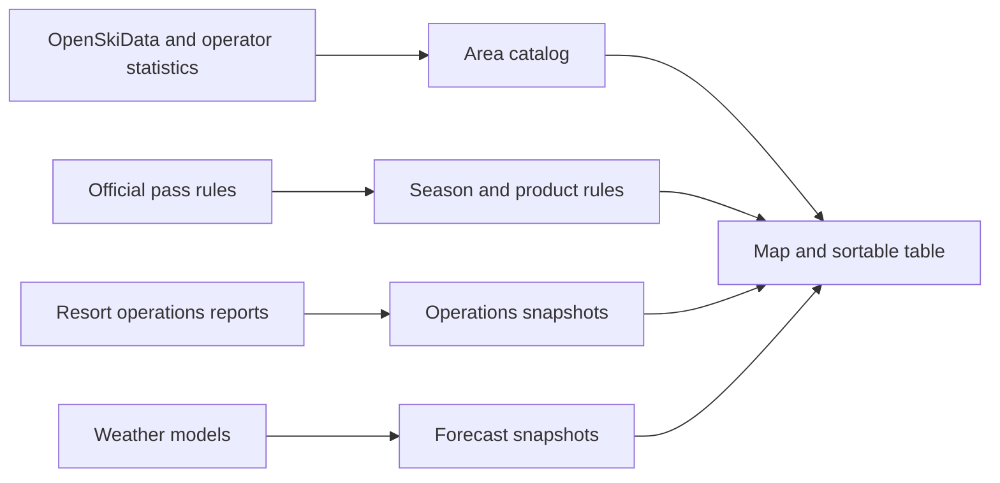

# ski-status guide

ski-status maps North American ski areas and worldwide pass destinations.
Use the table to compare mountain statistics. Use the operator links to check current conditions. [Project tasks](TODO.md)

## Use ski-status

Open `/projects/ski-status/map`. Select **Map**, **Split**, or **Table**.
Each view keeps your filters, sort order, and selected area.

- **Map** gives the map most of the space. On a wide screen, use the list to select an area.
- **Split** gives both panes equal space on a wide screen. On a narrow screen, scroll between the table and map.
- **Table** gives the comparison table most of the space. On a wide screen, the map stays beside it.

On a wide screen, the page starts in **Split**. On a narrow screen, it starts in **Table**.

- Search by area name, alternative name, town, country, or skiing type.
- Select a country, state, or province under **Region**. A shared ski area appears under each country that it covers. Select **Filters** to show the controls on a narrow screen.
- Select **Indy** for included access. Select **Indy discounts** for Alpine Allied discounts and the North Cascade Heli offer.
- Select a **Pass product** to see verified access on a **Ski date**. A blank date uses today at each ski area.
- Select your **Home ski area** for an Indy Add-On. The results exclude this area.
- Select **Conventional downhill** to include outdoor lift-served areas that also have Nordic trails. Select **Cross-country only** to find Nordic centers. Select **Specialty skiing** to include Nordic-only areas and other types such as indoor skiing.
- Turn on **In map view** to limit the table to areas inside the map pane.
- Select a column header to change the sort order.
- Hover over a marker to see the area name and location. Zoom in to separate nearby markers.
- Select a marker to open its map popup. A table row opens the same popup when the map is visible. Select **View resort details** in the popup or select the area name below the filters. On a narrow screen in **Map** view, the details are below the map.
- Select empty map space to clear the selection. To use the keyboard, press Escape with focus in the map.
- Select **Official conditions** to open the operator's report. Use **Resort website and conditions** when the main site has the report.
- Open **Published statistic sources** to see which fields each source supports. The list includes the verification date and any note about what the figure covers.
- Open **Columns** to choose comparison fields. Select **Export CSV** to download the current results and the selected fields with export permission.

The URL stores the search text, filters, sort order, selected area, view, and map settings.
The browser stores your unit and column preferences.

### Map display

Drag the globe to see other regions. Zoom in to see a local map. Select **Fit results** to show the matches. For worldwide results, the map zooms out to a globe overview.
With **In map view** off, filter changes can fit the results if the map is visible and the selection is empty.

With **In map view** on, the table and count update after the map moves, zooms, or changes size.
A marker must be on the visible side of the globe and inside the map pane.
Select **Fit all results** to fit all areas that match the other filters.

The map keeps its position when you change views. On a narrow screen, **Table** uses the last visible map area.
Open **Map** to set the area for the first time. The selected area's details stay open when its marker moves out of view.

The default map shows one cyan dot per ski area. Use **Color by** to show pass access, skiable area, vertical drop, summit elevation, or highest lift terminal. The legend shows ranges in your selected units. Gray marks an unknown value. A gold outline shows the selected area.

Select **Operating status** to color markers from recent resort reports. Gray marks stale, missing, or unknown status. Open the resort details for the source and report time.

In **Map** view, the second column follows **Color by**. Select its header to sort by the displayed number. With **Resort dots** selected, the column shows the active sort field or skiable area when you sort by name.

With **Pass access** selected, the map shows a brand icon for each area with included access. The icons grow as you zoom in. A yellow **+** marks an area with access on more than one pass. Use the pass filter to choose which icon appears on a multi-pass badge. Select an area to see all its passes.

An orange dot marks an area with discount-only access. With **Indy discounts** selected, the map uses orange for each Indy discount. A gray dot marks an area without confirmed access. The legend shows the pass for each icon.

The app serves the pass images with its site files.

| Pass | Source |
| --- | --- |
| Ikon | [Ikon Pass favicon](https://www.ikonpass.com/favicon/favicon-white-32x32.png) |
| Epic | [Vail Resorts My Epic app icon](https://apps.apple.com/us/app/my-epic-skiing-snowboarding/id395375487) |
| Indy | [Indy Pass website icon](https://www.indyskipass.com/themes/custom/origin/images/favicon/apple-touch-icon.png) |
| Mountain Collective | [Cached Mountain Collective site icon](https://www.google.com/s2/favicons?domain=mountaincollective.com&sz=64) |

An acreage value such as `200+` gives a minimum. The table sorts by that minimum. If the minimum leaves more than one possible color range, the map shows a gray dot.

The globe uses the CARTO Dark Matter background. Turn on **Terrain relief** to see shaded slopes from zoom level 8. Mapterhorn supplies the elevation tiles. [CARTO Basemaps](https://docs.carto.com/faqs/carto-basemaps), [MapLibre projections](https://maplibre.org/maplibre-style-spec/types/#projectiondefinition), [Mapterhorn elevation tiles](https://mapterhorn.com/data-access/)

Zoom in to level 11 to see footprints, runs, and lifts for the current results. Dashed gold lines show lifts. Run colors follow the local difficulty scale. Cyan marks Nordic trails. Violet marks ski touring routes. Lift stations appear at zoom level 13. Hover or tap a run or lift to see its mapped name and type. Use **Ski terrain** to hide or show these layers.

Use the table during a map failure. If the background fails, select **Retry background**. If the map or its markers fail, select **Retry map** to rebuild the map. The canvas receives keyboard focus after the retry. Your filters and selected area remain active.

If the shading fails, turn **Terrain relief** off. Turn it on again to load new tiles.

If the ski terrain fails, select **Retry ski terrain** at resort zoom. This retry keeps the map position and filters. [Terrain coverage and updates](#runs-and-lifts-at-resort-zoom)

## Catalog

On November 20, 2026, the catalog had 583 map points in 21 countries.
The United States had 334 points. Canada had 72. Other countries had 177.
The country filter also includes Germany through shared areas.
The catalog had 126 areas with Ikon access, 98 with Epic access, 298 with included Indy access, and 34 with Mountain Collective access.

All 583 areas have at least one published statistic. The six main downhill fields have values for 132 areas.
Mapped terrain values cover 536 areas. [First-release data review](../../docs/reviews/2026-11-20-ski-status-first-release-work.md#catalog-coverage)

| Published field | Areas |
| --- | ---: |
| Skiable acreage | 256 |
| Vertical drop | 452 |
| Lift count | 455 |
| Trail count | 496 |
| Base elevation | 193 |
| Summit elevation | 216 |
| Downhill trail length | 55 |
| Nordic trail length | 60 |
| Highest lift terminal | 27 |
| Lowest lift terminal | 7 |
| Night skiable acreage | 9 |
| Difficulty breakdown | 94 |
| Season window | 64 |
| Official conditions link | 362 |

| File | Use |
| --- | --- |
| [Area statistics](data/areas.json) | Resort sites, published mountain statistics, and official report links. Empty fields display as unknown. |
| [Locations and mapped terrain](data/locations.json) | Points, local time zones, and mapped values from the November 16 OpenSkiData build. Each point has source links. |
| [Resort terrain index](data/resort-terrain.json) and [PMTiles archive](data/resort-terrain.pmtiles) | Footprints, runs, lifts, and lift stations for 550 areas. The index records source and archive checksums and shared terrain groups. |
| [Pass memberships](data/passes-2026-27.json) | Family access for the 2026/27 season. The details show discounts and listings with unconfirmed access. Each entry links to a source. |
| [Pass products](data/pass-rules/) | Verified product rules by family, season, resort, and local date. |

Use the same area ID in the area, location, and pass records. Add one point per area. Add one membership per pass family.
Put the map point's country in `country`. Put other verified countries that the same area covers in `otherCountries`. Add the state or province code where applicable. [Catalog validation](../../src/features/ski-status/catalog.ts)

Use operator fact sheets, trail maps, and lift inventories. Use regional ski associations or public tourism agencies when they describe the same area. Check which mountains, trails, and lifts each figure includes.

Record the source URL, fields, and verification date in `statSources`. List each field once. Use the note to explain conversions, calculated totals, and terrain scope.
Set `reportCheckedOn` when you verify an official conditions link. Use `exportLicense` on a field citation when its terms permit CSV export.
Use `statsUrl` for published fields without a field-specific citation. Use absolute HTTPS links without credentials. Keep the pass access source in the pass record. [Catalog validation](../../src/features/ski-status/catalog.ts)

Panorama's summit elevation covers Goldie Plateau. Its highest lift terminal covers the Summit Quad. Lutsen reports 825 feet of lift-served vertical. [Panorama mountain stats](https://www.panoramaresort.com/public/while-you-are-here/mountain-stats), [Lutsen mountain stats](https://www.lutsen.com/mountain-info/trail-map-mountain-stats)

The **Mapped** columns use OpenSkiData. **Mapped elevation span** subtracts the mapped low point from the mapped high point.
It covers 534 areas. The **Base**, **Summit**, and lift terminal columns show published elevations for those locations.
The catalog has counts for named mapped downhill runs at 482 areas and for Nordic trails at 45.
Each count uses operating routes of the given activity. Segments with the same name count once. Routes without names can contribute to the mapped distance. [OpenSkiData dataset and license](https://www.openskidata.org/#license)

### Runs and lifts at resort zoom

OpenSkiMap uses OpenSkiData. OpenSkiData combines OpenStreetMap ski features with Skimap.org area records. It adds place names from Who’s On First and elevations from Mapterhorn. Ski-status builds its tiles from the downloadable data under ODbL. [OpenSkiData source and license](https://www.openskidata.org/#license)

The November 16, 2026 snapshot covers 550 catalog areas. It contains 421 footprints, 41,834 run features, 5,665 lift features, and 7,266 lift stations. A run feature can be one trail segment. Catalog entries for a shared ski area can use the same geometry. Use the operator report to check current openings. [OpenSkiData datasets](https://www.openskidata.org/#whats-in-the-data)

1. Download the GeoPackage and its `metadata.json` from the same build. [OpenSkiData downloads](https://www.openskidata.org/#downloads)
2. Install the Python bindings for GDAL and the Tippecanoe command. [Tippecanoe](https://github.com/felt/tippecanoe)
3. Run the importer.

   ```bash
   python3 projects/ski-status/scripts/build-resort-terrain.py path/to/openskidata.gpkg path/to/metadata.json
   ```

4. Review missing and shared area matches. Run the archive tests to check coverage and the checksum. [Local checks](#local-checks)
5. Commit the archive, JSON index, and any changes to `locations.json` together.

The importer checks the file size, layer names, feature counts, and build times. It matches each area by source ID or by a footprint that fits its location and activity.
The tiles assign only Nordic trails to cross-country areas. They assign only ski touring routes to ski touring areas.
The importer updates named route counts when the location file uses the same build.

The importer builds files in a temporary directory. It restores the previous output if a file replacement fails. The `data/resort-terrain.pid.lock` file prevents simultaneous builds. If a build stops and leaves this file, verify that its process has stopped before you remove it.

### Ikon destinations

The catalog covers the 26/27 Ikon destination list, including Europe, Asia, Oceania, and Chile. It uses separate points for the three NZSki areas, the three Grandvalira areas, and the five Valle d’Aosta areas. Each of the 12 Dolomiti Superski regions has one point. Search by group name, such as **Dolomiti Superski** or **SkiBig3**, to find its areas. The pass links give shared limits and product rules. [Ikon destination map](https://www.ikonpass.com/en/destinations), [Ikon access comparison](https://www.ikonpass.com/en/compare-benefits)

The Ikon map lists Kappl, See, and Galtür without access details. Find them in the full catalog under **Austria**. Their details show **Lift access unconfirmed**. The Ikon filter shows the confirmed Ischgl / Samnaun and Kitzbühel areas. [Ikon destination map](https://www.ikonpass.com/en/destinations), [Ischgl / Samnaun access](https://www.ischgl.com/en/winter/operating-times-prices/ski-network-tickets/ikon-pass)

### Epic destinations

The catalog covers the 26/27 Epic Pass list. It includes 44 North American areas and 54 areas in Europe, Japan, and Australia. The map has a pin for each of the 36 named European partners. Brides-les-Bains uses the Olympe gondola base. Search by group name to see its ski areas. For example, **Hakuba Valley** finds ten areas in Japan. [Epic Pass list](https://www.epicpass.com/pass-results/college.aspx), [European partners](https://www.epicpass.com/regions/europe.aspx), [Hakuba Valley](https://www.epicpass.com/regions/japan/hakuba-valley.aspx)

The three Australian resorts have access in the 2027 winter season. Select **Epic** in an area's details to read the current terms. Partners can share a day limit. Ski Arlberg also requires a stay booked directly with a lodging partner. [Australia access](https://www.epicpass.com/regions/australia.aspx), [Ski Arlberg access](https://www.epicpass.com/regions/europe/austria/ski-arlberg.aspx)

### Indy destinations

The catalog covers all 302 cards from the November 19 roster, plus the Gore Mountain Nordic Center. It includes 69 destinations outside the United States and Canada. The 303 records have 298 included memberships and five discounts. [Indy resort roster](https://www.indyskipass.com/our-resorts), [Indy November additions](https://www.indyskipass.com/this-is-indy/news/whiteface-gore-and-belleayre-join-allied-program-as-indy-pass-announces-15-additional-resorts-for)

Gore has a pin for downhill discounts and a separate pin for included Nordic access. Manning Park also has separate downhill and Nordic pins. Use the group link for shared day limits and redemption rules. Portes du Soleil appears under France and Switzerland. Oberstdorf Kleinwalsertal and Steinplatte appear under Austria and Germany. Each group has one representative pin. [Innsbruck access](https://www.indyskipass.com/our-resorts/innsbruck-region), [Portes du Soleil access](https://www.indyskipass.com/our-resorts/portes-du-soleil), [Oberstdorf and Kleinwalsertal ski areas](https://www.ok-bergbahnen.com/en/skigebiete/), [Steinplatte ski area](https://www.steinplatte.tirol/en/steinplatte-winklmoosalm-ski-area-in-winter.html)

The catalog uses the published roster figures for vertical drop, lifts, trail count, night skiing, and terrain parks. Use the operator's figures when the operator gives a more precise value for the same area. Leave fields empty when the source gives no comparable figure. The **Skiing** and **Night skiing** columns describe the venue. Open the pass link to check which activities and sessions it covers. [Indy access rules](https://www.indyskipass.com/this-is-indy/how-it-works), [North Cascade Heli discount](https://www.indyskipass.com/our-resorts/north-cascade-heli), [Stoke Mountain profile](https://www.indyskipass.com/our-resorts/stoke-mountain)

## Local checks

Install the repository dependencies. Run `npm run dev` to start Vite. Open `/projects/ski-status/map` on the local server.
If the trip media path is unavailable, start Vite directly for ski-status.

```bash
npx vite --host 127.0.0.1
```

Run the catalog, table, conditions, and terrain tests. The archive test checks the index against the packaged file.
The Python tests check the importer and candidate review. They require no GDAL or Tippecanoe installation.

```bash
npx vitest run src/test/skiStatus*.test.* src/test/skiResortTerrainMap.test.ts \
  scripts/__tests__/skiResortTerrain.test.ts scripts/__tests__/releaseSkiTerrain.test.ts \
  scripts/__tests__/syncSkiStatus.test.ts
npm run test:ski-terrain
```

Run the browser tests for filters, resort reports, and map behavior. They check terrain byte ranges. They use a fixed clock to check report age.

```bash
npm run test:e2e -- tests/e2e/ski-status.spec.ts --project=chromium
```

## First release

Include active public conventional downhill areas in North America with at least 100 published skiable acres. Include official pass destinations. Add specialty venues when an operator or managing organization documents the activity. Record the access type for each pass. Keep eligible areas in the catalog during the off-season. [Ikon destination map](https://www.ikonpass.com/en/destinations), [Epic Pass list](https://www.epicpass.com/pass-results/college.aspx), [Indy resort roster](https://www.indyskipass.com/our-resorts)

Whaleback has 86 skiable acres and qualifies through Indy lift access. Use skiable acreage for the threshold. Resort property acreage can include lodging and terrain outside the ski area. [Indy Whaleback profile](https://www.indyskipass.com/our-resorts/whaleback-mountain), [Monterreal property description](https://www.monterreal.com/)

### Map and table

Pass product and ski date filters use the area's local date. Operating status colors use fresh reports. Gray shows a stale or missing report.

Keep measured snow and forecast snow in separate columns. Compare each field in common units. Put unknown values last in both sort directions.
Group columns by mountain statistics, conditions, and season dates. Save column settings on the device.
CSV uses the current comparison filters, sort order, units, and column choices. The file includes report times, source links, and license credits.
Export includes area identity, OpenSkiData values, and fields with verified export permission. A field can appear for some areas and be blank for others. [Release tasks](TODO.md)

### Comparable mountain statistics

| Field | Definition |
| --- | --- |
| Area identity | Store the official name, website, ID, region, and country. Keep former names for search. Put the point near a base, trailhead, or visitor entrance. |
| Skiable acres | Use the operator's published skiable area. Record which mountains or terrain the figure covers. |
| Guided terrain | Use the published area of the terrain that the heli-ski or cat-ski operator serves. Record it in **Guided terrain**. |
| Lifts | Use the operator's total for the same area. Include surface lifts. |
| Elevation and vertical | Store lift terminal elevations in their own fields. Use the operator's figure for skiable vertical. If you calculate vertical, use elevations from the same skiable descent. Give the calculation in the source note. |
| Trails | Store the total and the number for each published grade. Keep the original basis for percentages such as trail count or terrain area. |
| Trail length | Record the published lengths of downhill and Nordic trails in their own fields. Use miles or kilometers in the app. |
| Night skiing | Store yes, no, or unknown. Show night skiable acres when the operator publishes them. Keep a published lower bound, such as `200+` acres. Track scheduled night operations in the conditions report. |
| Season window | Use the operator's published season window. Use **Year-round** for areas with lift access in all seasons. |

Store area in acres. Store elevation in feet. Store trail length in kilometers. Give the original unit in the source note for converted values. The table uses the selected display units. [Big SNOW specifications](https://www.bigsnowamericandream.com/press-room/), [Palisades Tahoe mountain statistics and season windows](https://www.palisadestahoe.com/footer/mountain-statistics)

## Inventory and data quality

### OpenSkiData audit

The November 19 download contained 12,440 world records. The audit selected named rows with `has_downhill=yes` and `status=operating`. The matching metadata reports a November 16 UTC build. Website counts indicate a populated source field. Lift counts indicate at least one mapped lift. [Ski-area CSV](https://tiles.openskimap.org/csv/ski_areas.csv), [Build metadata](https://tiles.openskimap.org/metadata.json)

| Geography | Candidate rows | Website present | Mapped lifts | Mapped elevation range |
| --- | ---: | ---: | ---: | ---: |
| United States | 571 | 529 | 511 | 526 |
| Canada | 273 | 239 | 235 | 257 |
| Mexico | 1 | 1 | 1 | 1 |
| Greenland | 3 | 2 | 3 | 3 |
| **Total** | **848** | **771** | **750** | **787** |

The audit counts candidates before the acreage and pass checks. A named row can describe one base area. Verify the acreage and elevations with the operator. The CSV shows 3–4 m of elevation for indoor Big SNOW. The operator reports 160 ft of vertical and four skiable acres. [OpenSkiData schema](https://www.openskidata.org/#schema), [Big SNOW specifications](https://www.bigsnowamericandream.com/press-room/)

The CSV has SHA-256 `9c5a372b8d02aedd281fd387c581c16f48915d89abacec7eba0faa53726a9df5`.

The November 20 review records an initial decision for each candidate. Filter the review log by region and decision. Review Mexico and Greenland in their own groups. [Candidate review log](research/north-america-2026-11-16.csv), [Regional counts](research/north-america-2026-11-16-summary.csv)

Use the same CSV for the mapped terrain values and the existing points. Match one operating row by its upstream source URL and coordinates. Check that the row covers the ski area. Leave the field empty when one row combines multiple areas that the catalog lists on their own. Use the downhill and Nordic lengths that apply to the venue. Keep the terrain source URL in `mappedTerrain`. [OpenSkiData statistics and source IDs](https://www.openskidata.org/#whats-in-the-data)

### Build the catalog

1. Import names, points, source IDs, and candidate websites from a versioned OpenSkiData file. Use regional directories to find missing areas. Check directory terms before you collect source data. [OpenSkiData downloads](https://www.openskidata.org/#downloads), [NSAA inventory by state](https://nsaa.org/NSAA/About/Media/Industry_Stats/NSAA/About/Media/Industry_Stats.aspx), [Canadian Ski Council directory](https://www.skicanada.org/ski-area-list/), [Québec ski area directory](https://maneige.ski/en/stations-et-conditions/)
2. Match by source ID or a verified name and location. Assign a stable local ID for links, reports, and visits. OpenSkiData feature IDs can change between builds. [OpenSkiData feature IDs](https://www.openskidata.org/#whats-in-the-data)
3. Review uncertain matches. Group bases when the operator publishes combined statistics. Palisades Tahoe publishes combined resort statistics. Keep independently operated areas separate if they share a pass allowance. [Palisades Tahoe statistics](https://www.palisadestahoe.com/footer/mountain-statistics), [Ikon access comparison](https://www.ikonpass.com/en/compare-benefits)
4. Verify eligibility with operator acreage, an official pass listing, or a source for the specialty venue. Record the upstream reference, decision, reason, source, and date. Give each unresolved case a next check. Check for duplicate, closed, and private areas before release. [Indy Pass website terms](https://www.indyskipass.com/website-terms-of-use)
5. Add operator statistics for each eligible area. Record the source, date, and scope of each figure. Use map data to check large differences. Verify the figure with the operator before changing the record. [OpenSkiData data definitions](https://www.openskidata.org/#whats-in-the-data)
6. Reconcile the decision counts with all candidates in each region. Compare field counts before and after each update. Check official conditions links for a current report or off-season status.

## Pass access by product and date

Create a reviewed file for each season and pass family. Record the product, area, access type, valid dates, and day allowance. Record shared allowances, blackout dates, and reservation rules. Include consecutive-day and weekday restrictions when they apply. Keep the source and verification date on each rule. Keep rules for past seasons.

| Program | Launch products and rules to verify |
| --- | --- |
| Ikon | Ikon, Base, and Session variants. Alta and Snowbird share Ikon days, with Snowbird access under Base. Store each partner's reservation and access rules. [Ikon 2026/27 comparison](https://www.ikonpass.com/en/compare-benefits) |
| Epic | Epic, Epic Local, and Day Pass variants by duration, resort tier, and peak-date option. The 4–7 day All Resorts products can include Canadian Rockies partners. Verify specialty products before adding their filters. [Epic products](https://www.epicpass.com/), [Epic partner rules](https://www.epicpass.com/regions/partner-resorts.aspx), [Peak dates](https://www.epicpass.com/info/peak-restricted-dates.aspx) |
| Indy | Base, Indy+, and Add-On variants. Track excluded dates and reservations by area. Record Allied discounts separately from included ski days. [Indy products](https://www.indyskipass.com/shop), [Blackouts and reservations](https://www.indyskipass.com/blackout-dates-reservations) |
| Mountain Collective | Included days, any published bonus days, and advance reservations where required. [Pass terms](https://mountaincollective.com/), [Destination reservation rules](https://mountaincollective.com/how-to-use-my-pass/) |

The family filter shows included partners for the season. The product filter uses verified rules and the resort's local ski date.
Season dates select the rules that apply during a winter season. Apply exact resort access windows where the pass operator publishes them.
Use the resort details to check the published allowance and reservation requirements. Check reservation availability on the operator's site.
Time zones come from the catalog point. [Coordinate to time zone lookup](https://github.com/photostructure/tz-lookup)

Indy Add-On access requires verification of an unrestricted home season pass. Select a home area to apply the exclusion. The app shows the requirement in the pass terms. [Indy Add-On rules](https://www.indyskipass.com/this-is-indy/how-it-works)

Ski Arlberg requires a direct booking with a lodging partner. The app shows this requirement with the shared three-day allowance. [Ski Arlberg pass terms](https://www.epicpass.com/regions/europe/austria/ski-arlberg.aspx)

Review the pass lists at the start of each season. Check for changes each week. Confirm each change with the pass operator. Keep pending changes visible until the review completes.

## Current conditions

### Sources and pilot

| Source | What it can supply | How to use it |
| --- | --- | --- |
| Resort reports | Operating status, lifts, trails, acres, base depth, measured snowfall, and night operations. Whistler has separate pages for snow and terrain. | Start with operator links. Add feeds from sources that permit reuse. [Killington mountain report](https://killington.com/mountain-report), [Whistler snow report](https://www.whistlerblackcomb.com/the-mountain/mountain-conditions/snow-and-weather-report), [Whistler lift and terrain status](https://www.whistlerblackcomb.com/the-mountain/mountain-conditions/terrain-and-lift-status.aspx) |
| Open-Meteo | Weather estimates and forecasts for temperature, wind, precipitation probability, snowfall, and freezing level. | Use one named base location per area in the pilot. Show the forecast period and location or elevation. Show the model time when available. [Forecast API](https://open-meteo.com/en/docs), [Noncommercial access](https://open-meteo.com/en/pricing) |
| SnoCountry | Resort and regional feeds with counts of open lifts, trails, and acres where available. | Evaluate the feed if operator reports leave large gaps. The full feed requires a paid key. Verify coverage and terms before use. [SnoCountry API](https://feeds.snocountry.net/) |
| Mountain News and Skiresort Service | Paid resort and mountain data feeds. Mountain News includes report times and fields that resorts supply. | Compare the resort list and field coverage before using a paid feed. [Mountain News partner API](https://partner.docs.onthesnow.com/api-reference/ski-resort-snowreport-api), [Skiresort Service product description](https://www.skiresort-service.com/fileadmin/user_upload/skiresort-service/content/engl/Skiresort-access-snow-reports-ski-resort-data-ski-weather.pdf) |

On November 19, the SnoCountry demo returned Bolton Valley, Bromley, and Burke. Each report had a time and an opening status. Base depth, recent snowfall, and open lift, trail, and acre counts were empty. Measure field coverage and report age during winter operation. [SnoCountry public example and field definitions](https://feeds.snocountry.net/)

The pilot covers Alta Badia, Val Gardena / Alpe di Siusi, and 3 Zinnen Dolomites. Open Data Hub and LTS supply resort report fields. Open-Meteo supplies forecasts for one base location per area.
The app uses separate timestamps for operations and snow measurements. It shows gray when the provider supplies only a measurement date. [Open Data Hub dataset](https://databrowser.opendatahub.com/dataset-overview/f15d894a-b77f-43cf-a802-e1590fc38068), [Open-Meteo forecast API](https://open-meteo.com/en/docs), [Pilot measurements](../../docs/reviews/2026-11-20-ski-status-first-release-work.md#conditions-pilot)

### Report and forecast rules

- Store operating status with each report. Use open, limited, temporarily closed, season closed, or unknown. Store hours and planned opening dates when the operator publishes them.
- Show open and total lifts, trails, and acres when the operator reports them. Calculate percentages from counts with the same scope and time.
- Keep the snow depth unit, range, and measurement location. Show the reporting period for new snow. Show forecast snow in its own column. Show reported zeros as zero.
- Store the source report time and the retrieval time. Calculate report age from the source report time. Mark pilot reports older than 24 hours as stale.
- Keep the last report and date visible when a refresh fails. Show gray markers when the report age or status is unknown.
- Show base forecasts for the next 24 hours of complete hourly data. Sum snowfall over the period. Show the highest hourly precipitation probability. Hide expired forecasts. [Open-Meteo hourly variables](https://open-meteo.com/en/docs)

For future season history, record the first and last days of public lift access in the area's time zone.
Use the median of up to five completed seasons for each typical date. Verify at least three actual dates for each median.
Compare dates in winter season order across the year boundary. Use the published season window when fewer than three dates are available.

## Repository and hosting design

The project uses React, TypeScript, Vite, and MapLibre. The `/projects/ski-status` route opens `/projects/ski-status/map`. Keep data preparation in `projects/ski-status/`. Keep feature code in `src/features/ski-status/`. Use the shared CARTO configuration and map recovery. [CARTO basemap configuration](../../docs/carto-basemaps.md), [Project routes](../../src/App.tsx)

The map uses a GeoJSON source for resort markers. The map and table use the same search and filters. The table reads the latest viewport when **In map view** is on. The app serves the PMTiles archive with its site files. It requests byte ranges from the archive at resort zoom.

Join static facts, pass rules, resort reports, and forecasts by the local area ID.



Update verified pass rules by hand. Publish catalog and pass files with the site revision.
Use scheduled jobs for reports and forecasts. Keep provider keys in those jobs. [Repository geospatial delivery review](../../docs/reviews/2026-11-13-geospatial-delivery-research.md#reusing-s3-and-cloudfront)

Credit sources where their data appears. Publish modified OpenSkiData with its license and credits.
Verify each feed's terms for storage, display, and export. Limit automatic OpenSkiData downloads to once per day. [OpenSkiData terms](https://www.openskidata.org/#license), [OpenStreetMap Foundation licensing guidance](https://osmfoundation.org/wiki/Licence/Community_Guidelines)

### Conditions publication

Run the collector locally to check both feeds. It saves files under `.cache/ski-status/` and prints coverage counts. Use `--directory` to select another path.

```bash
node --import tsx/esm projects/ski-status/scripts/sync-conditions.ts --forecasts
```

The collector uses a local lock file to prevent two jobs from writing to the same directory. If a job leaves `conditions.pid.lock`, check that the process has stopped before you remove the file.

The workflow uses `AWS_SKI_STATUS_SYNC_ROLE_ARN` on `main`. It publishes reports hourly and forecasts every six hours. The role can read and write the `ski-status/` prefix. [Sync workflow](../../.github/workflows/sync-ski-status.yml), [OIDC setup](../../docs/github-actions-oidc.md#deploy-and-switch)

The collector uploads each new snapshot before it replaces `manifest.json`. The S3 ETag identifies the manifest content that the collector read. The collector uses this value to make the replacement conditional. A concurrent update causes the write to fail. Retry from the current manifest. [S3 conditional writes](https://docs.aws.amazon.com/AmazonS3/latest/userguide/conditional-writes.html)

The manifest lists snapshot files by SHA-256 checksum. The app checks the manifest every five minutes. It reads changed files and verifies their checksums. It keeps the last valid data when a fetch or check fails. The app uses the packaged pilot data when it has no live copy.

The collector preserves rows with failed provider requests. The manifest gives report age and field coverage. Each successful publication writes an observation under `history/YYYY-MM-DD/`. Compare the received counts with the total counts to detect retained rows.

#### Restore a previous manifest

1. Read the active `manifest.json` from S3. Record its ETag.
2. Get the file named by `previousManifest`. Check its SHA-256 checksum against its name.
3. Set the recovered manifest's `updatedAt` to a UTC time later than the active value.
4. Upload it to `ski-status/manifest.json` with the recorded ETag in `--if-match`. Set its cache lifetime to 60 seconds.
5. Check the restored snapshot references on the data site. Open ski-status and verify the report dates. If the upload conflicts, start with the new active manifest.

## Release checks

Use the [task list](TODO.md) to track remaining work. Verify the changes before each release.

| Work | Acceptance check |
| --- | --- |
| Ski terrain | Run the release validator on the hosted preview for the candidate revision. It checks for `206`, the expected `Content-Range`, and the original bytes. It opens a lift and run tooltip at Heavenly. Check the revision and `previewJobId` in the report. Confirm that `skiTerrainRanges` is greater than zero. [Release validator](../../docs/release-validation.md), [PMTiles delivery](https://docs.protomaps.com/pmtiles/cloud-storage) |
| Pass products | Test shared days, reservations, access requirements, excluded products, blackout dates, and discounts. Match each included partner. Record exceptions. |
| Conditions pilot | Measure report age and field coverage for a week. Compare values with operator reports. Test failed updates, stale reports, unknown values, zero values, and partial openings. |
| First release | Verify the source and eligibility of each area. Check links. Verify the source and time of each report. Publish counts of recent reports and coverage by field. |

## Version 2

### Resort conditions and 5-day forecast

Add current weather and a five-day forecast to the conditions panel. Match reports and forecasts to the catalog area ID. Powderhorn shows how a resort can present a forecast and snowfall measurements. [Powderhorn Mountain Report](https://www.powderhorn.com/conditions/)

| Section | Fields to show |
| --- | --- |
| Current conditions | Update time, temperature, weather label and icon, wind speed and direction, and gusts. Show forecast snowfall for the next 24 hours and the base and peak totals for that period. Show freezing level and precipitation chance. Label current readings and forecasts. |
| 5-day forecast | One row per local date, starting with today. Show the weather label and icon, high and low temperatures, forecast snowfall, and precipitation chance. Show the freezing level, wind speed and direction, and gusts where available. |
| Snowfall | Reported new snow for the past 24 hours, 48 hours, and 7 days. Show base depth and season-to-date snowfall where the operator reports them. Keep the measurement location and any reported range. |

- Keep the report time, forecast issue time, and period each value covers. Show dates and times in the ski area's time zone. If a daily forecast value comes from hourly data, give the hour or the method used to combine the values.
- Keep separate forecast locations and elevations for the base and peak. Show both snowfall values when available. Show freezing level as elevation above sea level at 0°C. [Forecast API field definitions](https://open-meteo.com/en/docs)
- Use the app's unit setting for temperature, snow depth, elevation, and wind speed. Keep precipitation chance as a percentage. Give the source name and a link to each report or forecast.
- Show forecasts and measured snowfall with separate labels. Apply the [report and forecast rules](#report-and-forecast-rules) for stale and missing values. Show **Unknown** for missing data and **N/A** for fields that do not apply. Keep reported zeros.
- Test complete, partial, and stale reports. Check that the forecast starts on the resort's local date and that changing units preserves unknown values and zeros. Check that the panel can open for an area with no reports.

### Access routes and webcams

Start with Washington and British Columbia. Use operator directions to match each resort base to road segments. Use US 2 for Stevens Pass. Use the applicable Highway 99 segments for Whistler. Match closures, restrictions, and cameras to these roads. Use agency IDs and road geometry for each match. Show the agency's report time. Mark missing coverage as unknown. Link to agency and resort cameras. Embed feeds where the source permits it. Record parking prices, locations, and shuttles that operators publish. Consider Utah's feed for expansion. [WSDOT Traveler Information API](https://apps.wsdot.wa.gov/traffic/api/), [DriveBC Open511](https://api.open511.gov.bc.ca/help), [BC HighwayCams](https://images.drivebc.ca/bchighwaycam/pub/html/www/index.html), [UDOT API](https://www.udottraffic.utah.gov/developers/doc)

### Visited areas

Add a **Visited** toggle and an optional ski date. Store visits on the device with stable area IDs. Add a visited filter. Support backup import and export. Keep visits attached when an area name or source ID changes. Add account synchronization if users need visits on more than one device.
