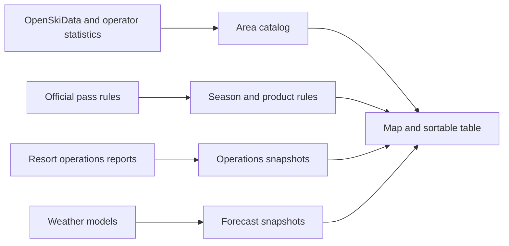

# ski-status project plan

November 19, 2026

ski-status is a personal map and comparison table for North American downhill ski areas. Use it to find where a specific pass works, see what is open, and compare mountains. Open directly to the map and table.

## Pilot catalog

Open `/projects/ski-status/map` from the project directory. The pilot contains 25 ski areas in the United States and Canada. Filter by region, pass family, and night skiing. Select a map marker or table row for source links and the operator's conditions report.

| File | Use |
| --- | --- |
| [Area statistics](data/pilot-areas.json) | Published mountain facts and report links checked on November 19, 2026. Missing fields display as unknown. |
| [Area locations](data/pilot-locations.json) | Representative points from the November 16 OpenSkiData build. The point records carry source identifiers and ODbL attribution. |
| [Pass memberships](data/passes-2026-27.json) | Verified 2026/27 family access for the pilot. Discount-only partners appear in the details and stay outside the included-access filter. |

Use the same area ID across the three files. Palisades Tahoe uses one marker and keeps both base-area sources. Sort published lower bounds by their stated minimum. Their displayed values retain the plus sign. Reports open on the operator's site during the pilot.

## First release

Include active, public, lift-served downhill areas with **at least 100 published skiable acres or included lift access on a supported pass**. Apply the same rule throughout North America, including Alaska, Mexico, and Greenland. Start with Ikon, Epic, Indy, and Mountain Collective. Consider Powder Alliance next. Keep eligible areas visible in their off-season. [Powder Alliance eligibility](https://www.powderalliance.com/), [Visit Nuuk ski area](https://visitnuuk.com/providers/skiliften/), [Monterreal](https://www.monterreal.com/)

Whaleback qualifies through Indy at 86 acres. Indy Allied discounts alone do not qualify an area. Show those discounts as a separate access type for areas that already qualify. Use skiable acreage for the threshold. Resort property acreage can include lodging and other non-ski terrain. [Indy Whaleback profile](https://www.indyskipass.com/our-resorts/whaleback-mountain), [Indy Allied terms](https://www.indyskipass.com/this-is-indy/news/whiteface-gore-and-belleayre-join-allied-program-as-indy-pass-announces-15-additional-resorts-for), [Monterreal property description](https://www.monterreal.com/)

### Map and table

- On desktop, show a compact map beside the table. On mobile, switch between Map and Table without clearing filters or selection.
- Cluster dots at continental zoom. Show individual dots when zoomed in. Select a dot or a row to open the same area detail panel.
- Search by area name, alias, state or province, or nearby town. Filter by pass family, exact product, ski date, operating status, and night skiing.
- Sort by any published statistic. Compare numbers in common units. Put unknown values last in both directions. Expose distinct columns for reported and forecast snow.
- Group columns into mountain statistics, conditions, and season dates. Remember visible columns and units locally. Keep a table view for the full catalog and make **In map view** a toggle.
- Put filters, sort, and selected ski area in a shareable URL. Keep the table usable if the basemap fails or WebGL is unavailable.
- Export filtered rows as CSV where the data licenses permit it. Include units, report timestamps, and source links for exported values.

### Comparable mountain statistics

| Field | Definition |
| --- | --- |
| Name and website | Operator name, official website, area ID, state or province, country, time zone, and a map point near public lift access. Keep former names as aliases. |
| Skiable acres | Operator's published skiable area. Record coverage such as combined mountains or inbounds terrain alongside the number. |
| Lifts | Operator's total for the same area, with a type breakdown when available. Include surface lifts in the definition. |
| Elevation and vertical | Store the highest lift's top terminal and lowest lift's bottom terminal elevations. Label their difference as lift elevation range. Preserve published skiable vertical separately. |
| Trails | Store total and counts by green, blue, black, double black, and other published grades. Keep published percentages with their original denominator. |
| Night skiing | Store yes, no, or unknown. Show night skiable acres when the operator publishes them. Track scheduled night operations in the conditions report. |
| Season dates | Keep this season's planned and actual dates. Show typical opening and closing from the median of up to five completed seasons, with at least three published actual dates for each measure. |

Keep values in common units internally. Preserve the original unit and source. Display acres, feet, and inches by default and offer metric units. Use operator announcements and archived reports to verify actual dates. Record the first and last public lift-served days of the regular winter season. Compare typical dates by their position in the winter season across the year boundary. When history is thin, show a published season window or leave typical dates unknown. Keep calendar dates in the resort's time zone. Use **Year-round** where the operator runs without a winter opening and closing cycle. [Big SNOW specifications](https://www.bigsnowamericandream.com/press-room/), [Palisades Tahoe mountain statistics and season windows](https://www.palisadestahoe.com/footer/mountain-statistics)

## Inventory and data quality

### OpenSkiData audit

The November 19 download contained 12,440 world records. The audit selected named rows with `has_downhill=yes` and `status=operating`. The matching metadata reports a November 16 UTC build. Website counts indicate a populated source field. Lift counts indicate at least one mapped lift. [Ski-area CSV](https://tiles.openskimap.org/csv/ski_areas.csv), [Build metadata](https://tiles.openskimap.org/metadata.json)

| Geography | Candidate rows | Website present | Mapped lifts | Mapped elevation range |
| --- | ---: | ---: | ---: | ---: |
| United States | 571 | 529 | 511 | 526 |
| Canada | 273 | 239 | 235 | 257 |
| Mexico | 1 | 1 | 1 | 1 |
| Greenland | 3 | 2 | 3 | 3 |
| **Total** | **848** | **771** | **750** | **787** |

These rows are candidates before the acreage and pass checks. The CSV has no skiable acreage field. A named row can describe an individual base area. The mapped elevations also need review. For example, the CSV shows a 3–4 m elevation range for indoor Big SNOW. The operator publishes 160 ft of vertical and four skiable acres. [OpenSkiData schema](https://www.openskidata.org/#schema), [Big SNOW specifications](https://www.bigsnowamericandream.com/press-room/)

The CSV has SHA-256 `9c5a372b8d02aedd281fd387c581c16f48915d89abacec7eba0faa53726a9df5`.

### Build the catalog

1. Import a versioned OpenSkiData snapshot. Seed names, locations, source IDs, and candidate websites. Check official pass rosters and regional directories for missing destinations. [OpenSkiData downloads](https://www.openskidata.org/#downloads), [NSAA inventory by state](https://nsaa.org/NSAA/About/Media/Industry_Stats/NSAA/About/Media/Industry_Stats.aspx), [Canadian Ski Council directory](https://www.skicanada.org/ski-area-list/), [Québec ski area directory](https://maneige.ski/en/stations-et-conditions/)
2. Match by upstream ID or a reviewed alias and location. Assign a stable local ID for links, reports, and visits. OpenSkiData feature IDs are content hashes that can change between builds. [OpenSkiData feature IDs](https://www.openskidata.org/#whats-in-the-data)
3. Review ambiguous matches and store base areas under their parent where the operator reports the resort together. Palisades Tahoe has two candidate records and publishes combined resort stats. Keep independently operated areas distinct when a pass shares a day allowance across them. [Palisades Tahoe statistics](https://www.palisadestahoe.com/footer/mountain-statistics), [Ikon access comparison](https://www.ikonpass.com/en/compare-benefits)
4. Confirm the inclusion rule from an operator acreage figure or a current pass roster. Record the reason for inclusion and its source. Keep candidates with unresolved acreage in the review list. Screen out closed, private, or duplicate rows during review.
5. Enrich eligible areas with operator statistics. Save the source URL, date checked, and scope for each value. Record the mapped basis if an estimate from lift terminal geometry appears. A mapped trail segment count has a different definition from an operator trail count. [OpenSkiData data definitions](https://www.openskidata.org/#whats-in-the-data)
6. Report resolved and unresolved candidates by region. Track field coverage for acreage, elevations, difficulty, night acreage, and dates. For example, Skibowl publishes total acres and the number of lit runs on its statistics page. Those figures leave night skiable acres unknown. [Skibowl statistics](https://skibowl.com/about-winter/stats/)

### Similar tools

PisteFinder already offers pass filters and terrain comparisons based on mapped features. OnTheSnow offers pass-based snow reports, forecasts, and webcams. For ski-status, prioritize exact pass rules for a chosen ski date and one sortable table with mountain statistics and timestamped reports. [PisteFinder](https://pistefinder.com/), [OnTheSnow app](https://www.onthesnow.com/news/mobile/)

## Pass access by product and date

Create a reviewed file for each season and pass family. Track exact product, area, access type, valid dates, day allowance, shared day pool, blackout dates, and reservation rules. Support consecutive-day and weekday restrictions when a product uses them. Keep the source and verification date on each rule. Keep old seasons available for dates in their season.

| Program | Launch products and rules to verify |
| --- | --- |
| Ikon | Ikon, Base, and Session variants. Alta and Snowbird share Ikon days, with Snowbird access under Base. Store each partner's reservation and access rules. [Ikon 2026/27 comparison](https://www.ikonpass.com/en/compare-benefits) |
| Epic | Epic, Epic Local, and Day Pass variants by duration, resort tier, and peak-date option. The 4–7 day All Resorts products can include Canadian Rockies partners. Verify specialty products before adding their filters. [Epic products](https://www.epicpass.com/), [Epic partner rules](https://www.epicpass.com/regions/partner-resorts.aspx), [Peak dates](https://www.epicpass.com/info/peak-restricted-dates.aspx) |
| Indy | Base, Indy+, and Add-On variants. Track excluded dates and reservations by area. Record Allied discounts separately from included ski days. [Indy products](https://www.indyskipass.com/shop), [Blackouts and reservations](https://www.indyskipass.com/blackout-dates-reservations) |
| Mountain Collective | Included days, any published bonus days, and advance reservations where required. [Pass terms](https://mountaincollective.com/), [Destination reservation rules](https://mountaincollective.com/how-to-use-my-pass/) |

The family filter finds all included partners for that season. When a user selects a product and date, evaluate published rules for that resort's local date. Show **Included**, **No access**, **Blackout**, **Reservation required**, or **Rules unverified** as applicable. Keep reservation requirements visible on eligible results. State the total allowance and any shared pool. Personal day use and reservation availability require separate information.

Review the rosters at season rollover. Check for changes weekly during the season. Confirm each changed rule with the pass operator. Keep verified and pending changes visible during review so a partner change cannot silently remove a record.

## Current conditions

### Sources and pilot

| Source | What it can supply | How to use it |
| --- | --- | --- |
| Resort operations reports | Open status, lifts, trails, acres, base depth, measured snowfall, and night operations when reported. Whistler publishes snow and terrain on separate pages. | Begin with operator links for every area with a public report. Add reviewed integrations for sources that permit reuse. [Killington mountain report](https://killington.com/mountain-report), [Whistler snow report](https://www.whistlerblackcomb.com/the-mountain/mountain-conditions/snow-and-weather-report), [Whistler lift and terrain status](https://www.whistlerblackcomb.com/the-mountain/mountain-conditions/terrain-and-lift-status.aspx) |
| Open-Meteo | Modeled current weather and forecasts for temperature, wind, precipitation, and snowfall. | Start with one named base location per area. Show the forecast period, model time when available, and elevation or location. [Forecast API](https://open-meteo.com/en/docs), [Noncommercial access](https://open-meteo.com/en/pricing) |
| SnoCountry | Documented resort-list and regional feeds, with counts of open lifts, trails, and acres where available. | Evaluate only if owner reports leave major gaps. The full feed requires a paid key. Request coverage and display terms before committing. [SnoCountry API](https://feeds.snocountry.net/) |
| Mountain News and Skiresort Service | Commercial partner feeds for resort reports and other mountain data. Mountain News publishes a report timestamp and individual fields when supplied by resorts. | Compare the covered resort IDs and field completeness if a paid source becomes worthwhile. [Mountain News partner API](https://partner.docs.onthesnow.com/api-reference/ski-resort-snowreport-api), [Skiresort Service product description](https://www.skiresort-service.com/fileadmin/user_upload/skiresort-service/content/engl/Skiresort-access-snow-reports-ski-resort-data-ski-weather.pdf) |

On November 19, SnoCountry's Vermont demo returned Bolton Valley, Bromley, and Burke. All three had a report time and an opening status. Fields for base depth, recent snowfall, and open lift, trail, and acre counts were blank. This sample tests pre-season handling. An in-season trial should measure coverage and report age for each requested field. [SnoCountry public example and field definitions](https://feeds.snocountry.net/)

### Report and forecast rules

- Store operating status separately from area eligibility. Distinguish open, limited, temporarily closed, season closed, and unknown. Support a planned opening date and a resort-specific daily schedule.
- Show open and total lifts, trails, and acres when reported. Derive closed totals and percentages only when the counts have the same scope and report time. Keep **trails open %** and **acres open %** distinct.
- Preserve snow depth units, range, and measuring location. Show the exact interval for new snow, such as **24 h reported**. Keep forecast snow in its own column. A blank value stays unknown and a reported zero displays as zero.
- Preserve the operator's report time and the fetch time. For the initial pilot, flag operations reports older than 24 hours as stale. Keep the last report visible with its date. Indicate when an update is newer but missing a field.
- Use source-specific freshness when a provider changes cadence in the off-season. Show the date of an official seasonal closure. Update card labels from the report times so a failed refresh ages data correctly.
- Publish a coverage count for recent reports and each core condition field. Show the operator link alongside sparse or stale data.

## Repository and hosting design

Use the existing React, TypeScript, Vite, and MapLibre stack. Follow ADV Atlas's direct-to-map route pattern with `/projects/ski-status/map` and a redirect from `/projects/ski-status`. Keep ingestion under `projects/ski-status/` and UI code under `src/features/ski-status/`. Reuse the shared CARTO basemap configuration and map recovery behavior. [CARTO basemap configuration](../../docs/carto-basemaps.md), [Existing project routes](../../src/App.tsx)

Use a GeoJSON source for clustered points and typed JSON for table data. Join static facts, pass rules, reported operations, and forecast snapshots by the local area ID. A single filter result drives the map and table.

Use scheduled jobs for feeds and manual updates for reviewed rules. Publish validated JSON to `data.rsmb.tv` through the existing S3 and CloudFront pattern. Scope publisher permissions to the `ski-status` prefix. Keep any partner keys in the scheduled job. [Repository geospatial delivery review](../../docs/reviews/2026-11-13-geospatial-delivery-research.md#reusing-s3-and-cloudfront), [GitHub OIDC setup](../../docs/github-actions-oidc.md)

Publish catalog and pass files by revision. Refresh weather and operations on their own schedules. Upload each snapshot before updating its manifest. Include schema version, compatible catalog revision, coverage, and timestamps. Keep the last valid snapshot available if a source fails or delivers an invalid response. Serialize manifest writes and retain the previous manifest for rollback.

For the pilot, refresh forecasts every six hours. A sizing case of 400 areas at one location each uses 1,600 location updates a day before retries or variable weighting. Open-Meteo lists 10,000 calls per day and 300,000 per month for its noncommercial endpoint. Check actual call accounting and leave room for retries. Aim for hourly operations updates where a source supports them. [Open-Meteo plans and call accounting](https://open-meteo.com/en/pricing)

Credit the sources where their data appears. OpenSkiData permits use under ODbL, requires upstream credits, and restricts automated downloads to once per day. Build tiles from its downloads when needed. Publish modified ODbL data with the required license and attribution. Track terms for each operations feed, including storage, display, and export, before enabling it. [OpenSkiData terms and attribution](https://www.openskidata.org/#license), [OpenStreetMap Foundation licensing guidance](https://osmfoundation.org/wiki/Licence/Community_Guidelines)

## Implementation sequence and acceptance checks

| Stage | Deliverable | Acceptance check |
| --- | --- | --- |
| 1. Catalog pilot | Review 25 eligible areas across several regions. Include a sub-100-acre pass partner, a multi-base resort, and a resort with night skiing. | Verify the rule, coordinates, source links, and operator field definitions for each area. Publish the research coverage alongside the pilot. |
| 2. Map and table | Build the synchronized views, details, search, sortable columns, URL state, and unit preferences. | Verify the same result count and selection in each view. Check keyboard access, phone layout, map recovery, and sort order for zero, unknown, and stale fields. |
| 3. Pass products | Build the date evaluator and verify the first four families against official season sources. | Test one shared pool, one reservation rule, an excluded product, blackout endpoints, and a discount-only partner. Resolve every included partner to an area or record why it falls outside scope. |
| 4. Conditions pilot | Cover the pilot areas with forecasts and official conditions links. Run scheduled reports for a group with permitted operations sources. | Track fresh status, terrain, depth, and snow coverage over a week of winter operation. Compare values with operator reports. Simulate a failed refresh, a stale report, a blank, a true zero, and a partial opening. |
| 5. First release | Review the eligible catalog by region and expand reporting from the pilot. Publish coverage by field and source. | Every dot and table row has an inclusion reason and an official website. Every reported condition has a source and time. Show the number of areas with a fresh operations report. |

Plan for manual verification time. Reviewing 848 candidates at four minutes each would take about 57 hours. Start from the official pass rosters and regional checklists. Use the geodata to find likely matches, then review uncertain and near-threshold records. Measure the time on the first 25 before estimating the full catalog. Use the existing hosting and free forecast feed for the pilot. Report actual conditions coverage before considering the cost of a licensed feed.

## Version 2

### Runs and lifts at resort zoom

Render named runs, lift lines, and terminal points from OpenSkiData when a selected resort is zoomed in. Apply local difficulty grades. Keep the resort's official map link and indicate incomplete mapped coverage. Start with one resort-sized download at a time. Move broad coverage to PMTiles on S3 and CloudFront if measurements show a benefit. Check byte range requests, caching, and attribution on the hosted tiles. [OpenSkiData runs and lifts](https://www.openskidata.org/), [PMTiles on cloud storage](https://docs.protomaps.com/pmtiles/cloud-storage), [Repository tile delivery review](../../docs/reviews/2026-11-13-geospatial-delivery-research.md)

### Access routes and webcams

Start with Washington and British Columbia. Map each resort base to explicit highway segments and directions. For example, associate Stevens Pass with US 2 and Whistler with the appropriate Highway 99 segments. Match closures, chain or tire restrictions, and cameras by agency ID and route geometry. Show the agency's report time and identify missing coverage as unknown. Link to agency cameras first. Embed camera views where the agency permits it. Utah's documented feed is a second expansion option. [WSDOT Traveler Information API](https://apps.wsdot.wa.gov/traffic/api/), [DriveBC Open511](https://api.open511.gov.bc.ca/help), [BC HighwayCams](https://images.drivebc.ca/bchighwaycam/pub/html/www/index.html), [UDOT API](https://www.udottraffic.utah.gov/developers/doc)

### Visited areas

Add a manual **Visited** toggle and optional ski date. Store visits on the device against stable area IDs. Add a visited filter and import and export for backups. Keep older visits attached when the area name or upstream ID changes. Add account sync only if visits need to follow users across devices.
