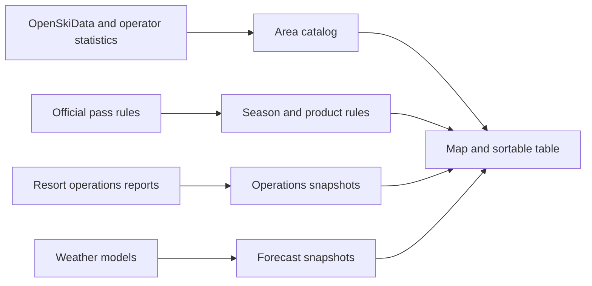

# ski-status guide

ski-status maps North American ski areas and worldwide pass destinations.
Use the comparison table for mountain statistics. Open an operator link to check current conditions.

[Find an area](#use-ski-status) · [Maintain the catalog](#catalog) · [Run tests](#local-checks) · [Publish conditions](#conditions-publication) · [Project tasks](TODO.md)

## Use ski-status

Open `/projects/ski-status/map`. The map opens in **Ski today**.
Use **Ski today** to find areas that report open or limited skiing for the local ski day.
The report count also includes areas that report closures.
Select **All resorts** to include all areas that match the other filters.

### Find an area

- Search by name, alternative name, town, state, province, country, or skiing type. Select **Clear search** to remove the search text.
- Select one or more pass buttons. An area matches if any selected pass gives included access. **Results** lists the matching passes if you select more than one. Select an active pass again to remove it. Pass filters keep the map at its current position and zoom. Select **Fit results** to zoom to the matches.
- Open **Filters**. Choose a continent, country, state, or province. Select **Include** or **Exclude**. Include California and Japan to see ski areas in either place. Exclude Europe to hide its areas. An exclusion takes priority over an inclusion.
- Remove a location from the dialog or the header. The browser saves each exclusion you add or remove. A shared link applies its own list during that visit. Edits from a shared view save only the places you change.
- Check the filter icon for the number of active filters. Select **Show results** to close the dialog. On a phone, this opens **Results** from the map.
- Select **Indy discounts** for Alpine Allied discounts and the North Cascade Heli offer. Remove other active filters from the header.
- Select a **Pass product** to check access on a **Ski date**. This date applies to the product's pass family. A blank date uses the local date at each area. For Indy Add-On, select your **Home ski area** to exclude it.
- Select a month under **Typical season in**. Open an area to see its season dates and sources.
- Select **Conventional downhill** for outdoor areas with ski lifts. This filter also includes areas that have Nordic trails. Select **Cross-country only** for Nordic centers. Select **Specialty skiing** for Nordic-only and indoor areas, among other types.

### Inspect and compare areas

- Select a marker, result, or table row to open the area details. Open **Official conditions** for the operator's report. Some areas show **Resort website and conditions**. Select **Show runs and lifts** to see the mapped terrain.
- Open **Visitor information** for trail maps, day-ticket prices, lodges, parking, shuttles, and webcams. Check the recorded season and date. Prices use local currencies. Use the source links to check current prices and access.
- Select a state, province, or country in a resort location to focus the map on that place. The view switches to the map when necessary. The search and filters stay in effect.
- Open Google Maps for a verified resort listing or visitor entrance. The map search uses the area's name, location, and ski activity. A Wikipedia link opens a verified article or ski area section.
- Check the dates in **Season and snowfall**. Open **Monthly values** to read the amounts. Select **Snow depth** when that option is available. Open **Snow sources** to check the measurement sites and periods.
- Select **Close details**. If the control that opened the panel is visible, the app returns focus to it. Press Escape on the map or select empty space to clear the selection. Use skip links to reach search, the map, or results.
- On a wide screen, the map and results appear side by side. On a phone, switch between **Map** and **Results**. Select **Compare** for the full table.
- **Results** shows each available resort icon next to its name. Choose a field to change the sort order. Each result shows its value for that field. If the value is missing, the result shows **Unknown**.
- In **Compare**, select a column header to sort. Use **Previous** and **Next** to move through pages of 50 areas. **All resorts** shows mountain statistics first. The status views show report columns first. Select **Columns** to change the fields. Select **Export CSV** to save all matches. The file uses the chosen fields and their export permissions.

Select **Share current view** beside the result count. Use the system share menu when it opens. The app can copy the link or show it in a dialog.
The link saves the search, filters, sort order, selected area, view, map position, and layers.
The browser saves units and columns.

### Map display

Pan or zoom the globe to explore. The URL updates when the map stops. Select **Search this area** to set the map area. Remove the **Map area** filter to clear it. Open a shared link to restore the map position and search area at any screen width.

The map draws one marker for each ski area at every zoom level. **Resort icons** puts each available logo on a contrasting background. Other areas use a mountain symbol. Icons stay small at globe scale and grow as you zoom in. Resort names fade in between zoom levels 7 and 9.5 where they have space. The operating status layer uses symbols and colors. A gold outline marks the selected area.

Hover over a marker to preview the area. **Skiing status unknown** means the app has no verified operating report for today. Open **Check official conditions** in the preview for the operator's report.

The map uses a verified visitor entrance when available. It can use an inferred base when the mapped lifts support that location.
Double-click a resort marker or select **Show runs and lifts** to zoom to its terrain. Select **Previous view** to restore the map position, zoom, and angle. On a phone, the map appears above the open details. The map receives keyboard focus when it loads.
The map fits countries, states, and provinces using shared geographic bounds. The continent filter matches the `CONTINENT` and `ISO_A2_EH` fields in Natural Earth v5.1.2. [Natural Earth country data](https://www.naturalearthdata.com/downloads/50m-cultural-vectors/50m-admin-0-countries-2/), [Terms of use](https://www.naturalearthdata.com/about/terms-of-use/)

Select the **Layers** icon next to **Fit results**. The panel opens next to the map controls. Layer changes apply immediately. You can pan or zoom the map while the panel is open. Press Escape or select **Close** to return focus to **Layers**.
Use **Map markers** to show resort icons, operating status, pass access, or a mountain statistic. The results show the selected metric and operating status. A gray marker in a metric layer means that the value is unknown.

Select the information icon at the bottom right of the map. It shows the source credits and data license.
Download the catalog points, base points, or terrain from this panel.

The pass layer uses brand icons for included access. A yellow **+** marks a multi-pass area. The badge gives priority to a selected pass that matches the area. Orange marks discount-only access. Gray marks unconfirmed access.

The app serves pass images with its site files. If an image fails, the map uses a colored dot. Pass controls show initials.

| Pass | Source |
| --- | --- |
| Ikon | [Ikon Pass favicon](https://www.ikonpass.com/favicon/favicon-white-32x32.png) |
| Epic | [Vail Resorts My Epic app icon](https://apps.apple.com/us/app/my-epic-skiing-snowboarding/id395375487) |
| Indy | [Indy Pass website icon](https://www.indyskipass.com/themes/custom/origin/images/favicon/apple-touch-icon.png) |
| Mountain Collective | [Cached Mountain Collective site icon](https://www.google.com/s2/favicons?domain=mountaincollective.com&sz=64) |

An acreage value such as `200+` gives a minimum. The table sorts by that minimum. If the minimum leaves more than one possible color range, the map shows a gray dot.

The globe uses the CARTO Dark Matter background. Land-use details, waterways, and water labels appear from zoom level 3. In **Layers**, turn on **Terrain relief** to see shaded slopes. The shading starts to fade in at zoom level 4. It increases up to level 13. The first view fades in after the visible tiles load. Mapterhorn supplies the elevation tiles. [CARTO Basemaps](https://docs.carto.com/faqs/carto-basemaps), [MapLibre hillshade](https://maplibre.org/maplibre-style-spec/layers/#hillshade-exaggeration), [Mapterhorn elevation tiles](https://mapterhorn.com/data-access/)

State and province lines fade in from zoom level 3. They reach 50% opacity at level 4 and full opacity at level 6. The lines draw above the terrain and snow layers.

Interstates and other major highways start to fade in near zoom level 6. They get brighter near level 9 so you can follow them over the terrain and snow layers. Route shields fade in between levels 9 and 10 where the basemap has a route number. Place and ski area labels have priority. The detailed basemap roads take over at level 12.

Turn on **Snow depth** to see NOAA estimates for the contiguous United States. The layer fades in at regional zoom. It starts to fade out when resort outlines appear at zoom level 9. It is barely visible at level 13 and disappears at level 14. NOAA uses grid cells about 1 km across. Open **Layers** for depth ranges in the selected units. [NOAA Snow Analysis](https://www.nohrsc.noaa.gov/nsa/), [Snow depth service](https://mapservices.weather.noaa.gov/raster/rest/services/snow/NOHRSC_Snow_Analysis/MapServer)

Resort footprints start to fade in at zoom level 9. Runs and lifts start at level 11. Lift stations start at level 13. Dashed gold lines show lifts. Run colors follow the local difficulty scale. Cyan marks Nordic trails. Violet marks ski touring routes. Hover or tap a run or lift to see its mapped name and type. Open **Layers** for the difficulty key and the **Ski terrain** toggle.

Mountain peaks use triangle markers. Trail-map triangles appear at zoom level 8. They grow at level 9 and get names at level 10. The basemap can supply other peaks within 10 km of a catalog ski area. These peaks use the same steps at levels 10, 11, and 12. Hover or tap a triangle to see the peak name. If the source gives an elevation, the popup shows it on a second line. It rounds the elevation to the nearest whole foot or meter in your selected units. Use **Layers → Mountain peaks** to hide the markers. [Peak records](#mountain-peaks)

Use **Results** or **Compare** during a map failure. If the background fails, select **Retry background**. If the map or its markers fail, select **Retry map**. The new map opens at the last saved position. It keeps the filters and selected area. The map receives keyboard focus after the retry.

If a shading layer fails, turn **Terrain relief** or **Snow depth** off. Turn it on again to load new tiles.

If the ski terrain fails, select **Retry ski terrain** at resort zoom. This retry keeps the map position and filters. [Terrain coverage and updates](#runs-and-lifts-at-resort-zoom)

## Catalog

On November 21, 2026, the catalog had 588 map points in 21 primary countries.
The United States had 334 points. Canada had 77. Other countries had 177.
The country filter also includes Germany through shared areas.
There were 129 areas with Ikon access and 98 with Epic access.
There were 297 areas with included Indy access and 34 with Mountain Collective access.

All 588 areas have at least one published statistic. The catalog has 527 conventional downhill areas, including areas with Nordic trails. Of these, 315 have all six main comparison fields. Mapped terrain values cover 538 areas.
There are 331 direct Wikipedia links, 12 verified Google Maps destinations, and 31 bundled resort icons. [Catalog review](../../docs/reviews/2026-11-21-ski-status-catalog-coverage.md), [Data quality batches](research/data-quality-log.md), [Icon index](data/runtime-icons.json)

| Published field | Areas |
| --- | ---: |
| Skiable acreage | 385 |
| Vertical drop | 467 |
| Lift count | 496 |
| Trail count | 507 |
| Base elevation | 423 |
| Summit elevation | 431 |
| Downhill trail length | 91 |
| Nordic trail length | 67 |
| Highest lift terminal | 56 |
| Lowest lift terminal | 25 |
| Night skiable acreage | 10 |
| Difficulty breakdown | 294 |
| Season window | 68 |
| Official conditions link | 553 |
| Planned season dates | 196 |
| Average annual snowfall | 183 |
| Average monthly snowfall | 65 |
| Monthly snow depth series | 81 |

Indy Pass profiles give acreage, elevations, and difficulty figures for individual areas. Use the operator or tourism authority when it gives a more precise area boundary. [Arctic Valley profile](https://www.indyskipass.com/our-resorts/arctic-valley), [Hohsaas area elevations](https://www.valais.ch/book/en/service-providers/saastal-ski-tickets)

| File | Use |
| --- | --- |
| [Area statistics](data/areas.json) | Resort sites, published mountain statistics, and official report links. Empty fields display as unknown. |
| [Locations and mapped terrain](data/locations.json) | Terrain points, local time zones, and mapped values from the November 16 OpenSkiData build. Each point has source links. |
| [Resort bases](data/resort-bases.json) | Visitor entrances verified against operator directions and lower lift stations matched from OpenSkiData. |
| [Resort terrain index](data/resort-terrain.json) and its [NAS archive](#local-assets) | Footprints, runs, lifts, and lift stations for 552 areas. The index records source and archive checksums and shared terrain groups. |
| [Resort peaks](data/resort-peaks.json) | Summit locations and evidence from official trail maps. |
| [Runtime icon index](data/runtime-icons.json) | File paths and SHA-256 checksums for the icons in the app. |
| [Pass memberships](data/passes-2026-27.json) | Family access for the 2026/27 season. The details show discounts and listings with unconfirmed access. Each entry links to a source. |
| [Pass products](data/pass-rules/) | Verified product rules by family, season, resort, and local date. |
| [Season dates](data/seasons.json) | Actual first and last ski days, planned dates, and published recurring windows. |
| [Snow history](data/snow-history.json) | Published annual snowfall, historical monthly snowfall totals, and snow depth. Values use centimeters and include sources. |
| [Resort links and icons](data/resort-links.json) | Verified Google Maps destinations, Wikipedia article titles and sections, and sources for bundled icons. |
| [Checked operator reports](data/conditions/operator-reports.json) | Dated operations, open terrain counts, and some named lifts and runs. |

Use the same area ID in the area, location, and pass records. Add one point per area. Add one membership per pass family.
Put the map point's country in `country`. Put other verified countries that the same area covers in `otherCountries`. Add the state or province code where applicable. [Catalog validation](../../src/features/ski-status/catalog.ts)
Use the area ID as the resort icon file name. Give each bundled icon a source. For a Google Maps destination, keep the operator directions or other source with the URL. Use the location, ski area ID, or operator site to match Wikipedia articles. If the town or mountain shares the article, link to the ski area section. [Resort links and icons](data/resort-links.json), [Wikidata ski-area identifier](https://www.wikidata.org/wiki/Property:P6400)

Use operator fact sheets, trail maps, and lift inventories. Use regional ski associations or public tourism agencies when they describe the same area. If the figures disagree, compare what each source includes. [Measurement rules](#comparable-mountain-statistics)

Record the source URL, fields, and verification date in `statSources`. List each field once. Use the note to explain conversions, calculated totals, and terrain scope.
Set `reportCheckedOn` when you verify an official conditions link. Use `exportLicense` on a field citation when its terms permit CSV export.
Use `statsUrl` for published fields without a field-specific citation. Use absolute HTTPS links without credentials. Keep the pass access source in the pass record. [Catalog validation](../../src/features/ski-status/catalog.ts)

Panorama's summit elevation covers Goldie Plateau. Its highest lift terminal covers the Summit Quad. Lutsen reports 825 feet of lift-served vertical. [Panorama mountain stats](https://www.panoramaresort.com/public/while-you-are-here/mountain-stats), [Lutsen mountain stats](https://www.lutsen.com/mountain-info/trail-map-mountain-stats)

The **Mapped** columns use OpenSkiData. **Mapped elevation span** subtracts the mapped low point from the mapped high point.
It covers 536 areas. The **Base**, **Summit**, and lift terminal columns show published elevations for those locations.
The catalog has counts for named mapped downhill runs at 484 areas and for Nordic trails at 45.
Each count uses operating routes of the given activity. Segments with the same name count once. Routes without names can contribute to the mapped distance. [OpenSkiData dataset and license](https://www.openskidata.org/#license)

### Season and snowfall

The area details label dates **Recorded**, **Scheduled**, or **Estimated**.
If only older records are available, the dates appear under **Last recorded season**.
The **Typical season** row gives the usual dates and their source. When enough completed seasons are available, it also gives the typical length in days.
In **Compare**, open **Columns** and select **Typical season length** to compare and sort the values. The month filter and comparison columns use the same typical season as the details. [Date rules](#opening-and-closing-dates)

The chart uses vertical bars that start at zero. Months run from left to right.
The ski year starts in July in the north and January in the south. The chart covers the months between the first and last measurements.
The line below the month labels marks the typical ski season. The typical dates also appear in text.
Open **Monthly values** for the amounts in the selected units. The app rounds amounts for display. A dash in the chart marks a month with no data.
Use **Snowfall** and **Snow depth** to change the measure. Each measure uses its own scale. [ONS axes and gridlines guide](https://service-manual.ons.gov.uk/data-visualisation/guidance/axes-and-gridlines), [W3C table headers guide](https://www.w3.org/WAI/tutorials/tables/two-headers/)

Monthly snowfall is the average of the monthly totals. Snow depth measures settled snow at the given location.
Open **Snow sources** for the source of each measure. Citations with the same provider, site, and period share an entry.

1. Use the same area ID in the snow history and the catalog.
2. Record snow measurements in centimeters. Use month numbers `1` to `12`.
3. Keep reported zeros. Omit a month when its value is unknown.
4. Give each series a source. Include its measurement location and period when available.
5. If the annual figure uses a different source, add an `annualSource` object. Set its `label` and HTTPS `source`. Add `location` and `period` when known. The reader also accepts an HTTPS URL in `annualSource`.

Use `survey` for snow depth surveys. Use `station` for averages of daily station readings. Use `monthly-peak` for the average of each month's maximum snow depth.

#### Snow history methods

- Copper Mountain averages October through April totals from its 2005/06 through 2024/25 seasons. Mt. Baker averages November through April totals from 11 seasons, 2015/16 through 2025/26. [Copper Mountain snowfall history](https://www.coppercolorado.com/the-mountain/mountain-safety-stats/winter-mountain-stats/), [Mt. Baker snowfall archive](https://www.mtbaker.us/the-mountain/snowfall-statistics/)
- The 28 USDA station series use at least five consecutive winters from 2015/16 through 2024/25. Each month from November through April needs at least 90% of its daily depth readings. Each winter has equal weight. The Sunshine Village snow course uses early-month measurements. [USDA Snow Survey station index](https://wcc.sc.egov.usda.gov/nwcc/yearcount?counttype=statelist), [Alberta snow survey](https://rivers.alberta.ca/Contents/SnowPack/2016/4/aprmsc.pdf)
- The NOAA daily series use 35 U.S. stations and one station near Beito, Norway. The stations are within 4.8 km of each area. Each series uses at least five consecutive winters from November through April. Use only readings that pass NOAA quality checks. Monthly snowfall needs all daily readings. Monthly depth needs at least 90% of daily readings. Each winter has equal weight. [NOAA daily data](https://www.ncei.noaa.gov/products/land-based-station/global-historical-climatology-network-daily)
- U.S. snowfall normals use the 1991–2020 period. Each month shown uses at least 20 years of readings. Match stations within 7.5 km and 200 m of the resort base or mapped low point. [U.S. Climate Normals](https://www.ncei.noaa.gov/products/land-based-station/us-climate-normals)
- The Canadian series use 1991–2020 normals from federal and Québec weather stations. New matches use a distance of up to 7.5 km and an elevation difference of up to 200 m. [Canadian Climate Normals](https://climate.weather.gc.ca/climate_normals/index_e.html), [Québec monthly normals](https://www.donneesquebec.ca/recherche/dataset/normales-climatiques-mensuelles)
- The Japan Meteorological Agency series use 1991–2020 normals for monthly snowfall totals and maximum snow depth. Each depth value is the average of that month's maxima. [Hakuba climate normals](https://www.data.jma.go.jp/stats/etrn/view/nml_amd_ym.php?prec_no=48&block_no=0396&year=&month=&day=&view=)

### Runs and lifts at resort zoom

OpenSkiMap uses OpenSkiData. OpenSkiData combines OpenStreetMap ski features with Skimap.org area records. It adds place names from Who’s On First and elevations from Mapterhorn. Ski-status builds its tiles from the downloadable data under ODbL. [OpenSkiData source and license](https://www.openskidata.org/#license)

The November 16, 2026 snapshot covers 552 catalog areas. It contains 422 footprints, 41,895 run features, 5,680 lift features, and 7,286 lift stations. A run feature can be one trail segment. Catalog entries for a shared ski area can use the same geometry. Use the operator report to check current openings. [OpenSkiData datasets](https://www.openskidata.org/#whats-in-the-data)

1. Download the GeoPackage and its `metadata.json` from the same build. [OpenSkiData downloads](https://www.openskidata.org/#downloads)
2. Install the Python bindings for GDAL and the Tippecanoe command. [Tippecanoe](https://github.com/felt/tippecanoe)
3. Run the importer.

   ```bash
   python3 projects/ski-status/scripts/build-resort-terrain.py path/to/openskidata.gpkg path/to/metadata.json
   ```

4. Review missing and shared area matches. Review changes to base points.
5. Update the browser terrain fixture if the Heavenly or Lake Louise groups change. Run the archive tests. [Terrain fixture](#terrain-fixture)
6. Keep the full PMTiles file on the NAS. Commit the index, bases, and any changes to `locations.json` together.

The importer checks the file size, layer names, feature counts, and build times. It matches each area by source ID or by a footprint that fits its location and activity.
The tiles assign only Nordic trails to cross-country areas. They assign only ski touring routes to ski touring areas.
The importer keeps verified entrances for areas in the current catalog. It considers mapped bottom stations near operating lifts.
It counts only the lower terminal when the two elevations differ by at least 5 m. It can consider both ends of a flat lift.
The inferred base requires a lift cluster, or one qualifying lift at a single-lift area.
The importer updates named route counts when the location file uses the same build.

The importer builds files in a temporary directory. It verifies the archive before it updates the index.
It saves each archive in a NAS folder with its checksum as the folder name.
If a file replacement fails, the importer restores the previous JSON files.
The `data/resort-terrain.pid.lock` file prevents simultaneous builds.
If a build leaves this file, verify that the process has stopped. Then, remove the file.

### Mountain peaks

Check the operator's trail map for named summits in and near the ski area. Use a geographic names office or a topographic map to verify each summit location. Use the name on the trail map when it identifies the summit. Match any difference in names before you add a point.

Add one record per summit to `data/resort-peaks.json`. Give the point as longitude and latitude. Record `locationSource` and the check date in `checkedOn`. Add the direct operator map URL and the area ID to `trailMaps`. If more than one ski area shows the same summit, add each area to that list. Set `elevationFt` when a source gives the summit elevation. Give the URL in `elevationSource` if a separate source gives that value. Use the location of the summit for the point. Lift stations and trail endpoints have their own terrain records. [Peak data](data/resort-peaks.json), [Data checks](../../src/test/skiStatusResortData.test.ts)

### Local assets

The ski-status asset folder is `N:\projects\ski-status\assets` on Windows. On WSL, Vite uses `/mnt/n/projects/ski-status/assets`.
Connect to the share in Windows. If WSL cannot see the drive, mount it from an Ubuntu shell.

```bash
sudo mount -t drvfs N: /mnt/n
```

If you use a different path, set `SKI_ASSETS_ROOT` in `.env.local`. Restart Vite.
Set the same variable in the shell before you run the archive tests or the terrain importer.
The importer also accepts `--assets-root`.

- `runtime/pass-icons/` and `runtime/resort-icons/` hold the release icons. Update the checksum in `data/runtime-icons.json` when you change an icon. Keep the source in the catalog or pass documentation.
- `runtime/terrain/<checksum>/resort-terrain.pmtiles` holds the archive named in the terrain index. Vite sends the byte ranges that the map requests.
- `trail-maps/` and `resort-icons/` hold research copies. Open Vite on localhost to use these copies.
  Vite lists available files from the batch manifests. The app uses the icon previews and links to matching NAS trail maps.
  Vite verifies the manifest's byte count and streams the file to check its SHA-256 checksum.
  It reuses a verified checksum while the file's size, identity, and timestamps stay the same.
  When a file changes, give the new copy a different path and record it in the next manifest.
  Refresh the page after a batch saves a new manifest.

### Release assets

Vite packages the runtime files in the icon and terrain indexes.
Each URL includes the file's SHA-256 checksum. The browser loads the files from the same origin as the site.

1. Build the candidate revision on a machine with the NAS. Use `npm run build`.
2. Copy the files from `dist/data/ski-status/assets/runtime/` to the mirror's `runtime/` folder.
   Keep earlier checksum folders so you can rebuild earlier revisions.
3. Set `SKI_ASSETS_BASE_URL` to the HTTPS folder that contains `runtime/`. Use a URL without credentials, a query, or a fragment.
   Set this variable in the Amplify app environment. [Preview validation](../../docs/release-validation.md#ski-status-build-assets)
4. Run the release checks on the preview. Confirm its revision and Amplify job. [Release checks](#release-checks)

Vite reads the local files first. It reads missing files from the mirror.
The build reads up to 1 MiB per icon and 64 MiB for the terrain archive. These limits apply to both sources.
A missing file, a file that exceeds its limit, or a checksum error stops the build.

### Ikon destinations

The catalog covers the 26/27 Ikon destination list, including Europe, Asia, Oceania, and Chile. It uses separate points for the three NZSki areas, the three Grandvalira areas, and the five Valle d’Aosta areas. Each of the 12 Dolomiti Superski regions has one point. Search by group name, such as **Dolomiti Superski** or **SkiBig3**, to find its areas. The pass links give shared limits and product rules. [Ikon destination map](https://www.ikonpass.com/en/destinations), [Ikon access comparison](https://www.ikonpass.com/en/compare-benefits)

Ischgl / Samnaun, Galtür, Kappl, and See share seven days on the Ikon Pass or five days on the Ikon Base Pass. The date filter uses each area's published winter schedule. [Ikon access at Ischgl](https://www.ikonpass.com/en/destinations/ischgl), [Ischgl / Samnaun schedule](https://www.ischgl.com/en/winter/operating-times-prices/ski-network-tickets/ikon-pass), [Galtür schedule](https://www.galtuer.com/en/bergbahnen-galtuer/winter/ski-pass-prices-silvapark), [Kappl and See schedule](https://www.see.at/en/winter/operating-times-prices/skipass-prices-see-kappl)

### Epic destinations

The catalog covers the 26/27 Epic Pass list. It includes 44 North American areas and 54 areas in Europe, Japan, and Australia. The map has a pin for each of the 36 named European partners. Brides-les-Bains uses the Olympe gondola base. Search by group name to see its ski areas. For example, **Hakuba Valley** finds ten areas in Japan. [Epic Pass list](https://www.epicpass.com/pass-results/college.aspx), [European partners](https://www.epicpass.com/regions/europe.aspx), [Hakuba Valley](https://www.epicpass.com/regions/japan/hakuba-valley.aspx)

The three Australian resorts have access in the 2027 winter season. Select **Epic** in an area's details to read the current terms. Partners can share a day limit. Ski Arlberg also requires a stay booked directly with a lodging partner. [Australia access](https://www.epicpass.com/regions/australia.aspx), [Ski Arlberg access](https://www.epicpass.com/regions/europe/austria/ski-arlberg.aspx)

### Indy destinations

The catalog covers all 302 cards from the November 19 roster, plus the Gore Mountain Nordic Center. It includes 69 destinations outside the United States and Canada. The 303 records have 297 included memberships, five discounts, and one roster listing for Eagle Point, which is closed for 2026/27. [Indy resort roster](https://www.indyskipass.com/our-resorts), [Indy November additions](https://www.indyskipass.com/this-is-indy/news/whiteface-gore-and-belleayre-join-allied-program-as-indy-pass-announces-15-additional-resorts-for), [Eagle Point season closure](https://www.eaglepointresort.com/eagle-point-resort-announces-2026-27-winter-season-closure-following-cottonwood-fire/)

Gore has a pin for downhill discounts and a separate pin for included Nordic access. Manning Park also has separate downhill and Nordic pins. Use the group link for shared day limits and redemption rules. Portes du Soleil appears under France and Switzerland. Oberstdorf Kleinwalsertal and Steinplatte appear under Austria and Germany. Each group has one representative pin. [Innsbruck access](https://www.indyskipass.com/our-resorts/innsbruck-region), [Portes du Soleil access](https://www.indyskipass.com/our-resorts/portes-du-soleil), [Oberstdorf and Kleinwalsertal ski areas](https://www.ok-bergbahnen.com/en/skigebiete/), [Steinplatte ski area](https://www.steinplatte.tirol/en/steinplatte-winklmoosalm-ski-area-in-winter.html)

The catalog uses the published roster figures for vertical drop, lifts, trail count, night skiing, and terrain parks. Use the operator's figures when the operator gives a more precise value for the same area. Leave fields empty when the source gives no comparable figure. The **Skiing** and **Night skiing** columns describe the venue. Open the pass link to check which activities and sessions it covers. [Indy access rules](https://www.indyskipass.com/this-is-indy/how-it-works), [North Cascade Heli discount](https://www.indyskipass.com/our-resorts/north-cascade-heli), [Stoke Mountain profile](https://www.indyskipass.com/our-resorts/stoke-mountain)

## Local checks

Install the repository dependencies. Run `npm run dev` to start Vite. Open `/projects/ski-status/map` on the local server.
If the trip media path is unavailable, start Vite directly for ski-status.

```bash
npx vite --host 127.0.0.1
```

Run the project tests with V8 coverage. Use the same source paths for each comparison.

```bash
npm run test:coverage -- ski \
  --coverage.include='src/features/ski-status/**' \
  --coverage.include='scripts/ski-*.ts' \
  --coverage.include='shared/ski*.ts'
```

Run the repository suite for the shared search, report collectors, and release checks.
The suite includes Python tests for the terrain importer and candidate review.
The Python tests run without GDAL or Tippecanoe.

```bash
npm test
```

Run the browser tests for filters, resort reports, and map behavior.
The tests check downloads, terrain byte ranges, and report age.

```bash
npm run test:e2e -- tests/e2e/ski-status.spec.ts --project=chromium
```

### Terrain fixture

The browser tests use sample icons and a terrain fixture when the NAS is unavailable.
The NAS check uses the full archive. It verifies the checksum and opens the Heavenly tooltips.
The fixture contains only Heavenly and Lake Louise geometry from OpenSkiData. It keeps the source credits and ODbL license. [OpenSkiData license](https://www.openskidata.org/#license)

If either area's terrain group changes, run these commands from the repository root. Use Tippecanoe's `tile-join`.

```bash
asset_root="${SKI_ASSETS_ROOT:-/mnt/n/projects/ski-status/assets}"
index='./projects/ski-status/data/resort-terrain.json'
checksum=$(node -p 'require(process.argv[1]).archiveSha256' "$index")
filter=$(node -p 'const { groupsByArea } = require(process.argv[1]); JSON.stringify({ "*": ["in", "group", ...groupsByArea.heavenly, ...groupsByArea["lake-louise"]] })' "$index")
tile-join --force --no-tile-size-limit --feature-filter="$filter" \
  --output=tests/fixtures/ski-status/terrain.pmtiles \
  "$asset_root/runtime/terrain/$checksum/resort-terrain.pmtiles"
```

### Lighthouse

The November 20, 2026 checks used Lighthouse 13.6.0. The previews used `vite build --mode test` and the live CARTO basemap. The checks used the default mobile settings and the desktop preset.
Open the globe at `/projects/ski-status/map`. Open all resorts in Compare at `/projects/ski-status/map?view=table`.

| View | Performance before | Performance after | Total blocking time before | Total blocking time after |
| --- | ---: | ---: | ---: | ---: |
| Compare on mobile | 66 | 73 | 8,457 ms | 1,731 ms |
| Globe on mobile | 66 | 67 | 9,132 ms | 7,891 ms |
| Globe on desktop | 65 | 67 | 2,853 ms | 1,823 ms |

Compare rendered 2,009 elements on the first page, down from 50,356. Opening Compare directly skips the MapLibre download. The globe sets its projection and initial camera before drawing. It limits the canvas pixel ratio to 1.5. Chromium with Moto G4 emulation measured a drop from 3.83 seconds to 2.52 seconds for the basemap and markers to become usable.

Accessibility and SEO scored 100 in all six audits. Best Practices scored 96 in each run while the hosted conditions manifest returned HTTP 403. Lighthouse’s largest paint on the globe page measures visible text in the interface. [Lighthouse performance scoring](https://developer.chrome.com/docs/lighthouse/performance/performance-scoring/)

## First release

Include active public conventional downhill areas in North America with at least 100 published skiable acres. Include official pass destinations. Add specialty venues when an operator or managing organization documents the activity. Record the access type for each pass. Keep eligible areas in the catalog during the off-season. [Ikon destination map](https://www.ikonpass.com/en/destinations), [Epic Pass list](https://www.epicpass.com/pass-results/college.aspx), [Indy resort roster](https://www.indyskipass.com/our-resorts)

Whaleback has 86 skiable acres and qualifies through Indy lift access. Use skiable acreage for the threshold. Resort property acreage can include lodging and terrain outside the ski area. [Indy Whaleback profile](https://www.indyskipass.com/our-resorts/whaleback-mountain), [Monterreal property description](https://www.monterreal.com/)

### Map and table

Pass product and ski date filters use the area's local date. Current operating status requires a fresh report for that local ski day. Gray markers represent stale, unverified, or missing reports. The resort panel identifies those states in words.

Keep measured snow and forecast snow in separate columns. Compare each field in common units. Put unknown values last in both sort directions.
Group columns by mountain statistics, conditions, and season dates. Save column settings on the device.
CSV uses the current comparison filters, sort order, units, and column choices. The file includes report times, source links, and license credits.
Export includes area identity, OpenSkiData values, and fields with verified export permission. A field can appear for some areas and be blank for others. [Release tasks](TODO.md)

### Comparable mountain statistics

| Field | Definition |
| --- | --- |
| Area identity | Store the official name, website, ID, region, and country. Keep former names for search. Put the point near a base, trailhead, or visitor entrance. |
| Skiable acres | Use the operator's published skiable area. Record which mountains or terrain the figure covers. |
| Guided terrain | Use the published area of the terrain that the heli-ski or cat-ski operator serves. Record it in **Guided terrain**. |
| Lifts | Use the operator's total for the same area. Include surface lifts. |
| Elevation and vertical | Store lift terminal elevations in their own fields. Use the operator's published skiable vertical. If you calculate vertical, use elevations from the same skiable descent. Give the calculation in the source note. |
| Trails | Store the total and the number for each published grade. Keep the original basis for percentages such as trail count or terrain area. |
| Trail length | Record downhill and Nordic trail lengths in separate fields. Use `nordicKmQualifier` for a published minimum. The app shows that minimum with `+`. |
| Night skiing | Store yes, no, or unknown. Show night skiable acres when the operator publishes them. Keep a published lower bound, such as `200+` acres. Track scheduled night operations in the conditions report. |
| Season window | Use the operator's published season window. Use **Year-round** for areas with lift access in all seasons. |

Store area in acres. Store elevation in feet. Store trail length in kilometers. Give the original unit in the source note for converted values. The table uses the selected display units. [Big SNOW specifications](https://www.bigsnowamericandream.com/press-room/), [Palisades Tahoe mountain statistics and season windows](https://www.palisadestahoe.com/footer/mountain-statistics)

Check the base, summit, and vertical together. If a source defines vertical for a particular descent, give that scope in the source note.
The catalog rejects equal base and summit elevations for areas with a positive vertical drop. [Catalog validation](../../src/features/ski-status/catalog.ts)

Pomerelle's operator gives an 8,762 ft summit and a 1,002 ft vertical drop. The catalog calculates a 7,760 ft base from those values.
Pizol publishes a 1,718 m vertical between Pizolhütte and Wangs. The connecting lift reaches 2,250 m. [Pomerelle mountain data](https://www.pomerelle.com/the-mountain), [Pizol mountain data](https://pizol.com/en/company/company/)

Hohsaas uses the published 1,640 m descent from 3,200 m at Hohsaas to 1,560 m at Saas-Grund. Ober Mountain uses the operator's 500 ft ski-area figure and the 2,682 ft base and 3,208 ft ski slope elevations on its map. [Hohsaas descent](https://www.myswitzerland.com/en-gb/experiences/hohsaas-ski-run/), [Ober slope report](https://www.obergatlinburg.com/slope-report), [Ober mountain map](https://www.obermountain.com/wp-content/uploads/2024/01/23Winter_brochure_web.pdf)

Amihari Onsen's current course description places the Todomatsu start at 1,234 m. That point is 484 m above the catalog's published base. The earlier 600 m vertical had unverified endpoints. The vertical field is pending confirmation of a lift-served descent. [Amihari course descriptions](https://www.qkamura.or.jp/iwate/ski/)

## Inventory and data quality

### Recurring data batches

Open a Codex session at the repository root. Use the prompt below to verify one batch. Check the batch log for completed work and follow-up checks. [Data quality skill](.agents/skills/ski-status-data-quality/SKILL.md), [Batch log](research/data-quality-log.md)

Start with the largest downhill ski areas by published skiable acreage. Finish the checks for each area before you move to a smaller area. Include winter highway approaches and mountain passes in each resort review. [Batch order](.agents/skills/ski-status-data-quality/SKILL.md#choose-a-batch), [Road approaches](.agents/skills/ski-status-data-quality/SKILL.md#road-approaches)

Use a separate access file for each local ski season. Vite checks the files and uses the latest record for each area.
The site includes the fields that **Visitor information** displays. Research notes stay in the repository.
The panel shows map editions when the source gives them. Camera links open the published image, player, or operator page. [2026/27 resort access](research/resort-access-2026-27.json), [2026 resort access](research/resort-access-2026.json)

On November 21, 2026, seasonal access records included lodge or day facility details for 153 resorts.
There are 65 checked resort map points. These points include both entrances and lift bases.
There are 141 resorts with parking records and 146 with official trail maps.
There are 88 resorts with adult day prices or price bounds. There are 112 with operator cameras. [Batch coverage](research/data-quality-log.md)

```text
Follow projects/ski-status/.agents/skills/ski-status-data-quality/SKILL.md.
Complete one batch of up to 10 resorts in acreage order.
Apply verified changes. Run the checks and save the checkpoint.
Finish with the NAS asset archive and run summary.
```

Use a Goal for an initial sweep that continues across batches. [Codex Goals](https://developers.openai.com/cookbook/examples/codex/using_goals_in_codex)

```text
/goal Follow projects/ski-status/.agents/skills/ski-status-data-quality/SKILL.md.
Review the next 30 resorts in acreage order. Use batches of up to 10.
Validate each batch and save its checkpoint before you start the next batch.
Stop if no more cases are due. Save the NAS archive and report the results.
```

For regular maintenance, review a manual run before you schedule the one-batch prompt. Use a dedicated checkout with the skill, the data files, and the research log. Run one batch at a time. Keep the machine and desktop app running for local project access. [Scheduled tasks](https://learn.chatgpt.com/docs/automations?surface=app)

### OpenSkiData audit

The November 19 download contained 12,440 world records. The audit selected named rows with `has_downhill=yes` and `status=operating`. The matching metadata reports a November 16 UTC build. Website counts indicate a populated source field. Lift counts indicate at least one mapped lift. [Ski-area CSV](https://tiles.openskimap.org/csv/ski_areas.csv), [Build metadata](https://tiles.openskimap.org/metadata.json)

| Geography | Candidate rows | Website present | Mapped lifts | Mapped elevation range |
| --- | ---: | ---: | ---: | ---: |
| United States | 571 | 529 | 511 | 526 |
| Canada | 273 | 239 | 235 | 257 |
| Mexico | 1 | 1 | 1 | 1 |
| Greenland | 3 | 2 | 3 | 3 |
| **Total** | **848** | **771** | **750** | **787** |

The audit counts candidates before the acreage and pass checks. A named row can describe one base area. Verify the acreage and elevations with the operator. The CSV shows 3–4 m of elevation for indoor Big SNOW. The operator reports 160 ft of vertical and four skiable acres. [OpenSkiData schema](https://www.openskidata.org/#schema), [Big SNOW specifications](https://www.bigsnowamericandream.com/press-room/)

The CSV has SHA-256 `9c5a372b8d02aedd281fd387c581c16f48915d89abacec7eba0faa53726a9df5`.

The November 20 review recorded an initial decision for each candidate. As of November 21, 459 of 848 candidates remain unresolved, including 25 in Ontario. Filter the review log by region and decision. Review Mexico and Greenland in their own groups. [Candidate review log](research/north-america-2026-11-16.csv), [Regional counts](research/north-america-2026-11-16-summary.csv)

Use the same CSV for the mapped terrain values and the existing points. Match one operating row by its upstream source URL and coordinates. Check that the row covers the ski area. Leave the field empty when one row combines multiple areas that the catalog lists on their own. Use the downhill and Nordic lengths that apply to the venue. Keep the terrain source URL in `mappedTerrain`. [OpenSkiData statistics and source IDs](https://www.openskidata.org/#whats-in-the-data)

### Build the catalog

1. Import names, points, source IDs, and candidate websites from a versioned OpenSkiData file. Use regional directories to find missing areas. Check directory terms before you collect source data. [OpenSkiData downloads](https://www.openskidata.org/#downloads), [NSAA inventory by state](https://nsaa.org/NSAA/About/Media/Industry_Stats/NSAA/About/Media/Industry_Stats.aspx), [Canadian Ski Council directory](https://www.skicanada.org/ski-area-list/), [Québec ski area directory](https://maneige.ski/en/stations-et-conditions/)
2. Match by source ID or a verified name and location. Assign a stable local ID for links, reports, and visits. OpenSkiData feature IDs can change between builds. [OpenSkiData feature IDs](https://www.openskidata.org/#whats-in-the-data)
3. Review uncertain matches. Group bases when the operator publishes combined statistics. Palisades Tahoe publishes combined resort statistics. Keep independently operated areas separate if they share a pass allowance. [Palisades Tahoe statistics](https://www.palisadestahoe.com/footer/mountain-statistics), [Ikon access comparison](https://www.ikonpass.com/en/compare-benefits)
4. Verify eligibility with operator acreage, an official pass listing, or a source for the specialty venue. Record the upstream reference, decision, reason, source, and date. Give each unresolved case a next check. Check for duplicate, closed, and private areas before release. [Indy Pass website terms](https://www.indyskipass.com/website-terms-of-use)
5. Add operator statistics for each eligible area. Record the source, date, and scope of each figure. Use map data to check large differences. Verify the figure with the operator before changing the record. [OpenSkiData data definitions](https://www.openskidata.org/#whats-in-the-data)
6. Reconcile the decision counts with all candidates in each region. Compare field counts before and after each update. Check official conditions links for a current report or off-season status.

## Pass access by product and date

Create a reviewed file for each season and pass family. Record the product, area, access type, valid dates, and day allowance. Record shared allowances, blackout dates, and reservation rules. Include consecutive-day and weekday restrictions when they apply. Keep the source and verification date on each rule. Keep rules for past seasons.

| Program | Launch products and rules to verify |
| --- | --- |
| Ikon | Ikon, Base, and Session variants. Alta and Snowbird share Ikon days, with Snowbird access under Base. Store each partner's reservation and access rules. [Ikon 2026/27 comparison](https://www.ikonpass.com/en/compare-benefits) |
| Epic | Epic, Epic Local, and Day Pass variants by duration, resort tier, and peak-date option. The 4–7 day All Resorts products can include Canadian Rockies partners. Verify specialty products before adding their filters. [Epic products](https://www.epicpass.com/), [Epic partner rules](https://www.epicpass.com/regions/partner-resorts.aspx), [Peak dates](https://www.epicpass.com/info/peak-restricted-dates.aspx) |
| Indy | Base, Indy+, and Add-On variants. Track excluded dates and reservations by area. Record Allied discounts separately from included ski days. [Indy products](https://www.indyskipass.com/shop), [Blackouts and reservations](https://www.indyskipass.com/blackout-dates-reservations) |
| Mountain Collective | Included days, any published bonus days, and advance reservations where required. [Pass terms](https://mountaincollective.com/), [Destination reservation rules](https://mountaincollective.com/how-to-use-my-pass/) |

The family filter shows included partners for the season. The product filter uses verified rules and the resort's local ski date.
Season dates select the rules that apply during a winter season. Apply exact resort access windows where the pass operator publishes them.
Use the resort details to check the published allowance and reservation requirements. Check reservation availability on the operator's site.
Time zones come from the catalog point. [Coordinate to time zone lookup](https://github.com/photostructure/tz-lookup)

Epic Day Pass offers one to seven shared days in each of the three resort tiers. The 22-resort tier includes ten Midwest areas, eight Pennsylvania areas, and four New Hampshire areas. The 32-resort tier adds ten areas in Colorado, California, Washington, Vermont, and New York. The Restricted options apply November 27–28, December 26–31, January 16, and February 13–14. [Epic Day Pass configurator](https://www.epicpass.com/passes/epic-day-pass.aspx), [Epic peak dates](https://www.epicpass.com/info/peak-restricted-dates.aspx)

All Resorts includes Andermatt–Sedrun–Disentis and Crans-Montana at every duration. Four to seven days also include Telluride and the six Resorts of the Canadian Rockies. Telluride accepts the physical pass card at the lift. Matching Midwest bonus days apply to All Resorts at Afton Alps, Mt. Brighton, and Wilmot. [Andermatt access](https://www.andermatt-sedrun-disentis.ch/en/stories/epic-pass-general), [Crans-Montana access](https://epicpass.zendesk.com/hc/en-us/articles/25359856291227-Does-my-Pass-have-access-to-Crans-Montana), [Telluride terms](https://www.epicpass.com/regions/us/rockies/telluride.aspx), [Epic Midwest bonus days](https://epicpass.zendesk.com/hc/en-us/articles/4412221543451-Does-the-Epic-Day-Pass-include-bonus-days-at-Wilmot-Mt-Brighton-and-Afton-Alps)

The Ikon Pass includes two separate days at each of 14 Bonus Mountains. Their blackouts are December 26–30, January 16–17, and February 13–14. The details give ticket-window or direct-to-lift instructions. Standard Ikon lift reservations are required at Deer Valley, Jackson Hole, and Loon for products with access. [Bonus Mountain terms](https://www.ikonpass.com/en/bonus-mountain-program), [Ikon reservation rules](https://www.ikonpass.com/en/how-to-use-your-ikon-pass)

Indy Add-On access requires verification of an unrestricted home season pass. Select a home area to apply the exclusion. The app shows the requirement in the pass terms. [Indy Add-On rules](https://www.indyskipass.com/this-is-indy/how-it-works)

64 Indy areas have verified product rules, including 59 with rules for all four products. Cannon, Pats Peak, and Red Lodge publish dated Base blackouts. Cannon recommends advance reservations. Pats Peak requires advance reservations. Mt. Hood Meadows, Ragged Mountain, and St. Johann have verified Indy+ terms. [2026/27 Indy rules](data/pass-rules/indy-2026-27.json), [Cannon Indy terms](https://www.cannonmt.com/indy-pass), [Pats Peak Indy terms](https://www.patspeak.com/plan-your-visit/planning-tools/indy-pass/), [Red Lodge pass terms](https://www.redlodgemountain.com/season-passes/), [Mt. Hood Meadows Indy terms](https://www.skihood.com/explore/indy-pass), [Ragged tickets](https://www.raggedmountainresort.com/all-tickets/), [St. Johann Indy terms](https://www.bergbahnen-stjohann.at/en/indy-pass-skiing-in-st-johann-in-tirol.html)

Ski Arlberg requires a direct booking with a lodging partner. The app shows this requirement with the shared three-day allowance. [Ski Arlberg pass terms](https://www.epicpass.com/regions/europe/austria/ski-arlberg.aspx)

Review the pass lists at the start of each season. Check for changes each week. Confirm each change with the pass operator. Keep pending changes visible until the review completes.

## Current conditions

### Operating status and terrain

Use **Open for skiing** to find areas with a current open or limited report. **Closed** includes temporary and seasonal closures.
Some operators report the day's operations before the lifts start. Use the operator's link to check hours and changes.
The table uses totals from the same report as the open counts. It labels stale counts and percentages. It also labels values with an unknown age. Opening hours and night operations use the same age labels.

Open **Reported lifts and trails** in the area details to see the rows. The list starts with the items that the source reports as open.
The collector reads public CC0 lift and trail records for all 12 Dolomiti Superski regions. Alta Badia, Val Gardena / Alpe di Siusi, 3 Zinnen Dolomites, and Kronplatz also have matching regional summary feeds.
These records have their own dates and times. A named record becomes stale at the end of its local ski day or after 24 hours. Untimed records use the age of the resort report. The full area counts keep their own source and scope. Regions with only named records show an unknown overall status. [Open Data Hub lift dataset](https://databrowser.opendatahub.com/dataset-overview/ad42b408-e5eb-412b-8b0a-f7e8e9dab2b7), [Content API metadata](https://docs.opendatahub.com/use-data/content-api/reference/)

On November 20, 2026, five of the six checked areas reported limited skiing. Telluride reported zero open runs before its December 5 planned opening.
Each checked report expires at the end of its local ski day. Alberta uses UTC−06:00 from November 1, 2026. [Checked reports and sources](data/conditions/operator-reports.json), [Alberta Time](https://www.alberta.ca/albertas-new-time-system-abt), [Telluride schedule](https://tellurideskiresort.com/ski/)

### Opening and closing dates

The season file has 187 records of actual dates for 53 areas. It has plans for 196 areas. 29 records include terrain or conditions from opening day. For 2026/27, 29 areas have recorded first ski days and 193 have at least one scheduled date. [Season dates and sources](data/seasons.json)

Use operator records or reports to confirm the first and last lift-served ski days. Record the confirmed dates. Leave an unconfirmed date empty. Record passholder previews and breaks in daily operation. [Blue Mountain Ontario records](https://www.bluemountain.ca/mountain/opening-day), [SkiBig3 season recap](https://www.skibig3.com/blog/23-24-ski-big3-season-recap-shredding-through-the-highlights/), [Killington records](https://killington.com/hours), [Loveland records](https://skiloveland.com/openingclosingdates/), [Alta recap](https://www.alta.com/stories/2024-25-season-recap), [Peak Resorts 2019 filing](https://www.sec.gov/Archives/edgar/data/1517401/000155837019005982/skis-20190430x10k.htm)

Use `closingSource` when a different operator page gives the closing date. Use the same rule for planned dates.

The app uses up to five complete seasons from the five years before the check date. It calculates the median opening date and the median closing date.
It counts the calendar days from the first through the last ski day of each season. It shows the median of those counts, rounded to the nearest whole day. The count includes any breaks in operation between those dates.
With fewer than three complete seasons, the length is unknown. The app uses the operator's usual season window for typical dates when available.
The window can come from the season calendar or from the operator's month range in the catalog.
The month filter includes the first and last months of that window. Those months can include limited or weekend-only skiing.

The app shows remaining planned dates in the area's time zone. A recorded opening clears the opening plan for that season. A recorded closing removes its remaining plan.
A current operator report can give a new planned opening date. The app pairs it with a planned closing only if both dates fit the same season.
The details and comparison table use the same plan. CSV export includes the reported opening only when the operator permits export.

Opening-day figures apply to the day in the record. Use daily records to compare how much terrain usually opens later in the season. [Season calendar design](#season-conditions-calendar)

### Sources and pilot

| Source | What it can supply | How to use it |
| --- | --- | --- |
| Resort reports | Operating status, lifts, trails, acres, base depth, measured snowfall, and night operations. Whistler has separate pages for snow and terrain. | Start with operator links. Add feeds from sources that permit reuse. [Killington mountain report](https://killington.com/mountain-report), [Whistler snow report](https://www.whistlerblackcomb.com/the-mountain/mountain-conditions/snow-and-weather-report), [Whistler lift and terrain status](https://www.whistlerblackcomb.com/the-mountain/mountain-conditions/terrain-and-lift-status.aspx) |
| Open-Meteo | Weather estimates and forecasts for temperature, wind, precipitation probability, snowfall, and freezing level. | Use one named base location per area in the pilot. Show the forecast period and location or elevation. Show the model time when available. [Forecast API](https://open-meteo.com/en/docs), [Noncommercial access](https://open-meteo.com/en/pricing) |
| SnoCountry | Resort and regional feeds with counts of open lifts, trails, and acres where available. | Evaluate the feed if operator reports leave large gaps. The full feed requires a paid key. Verify coverage and terms before use. [SnoCountry API](https://feeds.snocountry.net/) |
| Mountain News and Skiresort Service | Paid resort and mountain data feeds. Mountain News includes report times and fields that resorts supply. | Compare the resort list and field coverage before using a paid feed. [Mountain News partner API](https://partner.docs.onthesnow.com/api-reference/ski-resort-snowreport-api), [Skiresort Service product description](https://www.skiresort-service.com/fileadmin/user_upload/skiresort-service/content/engl/Skiresort-access-snow-reports-ski-resort-data-ski-weather.pdf) |

On November 19, the SnoCountry demo returned Bolton Valley, Bromley, and Burke. Each report had a time and an opening status. Base depth, recent snowfall, and open lift, trail, and acre counts were empty. Measure field coverage and report age during winter operation. [SnoCountry public example and field definitions](https://feeds.snocountry.net/)

The collector covers Mammoth Mountain, Lake Louise, and all 12 Dolomiti Superski regions. Open-Meteo supplies one named forecast point per area. The Open Data Hub requests use the ski-status URL as their referrer. [Lake Louise base coordinates](https://publications.gc.ca/collections/collection_2025/pc/R64-571-2024-eng.pdf), [Open-Meteo forecast API](https://open-meteo.com/en/docs), [Open Data Hub request quotas](https://docs.opendatahub.com/use-data/authentication-and-access/quotas-and-tools/)

Mammoth Mountain publishes its report through Report Pal. The collector uses the feed for Main, Canyon, and Eagle lodges. It counts the alpine lift and trail records and stores their names and status. When available, it also stores lift type, trail difficulty, grooming, and snowmaking. The feed can list trail segments separately. The fact sheet counts named trails. [Report Pal feed directory](https://postman.resorts-interactive.com/), [Mammoth Mountain report](https://www.mammothmountain.com/on-the-mountain/mountain-report#lifts-and-trails), [Mammoth fact sheet](https://www.mammothmountain.com/-/media/project/mammoth/library/pdfs/Fact-Sheets/26-27_Marketing_MMSA_Fact-Sheets_85x11)

The Mammoth report supplies snow by location and the daily operator forecast. The collector uses the base location for the summary. It keeps reported zeros and leaves blank readings empty. It uses the report time for age and the local ski day. The lift and trail counts can be visible when the resort status is unknown. The app excludes Mammoth report data from CSV export. [Mammoth feed](https://reportpal-cdn.resorts-interactive.com/mtnxml/525)

The Lake Louise XML lists daily operations and named terrain. The collector compares the open counts with the named records. It uses the verified local ski day for the operations report. Snow and temperature keep their measurement dates. The XML generation time changes on each request. The report has a ski date with no exact report age. The app marks Lake Louise data as display-only. [Lake Louise feed](https://api.skilouise.com/docs/MTN-XML.php), [Snow report method](https://www.skilouise.com/things-to-do/how-we-report-snowfall-mountain-conditions/)

The local Rockies pilot covers Lake Louise, Banff Sunshine, and Mt. Norquay. It stores numeric counts and the report time.
Use the operator's conditions page to check the counts during a feed outage. [Rockies spot checks](../../docs/reviews/2026-11-21-ski-status-engineering-review.md#rockies-spot-checks)

The collector accepts up to 4 MiB per JSON response and 256 KiB per XML response. It rejects redirects and invalid UTF-8. The XML reader also rejects document types. The SkiBig3 reader requires one value for each count and an exact report time.

Open Data Hub and LTS supply the Dolomiti Superski resort counts and snow data. The collector can update named terrain during a failure of the resort report. The app uses gray markers when the resort report has no verified time or ski day. [Open Data Hub dataset](https://databrowser.opendatahub.com/dataset-overview/f15d894a-b77f-43cf-a802-e1590fc38068), [Pilot measurements](../../docs/reviews/2026-11-20-ski-status-first-release-work.md#conditions-pilot)

### Report and forecast rules

- Store operating status with each report. Use open, limited, temporarily closed, season closed, or unknown. Store hours and planned opening dates when the operator publishes them.
- Show open and total lifts, trails, and acres when the operator reports them. Calculate percentages from counts with the same scope and time.
- Keep the snow depth unit, range, and measurement location. Show the reporting period for new snow. Show forecast snow in its own column. Show reported zeros as zero.
- Store the source report time and the retrieval time. Calculate age from the source report time. Check that the report date matches the timestamp in the resort time zone. Collect a date-only report during its local ski day. Set its deadline within that day.
- Keep an observed temperature with the station and measurement time. Show this reading separately from the forecast.
- Mark pilot reports older than 24 hours as stale. Expire the daily status when the local ski day ends. Apply the provider deadline if it comes first.
- Keep the last report and its date visible when a refresh fails. Use gray markers for stale or unverified reports in the operating status layer.
- Show base forecasts for the next 24 hours of complete hourly data. Sum snowfall over the period. Show the highest hourly precipitation probability. Use a forecast from its retrieval time until its period ends. [Open-Meteo hourly variables](https://open-meteo.com/en/docs)

## Repository and hosting design

The project uses React, TypeScript, Vite, and MapLibre. The `/projects/ski-status` route opens `/projects/ski-status/map`.
Keep data preparation in `projects/ski-status/`. Keep feature code in `src/features/ski-status/`.
Use the shared CARTO configuration and map recovery. [CARTO basemap configuration](../../docs/carto-basemaps.md), [Project routes](../../src/App.tsx)

The map uses a GeoJSON source for resort markers. The map, results, and comparison table use the same search filters and committed map area. The app serves the PMTiles archive with its site files. It requests byte ranges from the archive at resort zoom.

Join static facts, pass rules, resort reports, and forecasts by the local area ID.



Update verified pass rules by hand. Publish catalog and pass files with the site revision.
Use scheduled jobs for reports and forecasts. Keep provider keys in those jobs. [Repository geospatial delivery review](../../docs/reviews/2026-11-13-geospatial-delivery-research.md#reusing-s3-and-cloudfront)

Credit sources where their data appears. Publish modified OpenSkiData with its license and credits.
Verify each feed's terms for storage, display, and export. Limit automatic OpenSkiData downloads to once per day. [OpenSkiData terms](https://www.openskidata.org/#license), [OpenStreetMap Foundation licensing guidance](https://osmfoundation.org/wiki/Licence/Community_Guidelines)

### Conditions publication

The local preview reads reports from `.cache/ski-status/`. A manifest request starts one collector when the cache is missing or at least one hour old. Later requests share that job. Each request waits up to 35 seconds. The collector can finish after the request returns.
**Ski today** uses verified operating status for each resort's local ski day. Use `VITE_SKI_CONDITIONS_LOCAL=0` to check the hosted feed from a local preview.

Run the collector to refresh the local files. It saves reports and forecasts under `.cache/ski-status/`. It prints the coverage counts. Use `--forecasts` to request a new forecast for each covered area. A report-only run also collects forecasts if all retained forecast periods have ended.

```bash
node --import tsx/esm projects/ski-status/scripts/sync-conditions.ts --forecasts
npm run dev
```

Use `--directory` to test a different collection path.

Open Mammoth Mountain in the resort details. Expand **Snow by location**, **Operator forecast**, or **Reported lifts and trails** to see the fields in the report. The bundled summary has the last checked counts, snow readings, and forecast. The named terrain inventory comes from the collector snapshot.

Run the Rockies review separately from the hosted collector. The command writes to `.cache/ski-status-rockies/` by default. Confirm the additional feeds’ display and storage terms before enabling hosted publication. The pilot readings are excluded from CSV.

```bash
node --import tsx/esm projects/ski-status/scripts/sync-conditions.ts --rockies-pilot
VITE_SKI_CONDITIONS_LOCAL=rockies npm run dev
```

1. Check all three operators at the end of the morning reporting window for seven ski days.
2. Record the verified ski days and report times.
3. Compare the lift and trail counts with the official reports.
4. Use the archive to review gaps and outages.

The proposed release threshold is a verified status for at least 19 of 21 ski area days.
Verify that the app counts zero stale or undated reports as current. [SkiBig3 reporting window](https://www.skibig3.com/api/), [SkiBig3 terms](https://www.skibig3.com/terms-of-use/), [Norquay terms](https://banffnorquay.com/terms-conditions/)

The collector locks the local directory during a write. If a job leaves `conditions.pid.lock`, check that the process stopped. Then remove the lock file.

The workflow runs on `main` when `AWS_SKI_STATUS_SYNC_ROLE_ARN` is set. It collects reports hourly and forecasts every six hours. The role can read and write the `ski-status/` prefix. [Sync workflow](../../.github/workflows/sync-ski-status.yml), [OIDC setup](../../docs/github-actions-oidc.md#enable-ski-status-sync)

The collector saves the snapshots and history entry before it replaces `manifest.json`.
The collector uses the S3 entity tag (ETag) to check for a concurrent update. If the ETag changes, retry with the current manifest. [S3 conditional writes](https://docs.aws.amazon.com/AmazonS3/latest/userguide/conditional-writes.html)

Each snapshot file name contains its SHA-256 checksum. The app checks the manifest every five minutes. It verifies each changed file before use.
The app and collector accept up to 64 KiB for a manifest and 8 MiB for a snapshot.
The collector reads one extra byte to detect a larger file. It requests that range from S3. [S3 byte ranges](https://docs.aws.amazon.com/cli/latest/reference/s3api/get-object.html)
An oversized active manifest stops the collector. An oversized snapshot triggers a refresh of that data.
If a file check fails, the app uses its last valid snapshot. It uses packaged data before the first valid download.

The collector uses the previous data when a provider request fails. A valid current operations report takes priority over an expired or unverified update. A newer timed update from the same operator can withdraw a status during the same ski day.
The app marks a report stale after the local ski day. Named terrain can update separately.
For timed terrain from the same source and license, the last retrieval sets the list of lifts and runs.
Each item in that list uses its latest timed observation across the two reports.
`recentReports` counts reports with a known status for the current ski day. `reports` also counts earlier or unverified reports.
`forecasts` counts records that the app can show at the time of collection.

Find archive entries under `history/YYYY-MM-DD/`. New entry names contain a UTC timestamp and the SHA-256 checksum. Older names contain only the timestamp. Each entry lists the snapshots from one collection. When two jobs run at the same time, an archive entry can refer to a collection that the active manifest never used.

#### Restore a previous manifest

1. Read the active `manifest.json` from S3.
2. Record its ETag.
3. Get the file that `previousManifest` names.
4. Compare its SHA-256 checksum with its file name.
5. Set the recovered manifest's `updatedAt` to a UTC time after the active value.
6. Set a cache lifetime of 60 seconds in the upload request.
7. Upload it to `ski-status/manifest.json` with the recorded ETag in `--if-match`.
8. Check the restored snapshot links on the data site.
9. Check the report dates in the app.

If the upload conflicts, start again with the current manifest.

## Release checks

Use the [task list](TODO.md) to track remaining work. Verify the changes before each release.

| Work | Acceptance check |
| --- | --- |
| Ski assets | Build from the HTTPS mirror. Run the release validator on the hosted preview. Check the revision and `previewJobId` in the report. Confirm that `skiTerrainRanges` is greater than zero. The validator checks the checksum, byte range responses, and both Heavenly tooltips. [Release validator](../../docs/release-validation.md), [PMTiles delivery](https://docs.protomaps.com/pmtiles/cloud-storage) |
| Pass products | Test shared days, reservations, access requirements, excluded products, blackout dates, and discounts. Match each included partner. Record exceptions. |
| Discovery | Open a resort's report from **Results** on a phone. Pan the map. Check the results before and after **Search this area**. Test Back and Forward. Open a shared view at a different width. Check keyboard focus. Check the map position after a retry. |
| Snow history | Open an area with snow measurements outside the scheduled season. Verify that the table shows those months. Verify the annual and monthly source links. Check the details at 320 pixels wide. |
| Rockies publication | Before you enable the Rockies feed, compare its snapshots with the operator pages for seven ski days. Check the local ski-day cutoff, missing reports, closures, and partial openings. [Pilot](#conditions-publication) |
| First release | Verify the source and eligibility of each area. Check links. Verify the source and time of each report. Publish counts of recent reports and coverage by field. |

Check the hosted preview and sync results before release. [Hosted checks](../../docs/reviews/2026-11-21-ski-status-engineering-review.md#hosted-checks)

## Planned features


### Season conditions calendar

Show a season calendar by local ski date. Compare the chance of an area being open with the share of trails, lifts, or acres usually open.
Use the calendar to compare early, midseason, and spring trips. Show base depth, new snow, and temperature beside terrain coverage.

| Measure | Input and display |
| --- | --- |
| Opening and closing | Use actual season boundaries. Show isolated opening days and later periods of daily or weekend operation when the operator supplies them. |
| Operating status | Use one verified ski-day observation at a consistent local time. Show the number of seasons and ski days with observations. |
| Terrain available | Show median shares and ranges for lifts, trails, and acres. Use matching numerator and denominator scopes. Track changes to the terrain inventory. |
| Snow and temperature | Keep base depth and snowfall with their measurement location and period. Keep temperature with its station and time. Label weather estimates with their model and elevation. |
| Named lifts and trails | Keep stable provider identifiers. Compare availability only where the source reports enough ski days for that feature. |

Keep the original report time, local ski date, time zone, provider, and retrieval time. Use the history entries to find the archived snapshots.
Remove repeat observations before aggregation. Keep an unknown day empty. Count closed days only when a report confirms closure.
Start with resorts that have at least three seasons of comparable records for each period shown. Show the sample size for each result.
Test warm early seasons with limited terrain, full winter operations, and spring schedules with gaps.

### Resort conditions and 5-day forecast

Extend the conditions panel to more resorts. Add current weather and five-day forecast fields where the source supplies them. Match each report and forecast to the catalog area ID. [Powderhorn Mountain Report](https://www.powderhorn.com/conditions/)

| Section | Fields to show |
| --- | --- |
| Current conditions | Update time, temperature, weather label and icon, wind speed and direction, and gusts. Show forecast snowfall for the next 24 hours and the base and peak totals for that period. Show freezing level and precipitation chance. Label current readings and forecasts. |
| 5-day forecast | One row per local date, starting with today. Show the weather label and icon, high and low temperatures, forecast snowfall, and precipitation chance. Show the freezing level, wind speed and direction, and gusts where available. |
| Snowfall | Reported new snow for the past 24 hours, 48 hours, and 7 days. Show base depth and season-to-date snowfall where the operator reports them. Keep the measurement location and any reported range. |

- Keep the report time, forecast issue time, and period each value covers. Show dates and times in the ski area's time zone. If a daily forecast value comes from hourly data, give the hour or the method used to combine the values.
- Keep separate forecast locations and elevations for the base and peak. Show both snowfall values when available. Show freezing level as elevation above sea level at 0°C. [Forecast API field definitions](https://open-meteo.com/en/docs)
- Use the app's unit setting for temperature, snow depth, elevation, and wind speed. Keep precipitation chance as a percentage. Give the source name and a link to each report or forecast.
- Show forecasts and measured snowfall with separate labels. Apply the [report and forecast rules](#report-and-forecast-rules) for stale and missing values. Show **Unknown** for missing data and **N/A** for fields that do not apply. Keep reported zeros.
- Test complete, partial, and stale reports. Check that the forecast starts on the resort's local date and that changing units preserves unknown values and zeros. Check that the panel can open for an area with no reports.

### Access routes and webcams

Collect winter road approaches as part of each resort review. Record the highways and named mountain passes on each verified approach.
Show each verified pass once on the map. Show the highway and the approaches that use it. Link to the official road status. [Road approach procedure](.agents/skills/ski-status-data-quality/SKILL.md#road-approaches)

Run `npx --no-install vitest run src/test/skiStatusRoadApproaches.test.ts` after a road data change. The test checks catalog IDs, route records, sources, and pass references. [Road data checks](../../src/test/skiStatusRoadApproaches.test.ts)
The research file has 181 approaches for 61 areas and 27 named passes. [Road approach records](research/road-approaches.json)

Start live road status and camera coverage in Washington and British Columbia. Match closures, restrictions, and cameras by agency road ID and geometry. Show the agency's report time. Mark missing coverage as unknown.
Link to agency and resort cameras. Embed a feed if the source permits it. Record published parking locations, prices, and shuttle service. Consider Utah's feed for expansion. [WSDOT Traveler Information API](https://apps.wsdot.wa.gov/traffic/api/), [DriveBC Open511](https://api.open511.gov.bc.ca/help), [BC HighwayCams](https://images.drivebc.ca/bchighwaycam/pub/html/www/index.html), [UDOT API](https://www.udottraffic.utah.gov/developers/doc)

### Visited areas

Add a **Visited** toggle and an optional ski date. Store visits on the device with stable area IDs. Add a visited filter. Support backup import and export. Keep visits attached when an area name or source ID changes. Add account synchronization if users need visits on more than one device.
