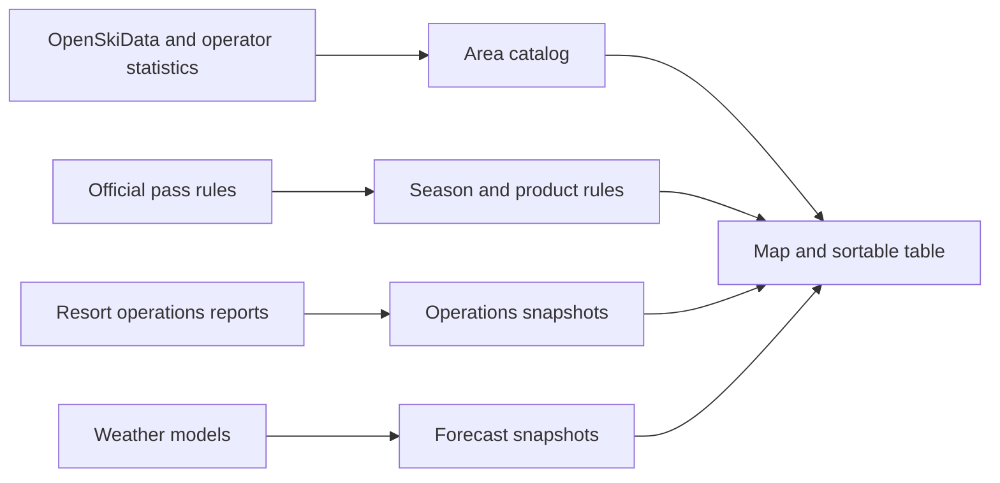

# ski-status guide and project plan

November 19, 2026

ski-status is a personal map and comparison table for North American downhill ski areas. Use it to compare mountain statistics and find ski areas on your pass.

The catalog includes links to official conditions reports. Pass filters show access by family for the listed season. See the [release tasks](TODO.md).

## Use ski-status

Open `/projects/ski-status/map`. Select **Map**, **Split**, or **Table** at the top of the page. Each view keeps your filters, sort order, and selected area.

- **Map** gives the map most of the space. On a wide screen, use the list beside it to select an area.
- **Split** gives both panes equal space on a wide screen. On a narrow screen, scroll between the table and map.
- **Table** gives the comparison table most of the space. On a wide screen, the map stays beside it.

On a wide screen, the page starts in **Split**. On a narrow screen, it starts in **Table**.

- Search by ski area, alternative name, town, or country.
- Filter by region, pass family, or night skiing. On a narrow screen, select **Filters** to see these controls.
- Turn on **In map view** beside the results count to limit the table to the map area.
- Select a column header to change the sort order.
- Select a dot or table row to show the area details. Use the area name below the filters to go to its details. Zoom in to separate nearby dots.
- Select **Official conditions** where available to open the operator's report. Each area also has a link to its website.

The URL stores the search text, filters, sort order, selected area, view, and map settings. The browser stores your unit preference.

The map keeps its position when you change views. With **In map view** off, filter changes fit the results when the map is visible and no area is selected. If the background fails, select **Retry background**. The table stays available during map failures.

### Map display

With **In map view** on, the table and count update after you pan or zoom. They also update when the map pane changes size. An area is in view when the center of its dot is within the map. Change the other filters or sort the table to compare areas in view. These changes keep the map at its current position. Select **Fit all results** to see all areas that match the other filters.

When **Table** hides the map on a narrow screen, the table uses the last visible map area. Before the map opens, the table uses the other filters. Open **Map** to set the area. If you pan away from the selected area, its details stay open.

The default map shows one cyan dot per ski area. Use **Color by** to show pass access, skiable area, vertical drop, summit elevation, or highest lift terminal. The legend shows ranges in your selected units. Gray marks an unknown value. A gold outline shows the selected area.

An acreage value such as `200+` gives a minimum. The table sorts by that minimum. If the minimum leaves more than one possible color range, the map shows a gray dot.

The map uses the hosted CARTO Dark Matter vector style. Turn on **Terrain relief** to see shaded slopes from zoom level 8. CARTO continues to provide the streets and labels. Mapterhorn supplies the elevation tiles. [CARTO Basemaps](https://docs.carto.com/faqs/carto-basemaps), [Mapterhorn elevation tiles](https://mapterhorn.com/data-access/)

CARTO publishes Dark Matter, Voyager, and Positron. MapTiler offers a separate Winter style with ski runs for a future resort view. [CARTO styles](https://carto.com/basemaps/#styles), [MapTiler topographic and winter maps](https://www.maptiler.com/maps/outdoor-topo/)

## Catalog

On November 19, 2026, the catalog had 197 ski areas across 33 regions. It had 167 areas in the United States and 30 in Canada. It had 83 published acreage figures and 48 links to official conditions reports. Each area meets the acreage or pass rule below.

| File | Use |
| --- | --- |
| [Area statistics](data/areas.json) | Resort sites, published mountain statistics, and official report links. Empty fields display as unknown. |
| [Area locations](data/locations.json) | Points from the November 16 OpenSkiData build. Each point has source identifiers. The file includes ODbL attribution. |
| [Pass memberships](data/passes-2026-27.json) | Family access for the 2026/27 season. The details show discounts. The pass filter includes areas with lift access. Each entry links to a source. |

Use the same area ID in the three files. Add one point for each area. Add at most one membership for each area and pass family. Palisades Tahoe uses one point with sources for both bases.

Cite an operator source for the mountain statistics in each record. Use absolute HTTPS URLs without usernames or passwords. The catalog checks for duplicate IDs, missing references, and conflicting values. It requires location attribution and a pass season that ends the next year. [Catalog validation](../../src/features/ski-status/catalog.ts)

## Local checks

Install the repository dependencies. Run `npm run dev` to start Vite. Open `/projects/ski-status/map` on the local server.

Run the catalog, table, and marker tests.

```bash
npx vitest run src/test/skiStatus.test.ts
```

Run the browser tests. They check map position, fallback, and view changes.

```bash
npm run test:e2e -- tests/e2e/ski-status.spec.ts --project=chromium
```

## First release

Include active, public, lift-served downhill areas. An area qualifies with **at least 100 published skiable acres or included lift access on a supported pass**. Apply this rule throughout North America, including Alaska, Mexico, and Greenland. Start with Ikon, Epic, Indy, and Mountain Collective. Consider Powder Alliance next. Keep eligible areas visible in the off-season. [Powder Alliance eligibility](https://www.powderalliance.com/), [Visit Nuuk ski area](https://visitnuuk.com/providers/skiliften/), [Monterreal](https://www.monterreal.com/)

Whaleback has 86 skiable acres and qualifies through Indy lift access. Show Indy Allied discounts on areas that qualify. Use skiable acreage for the threshold. Resort property acreage can include lodging and terrain outside the ski area. [Indy Whaleback profile](https://www.indyskipass.com/our-resorts/whaleback-mountain), [Indy Allied terms](https://www.indyskipass.com/this-is-indy/news/whiteface-gore-and-belleayre-join-allied-program-as-indy-pass-announces-15-additional-resorts-for), [Monterreal property description](https://www.monterreal.com/)

### Map and table

- Add filters for pass product, ski date, and operating status.
- Color dots by operating status after the app can check report age. Use gray when the latest report is unavailable or stale.
- Add separate columns for measured snow and forecast snow. Compare each field in common units. Put unknown values last in both directions.
- Group columns by mountain statistics, conditions, and season dates. Save the column settings on the device.
- Export filtered rows as CSV where licenses permit it. Include units, report times, and source links.

### Comparable mountain statistics

| Field | Definition |
| --- | --- |
| Area identity | Store the official name, website, ID, region, country, and time zone. Keep former names for search. Place the point near public lift access. |
| Skiable acres | Use the operator's published skiable area. Record which mountains or terrain the figure covers. |
| Lifts | Use the operator's total for the same area. Include surface lifts. Record the counts by lift type when available. |
| Elevation and vertical | Store the highest and lowest lift terminal elevations. Use their difference for lift elevation range. Keep the operator's skiable vertical. |
| Trails | Store the total and the number for each published grade. Keep the original basis for percentages such as trail count or terrain area. |
| Night skiing | Store yes, no, or unknown. Show night skiable acres when the operator publishes them. Track scheduled night operations in the conditions report. |
| Season dates | Keep planned and actual dates. Use the median of up to five completed seasons for each typical date. Verify at least three actual opening or closing dates for each median. |

Store values in common units. Keep the original unit and source. Display acres, feet, and inches by default. Offer metric units.

Use operator announcements and reports to verify season dates. Record the first and last days of public lift access for each winter season. Use the resort's time zone. Compare dates in winter season order across the year boundary. If fewer than three dates are available, show the published season window or show **Unknown**. Use **Year-round** for areas with lift access in every season. [Big SNOW specifications](https://www.bigsnowamericandream.com/press-room/), [Palisades Tahoe mountain statistics and season windows](https://www.palisadestahoe.com/footer/mountain-statistics)

## Inventory and data quality

### OpenSkiData audit

The November 19 download contained 12,440 world records. The audit selected named rows with `has_downhill=yes` and `status=operating`. The matching metadata reports a November 16 UTC build. Website counts indicate a populated source field. Lift counts indicate at least one mapped lift. [Ski-area CSV](https://tiles.openskimap.org/csv/ski_areas.csv), [Build metadata](https://tiles.openskimap.org/metadata.json)

| Geography | Candidate rows | Website present | Mapped lifts | Mapped elevation range |
| --- | ---: | ---: | ---: | ---: |
| United States | 571 | 529 | 511 | 526 |
| Canada | 273 | 239 | 235 | 257 |
| Mexico | 1 | 1 | 1 | 1 |
| Greenland | 3 | 2 | 3 | 3 |
| **Total** | **848** | **771** | **750** | **787** |

The audit counts candidates before the acreage and pass checks. A named row can describe one base area. Verify the acreage and elevations with the operator. The CSV shows 3–4 m of elevation for indoor Big SNOW. The operator reports 160 ft of vertical and four skiable acres. [OpenSkiData schema](https://www.openskidata.org/#schema), [Big SNOW specifications](https://www.bigsnowamericandream.com/press-room/)

The CSV has SHA-256 `9c5a372b8d02aedd281fd387c581c16f48915d89abacec7eba0faa53726a9df5`.

### Build the catalog

1. Import names, points, source IDs, and candidate websites from a versioned OpenSkiData file. Use regional directories to find missing areas. Check directory terms before you collect source data. [OpenSkiData downloads](https://www.openskidata.org/#downloads), [NSAA inventory by state](https://nsaa.org/NSAA/About/Media/Industry_Stats/NSAA/About/Media/Industry_Stats.aspx), [Canadian Ski Council directory](https://www.skicanada.org/ski-area-list/), [Québec ski area directory](https://maneige.ski/en/stations-et-conditions/)
2. Match by source ID or a verified name and location. Assign a stable local ID for links, reports, and visits. OpenSkiData feature IDs can change between builds. [OpenSkiData feature IDs](https://www.openskidata.org/#whats-in-the-data)
3. Review uncertain matches. Group bases when the operator publishes combined statistics. Palisades Tahoe publishes combined resort statistics. Keep independently operated areas separate if they share a pass allowance. [Palisades Tahoe statistics](https://www.palisadestahoe.com/footer/mountain-statistics), [Ikon access comparison](https://www.ikonpass.com/en/compare-benefits)
4. Verify eligibility with operator acreage or a current source for pass access. Record the reason and source. Keep unresolved areas in the review list. Remove duplicate, closed, and private areas from the release catalog. [Indy Pass website terms](https://www.indyskipass.com/website-terms-of-use)
5. Add operator statistics for each eligible area. Record the source URL, verification date, and scope. Label mapped lift terminal estimates. Use operator statistics for the official trail count. [OpenSkiData data definitions](https://www.openskidata.org/#whats-in-the-data)
6. Count resolved and unresolved candidates by region. Measure coverage for acres, elevations, grades, night acres, and dates. Skibowl reports total acres and the number of lit runs. Keep night skiable acres unknown until you find a source. [Skibowl statistics](https://skibowl.com/about-winter/stats/)

### Similar tools

PisteFinder compares mapped terrain and filters areas by pass. OnTheSnow groups reports by pass and shows forecasts and webcams. For ski-status, put date-specific pass rules, mountain statistics, and report times in one sortable table. [PisteFinder](https://pistefinder.com/), [OnTheSnow app](https://www.onthesnow.com/news/mobile/)

## Pass access by product and date

Create a reviewed file for each season and pass family. Record the product, area, access type, valid dates, and day allowance. Record shared allowances, blackout dates, and reservation rules. Include consecutive-day and weekday restrictions when they apply. Keep the source and verification date on each rule. Keep rules for past seasons.

| Program | Launch products and rules to verify |
| --- | --- |
| Ikon | Ikon, Base, and Session variants. Alta and Snowbird share Ikon days, with Snowbird access under Base. Store each partner's reservation and access rules. [Ikon 2026/27 comparison](https://www.ikonpass.com/en/compare-benefits) |
| Epic | Epic, Epic Local, and Day Pass variants by duration, resort tier, and peak-date option. The 4–7 day All Resorts products can include Canadian Rockies partners. Verify specialty products before adding their filters. [Epic products](https://www.epicpass.com/), [Epic partner rules](https://www.epicpass.com/regions/partner-resorts.aspx), [Peak dates](https://www.epicpass.com/info/peak-restricted-dates.aspx) |
| Indy | Base, Indy+, and Add-On variants. Track excluded dates and reservations by area. Record Allied discounts separately from included ski days. [Indy products](https://www.indyskipass.com/shop), [Blackouts and reservations](https://www.indyskipass.com/blackout-dates-reservations) |
| Mountain Collective | Included days, any published bonus days, and advance reservations where required. [Pass terms](https://mountaincollective.com/), [Destination reservation rules](https://mountaincollective.com/how-to-use-my-pass/) |

The family filter finds included partners for the season. When the user selects a product and date, apply the rules for the resort's local date. Show **Included**, **No access**, **Blackout**, **Reservation required**, or **Rules unverified**. Show reservation requirements on eligible results. Show the total allowance and any shared days. Individual usage and reservation availability need their own sources.

Review the pass lists at the start of each season. Check for changes each week. Confirm each change with the pass operator. Keep pending changes visible until the review completes.

## Current conditions

### Sources and pilot

| Source | What it can supply | How to use it |
| --- | --- | --- |
| Resort reports | Operating status, lifts, trails, acres, base depth, measured snowfall, and night operations. Whistler has separate pages for snow and terrain. | Start with operator links. Add feeds from sources that permit reuse. [Killington mountain report](https://killington.com/mountain-report), [Whistler snow report](https://www.whistlerblackcomb.com/the-mountain/mountain-conditions/snow-and-weather-report), [Whistler lift and terrain status](https://www.whistlerblackcomb.com/the-mountain/mountain-conditions/terrain-and-lift-status.aspx) |
| Open-Meteo | Current weather estimates and forecasts for temperature, wind, precipitation, and snowfall. | Use one named base location per area. Show the forecast period and location or elevation. Show the model time when available. [Forecast API](https://open-meteo.com/en/docs), [Noncommercial access](https://open-meteo.com/en/pricing) |
| SnoCountry | Resort and regional feeds with counts of open lifts, trails, and acres where available. | Evaluate the feed if operator reports leave large gaps. The full feed requires a paid key. Verify coverage and terms before use. [SnoCountry API](https://feeds.snocountry.net/) |
| Mountain News and Skiresort Service | Paid resort and mountain data feeds. Mountain News includes report times and fields that resorts supply. | Compare the resort list and field coverage before using a paid feed. [Mountain News partner API](https://partner.docs.onthesnow.com/api-reference/ski-resort-snowreport-api), [Skiresort Service product description](https://www.skiresort-service.com/fileadmin/user_upload/skiresort-service/content/engl/Skiresort-access-snow-reports-ski-resort-data-ski-weather.pdf) |

On November 19, the SnoCountry demo returned Bolton Valley, Bromley, and Burke. Each report had a time and an opening status. Base depth, recent snowfall, and open lift, trail, and acre counts were empty. Measure field coverage and report age during winter operation. [SnoCountry public example and field definitions](https://feeds.snocountry.net/)

### Report and forecast rules

- Store operating status with each report. Use open, limited, temporarily closed, season closed, or unknown. Store hours and planned opening dates when the operator publishes them.
- Show open and total lifts, trails, and acres when the operator reports them. Show grooming status where available. Calculate closed counts and percentages from counts with the same scope and time. Use separate columns for **trails open %** and **acres open %**.
- Keep the snow depth unit, range, and measurement location. Show the reporting period for new snow. Use one column for forecast snow. Show empty values as unknown. Show reported zeros as zero.
- Keep the operator's report time and the time the app retrieved it. Mark pilot reports older than 24 hours as stale. Keep the last report and date visible. Identify missing fields on new reports.
- Use a freshness limit for each source when its schedule changes. Show the date of an official seasonal closure. Calculate report age from the source time.
- Publish a count of recent reports and a count for each main conditions field. Show the operator's link when the report is incomplete or stale.

## Repository and hosting design

The project uses React, TypeScript, Vite, and MapLibre. The `/projects/ski-status` route opens `/projects/ski-status/map`. Keep data preparation in `projects/ski-status/`. Keep feature code in `src/features/ski-status/`. Use the shared CARTO configuration and map recovery. [CARTO basemap configuration](../../docs/carto-basemaps.md), [Project routes](../../src/App.tsx)

The client uses a GeoJSON source for the dots and JSON for the table. Both views use the same results. The map applies camera changes when its resort layer is ready and it has a visible viewport.

Join static facts, pass rules, resort reports, and forecasts by the local area ID in later stages. The following diagram shows the planned data flow.



Use scheduled jobs for feeds. Update verified pass rules by hand. Publish checked JSON to `data.rsmb.tv` through S3 and CloudFront. Limit publisher access to the `ski-status` prefix. Keep partner keys in the scheduled job. [Repository geospatial delivery review](../../docs/reviews/2026-11-13-geospatial-delivery-research.md#reusing-s3-and-cloudfront), [GitHub OIDC setup](../../docs/github-actions-oidc.md)

Publish catalog and pass files by revision. Refresh weather and reports on their own schedules. Upload each data file before you update the manifest. Include the schema version, catalog revision, coverage, and times. Keep the last valid file when a source fails or returns invalid data. Write one manifest update at a time. Save the previous manifest for rollback.

Refresh pilot forecasts every six hours. With 400 areas and one point per area, this gives 1,600 location updates per day. Retries and selected variables can increase the call count. Open-Meteo lists 10,000 daily calls and 300,000 monthly calls for noncommercial use. Check the actual call count. Keep capacity for retries. Update operations reports each hour where the source supports it. [Open-Meteo plans and call accounting](https://open-meteo.com/en/pricing)

Credit sources where their data appears. OpenSkiData permits use under ODbL and requires source credits. Limit automatic downloads to once per day. Build tiles from the downloads. Publish modified ODbL data with its license and attribution. Verify each feed's terms for storage, display, and export before use. [OpenSkiData terms and attribution](https://www.openskidata.org/#license), [OpenStreetMap Foundation licensing guidance](https://osmfoundation.org/wiki/Licence/Community_Guidelines)

## Implementation sequence and acceptance checks

The pilot used 25 areas to test catalog joins and map controls. The expanded catalog and views use the same checks. Use the [task list](TODO.md) for remaining work.

| Work | Acceptance check |
| --- | --- |
| Pass products | Test shared days, reservations, excluded products, blackout dates, and discount partners. Match each included partner or record why it is outside scope. |
| Conditions pilot | Measure report age and field coverage for a week. Compare values with operator reports. Test failed updates, stale reports, unknown values, zero values, and partial openings. |
| First release | Verify the source and eligibility of each area. Check links. Verify the source and time of each report. Publish counts of recent reports and coverage by field. |

At four minutes per area, a manual review of 848 candidates would take about 57 hours. Use regional directories and official sources to find eligible areas. Review uncertain matches and acreage near the threshold. Measure review time before you set the release schedule. Use existing hosting and the free forecast feed for the pilot. Measure report coverage before you consider a paid feed.

## Version 2

### Runs and lifts at resort zoom

Show named runs, lift lines, and terminals from OpenSkiData at resort zoom. Use local difficulty grades. Link to the resort map. Report incomplete mapping. Load one resort at a time. Use PMTiles on S3 and CloudFront if tests show a benefit. Check byte range requests, caching, and attribution on hosted tiles. [OpenSkiData runs and lifts](https://www.openskidata.org/), [PMTiles on cloud storage](https://docs.protomaps.com/pmtiles/cloud-storage), [Repository tile delivery review](../../docs/reviews/2026-11-13-geospatial-delivery-research.md)

### Access routes and webcams

Start with Washington and British Columbia. Use operator directions to match each resort base to road segments. Use US 2 for Stevens Pass. Use the applicable Highway 99 segments for Whistler. Match closures, restrictions, and cameras to these roads. Use agency IDs and road geometry for each match. Show the agency's report time. Mark missing coverage as unknown. Link to agency and resort cameras. Embed feeds where the source permits it. Record parking prices, locations, and shuttles that operators publish. Consider Utah's feed for expansion. [WSDOT Traveler Information API](https://apps.wsdot.wa.gov/traffic/api/), [DriveBC Open511](https://api.open511.gov.bc.ca/help), [BC HighwayCams](https://images.drivebc.ca/bchighwaycam/pub/html/www/index.html), [UDOT API](https://www.udottraffic.utah.gov/developers/doc)

### Visited areas

Add a **Visited** toggle and an optional ski date. Store visits on the device with stable area IDs. Add a visited filter. Support backup import and export. Keep visits attached when an area name or source ID changes. Add account synchronization if users need visits on more than one device.
